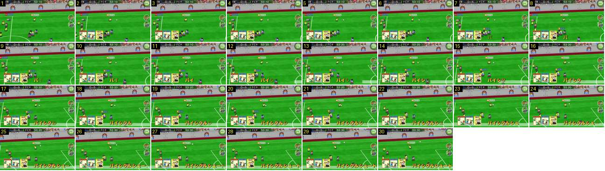

# Habilidade especial: as cartas e o nome a escrever-se

Como entra uma habilidade (combo) a meio do jogo. Três cartas pequenas aparecem de uma vez no canto inferior esquerdo e o nome escreve-se letra a letra, em amarelo, com uma faixa branca translúcida a correr por baixo. O jogo não abranda nem faz zoom.

- **Duração:** 1,0 s, 30 frames a 30 fps
- **Origem:** [BkdBKrKoW-g](https://www.youtube.com/watch?v=BkdBKrKoW-g&t=0s), de 0,66 s a 1,66 s, canal ゲームアディクト
- **Etiquetas:** habilidade, combo, cartas, nome-habilidade, tipografia, sem-abrandamento

## Frame a frame

- **1:** jogo normal, com a câmara alta e larga a seguir a bola.
- **2:** as três cartas aparecem de uma vez, já no tamanho final, sem deslizar nem crescer: «シュート», «エアロビクス» e «合気道». Cada uma tem ~60 × 75 px, moldura de cor (vermelha, azul, amarela), o título no topo e um desenho cartoon. Ficam lado a lado no canto inferior esquerdo, com ~10 px entre elas.
- **2–7 (0,2 s):** só as cartas.
- **8:** aparece a primeira letra, «バ», em amarelo-laranja grosso com contorno escuro, à direita das cartas, no fundo do ecrã.
- **8–28 (0,67 s):** as letras seguintes surgem da esquerda para a direita, uma a cada ~2 frames. Cada letra entra translúcida e fica opaca em 2–3 frames. A partir do frame 12, uma faixa branca translúcida e esbatida entra pela direita, por baixo do nome, e chega até à borda esquerda dele.
- **28–30:** o nome está completo, «バイシクルシュート», encostado ao canto inferior direito. Durante todo este tempo, o relógio anda ao ritmo normal (53:10 → 53:30) e a câmara continua a seguir a bola.

## Notas

- As cartas e o nome ficam no ecrã durante toda a jogada. Se ela acaba em golo, ficam por baixo do resultado gigante ([BkdBKrKoW-g](https://www.youtube.com/watch?v=BkdBKrKoW-g&t=6s), 6 s). Na repetição só aparece o nome, com a faixa branca ([BkdBKrKoW-g](https://www.youtube.com/watch?v=BkdBKrKoW-g&t=8s), 8 s).
- Os vídeos curtos deste canal usam transições de zoom com desfoque radial (BkdBKrKoW-g aos 7 s, ktqSs_8pJx8 aos 5 s) e um zoom rápido com escurecimento (wcZcGrrPbs0 aos 7 s). Parecem efeitos de edição e não do jogo, porque nos vídeos com jogos inteiros a passagem é sempre por preto.
