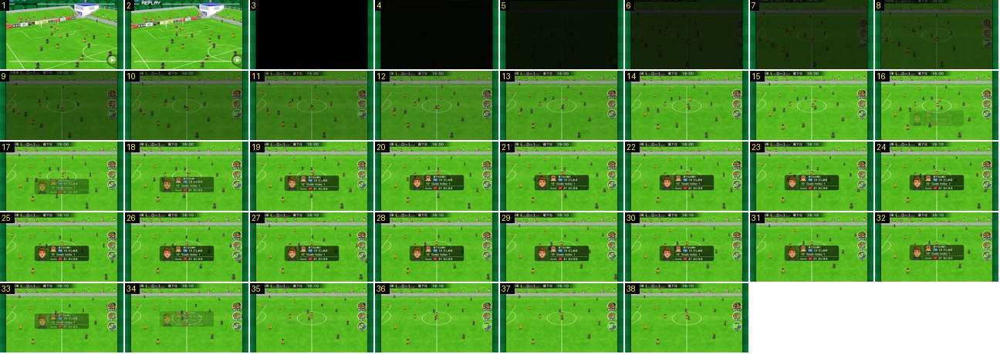

# Regresso ao jogo e ficha do marcador

O fim da sequência do golo: a repetição acaba, o ecrã fica preto, o jogo volta num fade, e aparece uma ficha com o retrato do marcador e o assistente. Esta ficha não estava nos documentos.

- **Duração:** 3,8 s, 38 frames a 10 fps
- **Origem:** [OSCtF-d6e4E](https://www.youtube.com/watch?v=OSCtF-d6e4E&t=103s), de 103,4 s a 107,2 s, canal Booby
- **Etiquetas:** golo, regresso-jogo, fade, ficha-marcador, retrato, assistencia, transicao

## Frame a frame

- **1–2:** a última parte da repetição, num plano alto e largo, com o botão verde de avançar em baixo à direita. O letreiro «REPLAY» pisca no canto superior esquerdo (aparece no frame 2, mas não no 1).
- **3–4 (0,2 s):** preto.
- **5–14 (1,0 s):** o jogo volta do preto num fade linear. Plano largo centrado no meio campo, já com a barra do marcador no topo (agora com o resultado novo, 0-1) e os três botões redondos à direita.
- **15:** jogo normal. O relógio volta a andar (16:00 → 16:10 durante a ficha).
- **16–19 (0,3–0,4 s):** a ficha entra a meio do ecrã, um pouco abaixo do centro: aparece em transparência e sobe cerca de 10 px por frame, a abrandar, até ficar opaca.
- **19–32 (1,4 s):** a ficha fica parada. É uma caixa verde-escura translúcida, com cantos arredondados (~280 × 80 px). À esquerda está o retrato vetorial do marcador. À direita: o emblema e o nome da equipa; a posição numa etiqueta de cor (FW azul), o número e o nome; «16' Goals today 1»; e, numa linha por baixo, «Assist», com a posição (DF vermelho), o número e o nome do assistente.
- **33–35 (0,3 s):** a ficha sai a subir e a desaparecer em transparência.
- **36–38:** jogo normal. Cerca de 1 s depois (~108 s), há um corte para o grande plano do pontapé de saída, no círculo central.

## Notas

- A ficha é igual nos golos sofridos, mas com o marcador da outra equipa ([ecma51SSHsI](https://www.youtube.com/watch?v=ecma51SSHsI&t=71s), 71 s e 349 s). No vídeo de outro canal ([DYRnbrZw1O4](https://www.youtube.com/watch?v=DYRnbrZw1O4&t=233s), 233 s), a linha «Assist» falta quando não há assistente.
- As substituições usam uma ficha com o mesmo formato, mas com setas verde e vermelha ([DYRnbrZw1O4](https://www.youtube.com/watch?v=DYRnbrZw1O4&t=236s), 236 s).
