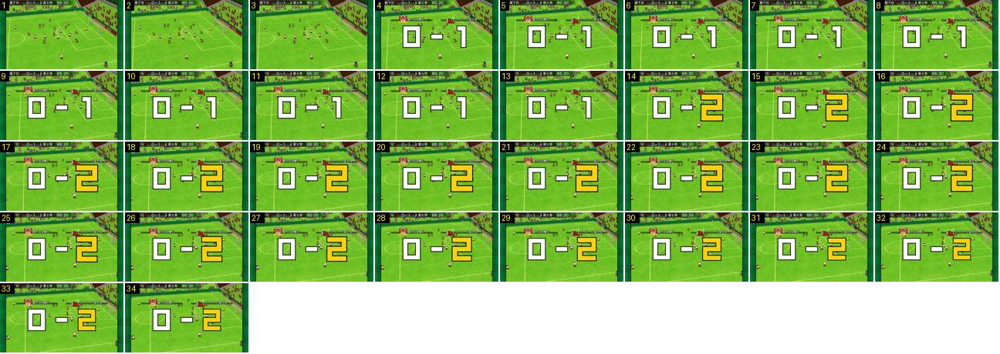

# Resultado gigante: entrada e troca do algarismo

O resultado gigante de um golo, a 30 fps. Mostra que o marcador não cresce ao entrar: aparece de uma vez com o resultado antigo, e só o algarismo novo dá um salto de escala. Golo sofrido pela equipa do jogador (0-1 → 0-2).

- **Duração:** 1,13 s, 34 frames a 30 fps
- **Origem:** [ecma51SSHsI](https://www.youtube.com/watch?v=ecma51SSHsI&t=329s), de 329,6 s a 330,74 s, canal Booby
- **Etiquetas:** golo, resultado-gigante, escala, algarismo, faixas-equipas, golo-sofrido

## Frame a frame

- **1–3:** jogo normal, bola dentro da baliza à direita. O relógio já parou (65:20). Não há placa nem aviso.
- **4:** corte seco, sem escala nem fade. Aparece tudo junto e a 100 %: as duas faixas escuras finas (emblema e nome de cada equipa, a casa à esquerda, a de fora à direita), por cima de «0 – 1» com os dois algarismos **brancos**. Os blocos ocupam cerca de 360 × 110 px do ecrã de 640, centrados um pouco acima do meio. A barra do topo continua a dizer 0-1.
- **4–13 (0,33 s):** o resultado antigo fica parado. Por baixo, o jogo continua: a câmara desliza devagar para a esquerda (cerca de 2 px por frame), e os jogadores levantam os braços.
- **14:** o «1» passa a «2» **amarelo**, num só frame, já grande: cerca de 125 % do tamanho final (mede-se pela área amarela, 4985 contra 3165 píxeis). O «0» e o traço não mexem.
- **14–23 (0,33 s):** o «2» fica a 125 %, parado.
- **24–32 (0,3 s):** o «2» encolhe até 100 %, a abrandar no fim (escala aprox. 1,22 → 1,19 → 1,16 → 1,14 → 1,11 → 1,08 → 1,05 → 1,02 → 1,00).
- **33–34:** fica estável. Neste golo, o resultado fica 6,6 s no ecrã (até 336,27 s) e sai por corte seco para preto, sem animação; depois vem a claque (ver [claque-golo-sofrido](../claque-golo-sofrido/README.md)).
