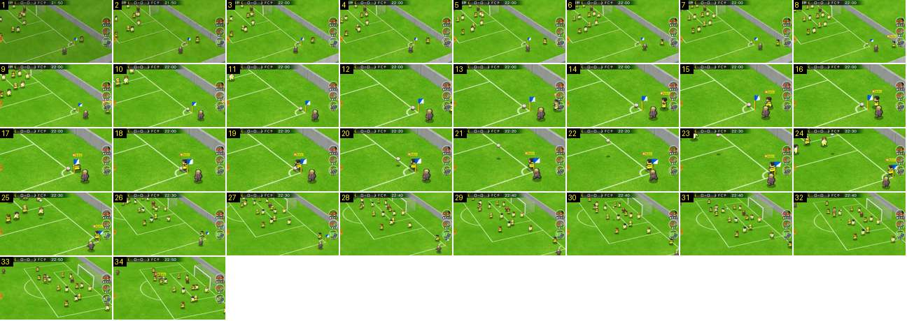

# Canto: zoom para a bandeirola e cruzamento

Um pontapé de canto. Depois do fade de recomeço, a câmara faz um zoom contínuo (sem corte) do plano diagonal da área até ao batedor junto à bandeirola. Mal a bola parte, recua a seguir a bola até ao plano diagonal da área. Neste vídeo, a câmara de jogo está mais perto do que nos vídeos do canal Booby, e o muro é cinzento e sem público.

- **Duração:** 3,4 s, 34 frames a 10 fps
- **Origem:** [geM9U2wSnq0](https://www.youtube.com/watch?v=geM9U2wSnq0&t=95s), de 95,0 s a 98,4 s, canal ゆーげーむず
- **Etiquetas:** camara, canto, bola-parada, bandeirola, zoom, zoom-out, seguimento, fade

## Frame a frame

- **1–3:** o fim de um fade a partir do preto (brilho 111 → 131): o recomeço depois de a bola sair.
- **3–8:** plano diagonal da área, com a baliza no topo e a bandeirola azul e branca à direita, junto à bola no arco do canto. Os jogadores esperam na área. O plano está parado.
- **8–14:** zoom contínuo para a bandeirola (×3 em 0,6 s), que abranda no fim. A câmara centra o canto e a bandeirola passa de ~18 para ~60 px de altura (no ecrã de 640).
- **14–20:** plano parado no canto: a bola no arco, o batedor amarelo (com a etiqueta «9 …») a chegar, e o árbitro de pé ao lado. O relógio continua a andar (22:00 → 22:20).
- **20–21:** cruzamento. A bola levanta e sobe no ecrã, com a sombra no relvado.
- **21–27:** a câmara segue a bola para cima e para a esquerda, e recua ao mesmo tempo (zoom-out de ~0,6 s, que abranda no fim).
- **27–34:** plano diagonal da área com os jogadores todos, a seguir a bola para a baliza.
