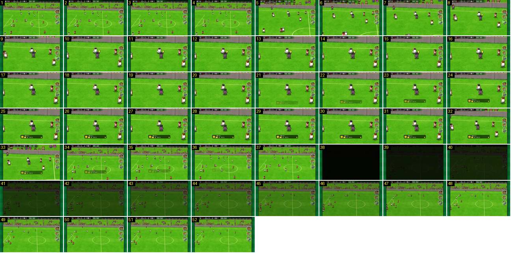

# Cartão amarelo: corte, zoom, faixa e saída pelo preto

Um cartão amarelo do princípio ao fim. A câmara corta para o árbitro, aproxima-se, e no fim recua num zoom-out rápido e corta para preto, com um fade de volta ao jogo. É o ciclo completo de um grande plano de falta.

- **Duração:** 5,2 s, 52 frames a 10 fps
- **Origem:** [0AWtZz7qiDM](https://www.youtube.com/watch?v=0AWtZz7qiDM&t=284s), de 284,0 s a 289,2 s, canal Booby
- **Etiquetas:** camara, falta, cartao-amarelo, arbitro, corte, zoom, zoom-out, preto, fade, faixa-notificacao

## Frame a frame

- **1–4:** plano largo lateral, com o jogo a decorrer.
- **5:** corte para um plano ~2,5× mais próximo e mais baixo: o muro da bancada passa a ser uma faixa cinzenta no topo e já não se vê o público.
- **5–9:** o zoom continua, primeiro depressa e depois devagar, até ao árbitro ficar com ~40 px de altura (no ecrã de 640), ao centro.
- **9–16:** o árbitro levanta o cartão amarelo. A câmara está parada.
- **17–20:** o árbitro baixa o braço.
- **21–24:** em baixo, a meio, entra uma faixa escura translúcida com o emblema da equipa, a posição, o número, o nome do jogador e um pequeno cartão amarelo à direita. Entra por fade, em ~0,3 s.
- **24–32:** plano parado, com a faixa. O relógio continua a andar durante o grande plano (55:30 → 55:40).
- **33–34:** zoom-out rápido: o frame 33 está a meio do caminho e o 34 já é o plano largo, em 0,2 s.
- **34–37:** já no plano largo, a faixa desaparece por fade.
- **38:** corte seco para preto (brilho 10, contra 119).
- **38–48:** fade a partir do preto, linear, durante 1,0 s (o brilho sobe ~10 por frame). Os jogadores aparecem noutras posições, as do livre. O corte a preto serve provavelmente para esconder este salto de posições.
- **49–52:** plano largo normal.
