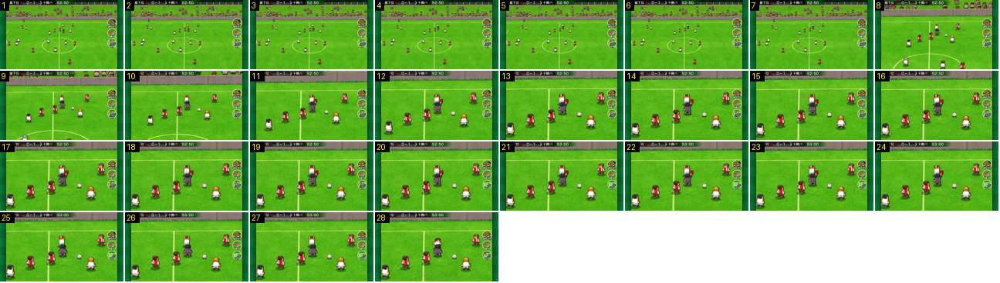

# Cartão vermelho: corte e zoom para o árbitro

A entrada do grande plano de um cartão vermelho. A câmara corta para perto e ainda se aproxima enquanto o árbitro levanta o cartão. O que ensina é o enquadramento: mais baixo do que no jogo, com os jogadores à volta e a bola parada ao lado.

- **Duração:** 2,8 s, 28 frames a 10 fps
- **Origem:** [0AWtZz7qiDM](https://www.youtube.com/watch?v=0AWtZz7qiDM&t=267s), de 266,8 s a 269,6 s, canal Booby
- **Etiquetas:** camara, falta, cartao-vermelho, arbitro, corte, zoom, grande-plano

## Frame a frame

- **1–7:** plano largo lateral, à volta do círculo central, com o jogo parado depois da falta.
- **8:** corte para um plano ~2,5× mais próximo. A câmara fica mais baixa: o muro da bancada é uma faixa cinzenta no topo e o público quase sai do quadro.
- **8–13:** o zoom continua e abranda (~25% no frame 9, ~5% no 12), até os jogadores terem ~45 px de altura no ecrã de 640.
- **11–27:** o árbitro, de preto ao centro, levanta o cartão vermelho por cima da cabeça. À esquerda e à direita ficam jogadores das duas equipas, e a bola parada à direita. Os botões redondos continuam à direita.
- **28:** o árbitro baixa o braço.
- **Depois do troço (não incluído):** a faixa do jogador expulso, com um cartão vermelho, entra em ~0,3 s a 269,8 s. O plano fica parado até 274,4 s, recua num zoom-out de 0,3 s, e o jogo continua no plano largo sem passar pelo preto. O relógio continua a andar (52:50 → 53:10).
