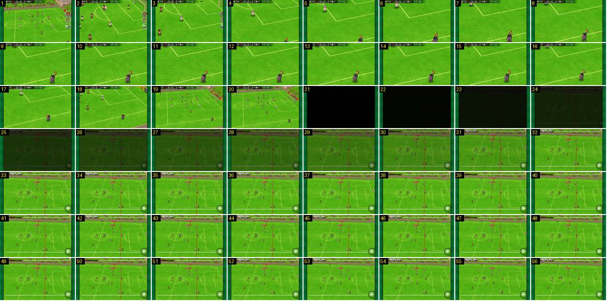

# Fora de jogo: fiscal de linha, preto e repetição com a linha

Um fora de jogo inteiro: a câmara corta para perto da área, desce até ao fiscal de linha com a bandeira levantada, recua, e corta para preto. A seguir vem uma repetição com uma linha vermelha vertical a marcar o fora de jogo e «REPLAY» a piscar. Mostra o grande plano do fiscal de linha e como entra uma repetição.

- **Duração:** 5,6 s, 56 frames a 10 fps
- **Origem:** [0AWtZz7qiDM](https://www.youtube.com/watch?v=0AWtZz7qiDM&t=78s), de 78,4 s a 84,0 s, canal Booby
- **Etiquetas:** camara, fora-de-jogo, fiscal-de-linha, bandeira, corte, pan, preto, fade, replay, linha-vermelha

## Frame a frame

- **1:** plano diagonal da área direita, com a jogada a decorrer.
- **2:** corte para um plano ~2× mais próximo, junto à área. Os botões redondos ainda se veem neste frame.
- **2–6:** a câmara desce e vai para a direita até ao fiscal de linha, que está em baixo à direita com a bandeira amarela e vermelha levantada. O movimento é rápido (~30 px por frame) e abranda ao chegar. Os botões redondos saem pela direita: no frame 3 estão meio cortados na borda e no 4 já não estão.
- **6–16:** plano parado no fiscal, com a bandeira no ar (1,0 s).
- **16–20:** a câmara recua e sobe outra vez, até a um plano diagonal largo da área, como um zoom-out.
- **21:** corte seco para preto (brilho 6). Não há fade de saída.
- **21–32:** fade a partir do preto, linear, durante 1,1 s, com o brilho a subir ~11 por frame. O que aparece já é a repetição: um plano largo, parado e um pouco mais alto, sem marcador nem botões redondos. Tem uma linha vermelha vertical, em perspetiva, que marca o fora de jogo, um botão verde redondo com ▶ em baixo à direita e uma barra fina branca de tempo ao longo do fundo.
- **31–56:** «REPLAY» em branco, com contorno, no canto superior esquerdo. Pisca com um ritmo certo: visível nos frames 31–36, 42–46 e 52–56, escondido em 37–41 e 47–51, ou seja, 0,5 s aceso e 0,5 s apagado. Nos frames 23–51 a imagem está congelada: os jogadores não se mexem, e a linha vermelha mostra quem estava adiantado. No frame 52 a linha desaparece e a jogada começa a correr. A câmara da repetição não se mexe neste troço.
- **Depois do troço (não incluído):** a repetição segue até 86,1 s. A repetição acaba com um corte para preto e um fade de volta ao jogo (ver a sequência [repeticao-golo-saida](../repeticao-golo-saida/README.md)).
