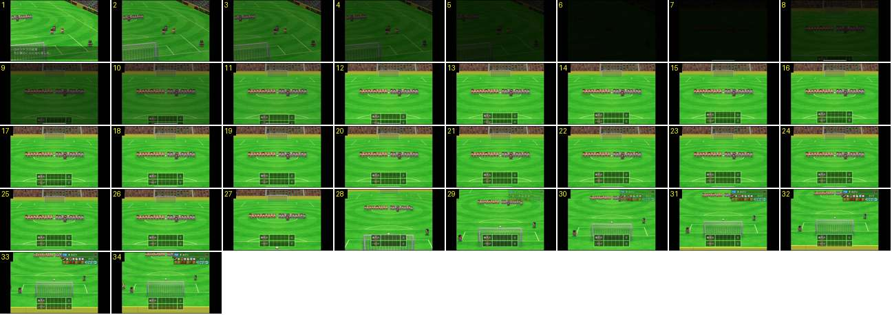

# Desempate por penáltis: entrada e câmara fixa

A passagem para o desempate por penáltis. Depois do diálogo do sorteio («quem bate primeiro»), o ecrã escurece e clareia para as duas equipas alinhadas no meio campo. A câmara desce depressa para a baliza e fica ali, parada, em todos os penáltis. Ao mesmo tempo entram o quadro dos remates em baixo e a ficha de quem vai bater.

- **Duração:** 3,4 s, 34 frames a 10 fps
- **Origem:** [XV5ehg-0xUk](https://www.youtube.com/watch?v=XV5ehg-0xUk&t=61s), de 61,2 s a 64,6 s (canal sem nome nos metadados)
- **Etiquetas:** camara, penaltis, desempate, fade, preto, plano-fixo, quadro-penaltis, ficha-jogador

## Frame a frame

- **1–6:** fade para preto, em 0,5 s (o brilho desce 90 → 6, ~17 por frame), sobre o plano diagonal do sorteio com a caixa de diálogo em baixo. Ao contrário dos grandes planos do jogo, aqui há fade de saída.
- **6–7:** preto (0,1–0,2 s).
- **7–12:** fade a partir do preto, também de 0,5 s. Aparece um plano novo: a câmara, por cima da linha de meio campo, olha para a baliza do fundo, e as duas equipas estão alinhadas lado a lado sobre a linha. Em baixo, ao centro, já está o quadro do desempate: duas linhas, uma por equipa, com o nome, cinco casas vazias e o total «0».
- **12–27:** plano parado (1,5 s).
- **27–31:** a câmara inclina-se para baixo e recua, depressa (0,4 s, com o fim a abrandar), até ficar atrás e por cima da baliza do lado de cá. As equipas alinhadas passam para o topo do ecrã, e a baliza e a marca de penálti ficam no centro.
- **30–31:** no canto superior direito entra a ficha do batedor (posição, número e nome, sete ícones de notas e o tipo), por fade.
- **31–34:** plano fixo dos penáltis: a baliza por baixo do centro, o guarda-redes, o batedor junto à bola, dois árbitros e uma faixa de relvado amarelado em baixo. Esta câmara não volta a mexer-se no desempate (ver [penaltis-remate-camara-fixa](../penaltis-remate-camara-fixa/README.md)).
