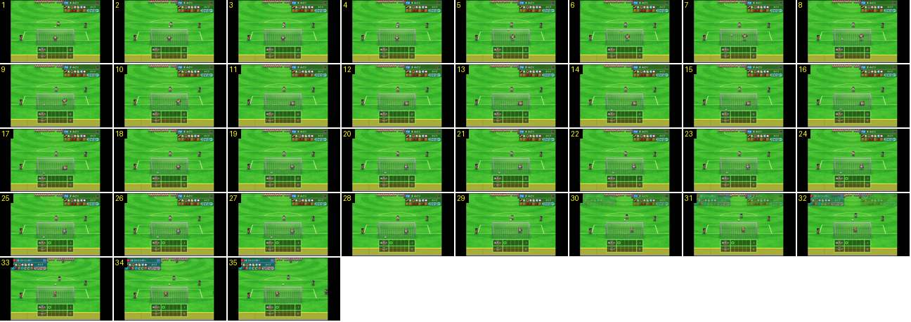

# Penálti: remate com a câmara fixa

Um penálti do desempate do princípio ao fim. A câmara não se mexe: não há zoom, corte nem repetição. O que muda são os elementos do ecrã: o círculo no quadro e a troca da ficha do batedor de um canto para o outro.

- **Duração:** 3,5 s, 35 frames a 10 fps
- **Origem:** [XV5ehg-0xUk](https://www.youtube.com/watch?v=XV5ehg-0xUk&t=69s), de 69,5 s a 73,0 s (canal sem nome nos metadados)
- **Etiquetas:** camara, penaltis, desempate, plano-fixo, quadro-penaltis, ficha-jogador, guarda-redes

## Frame a frame

- **1–4:** o batedor (FW 9) está por cima da bola, na marca. O guarda-redes está na linha de golo e a ficha do batedor no canto superior direito.
- **5:** remate. A bola sai do pé.
- **5–9:** a bola entra na baliza em ~0,3 s, junto ao poste esquerdo, e o guarda-redes atira-se para o outro lado.
- **9–11:** o guarda-redes cai deitado no relvado, dentro da baliza. A rede não se mexe.
- **12–23:** pausa de ~1,2 s, com tudo parado na mesma posição.
- **24–25:** no quadro, em baixo, aparece um círculo verde na primeira casa da equipa de cima, e o total muda de 0 para 1, sem animação.
- **30–33:** a ficha do batedor seguinte, da outra equipa (DF 13), entra no canto superior esquerdo por fade, enquanto a anterior se apaga à direita (~0,3 s). As fichas trocam de canto conforme a equipa que bate.
- **31–35:** o novo batedor aparece junto à bola e o guarda-redes volta ao centro da baliza. Não há corte nem fade de câmara entre penáltis.
