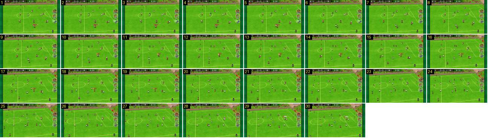

# Do plano largo ao plano diagonal, sem corte

Quando a bola se aproxima da área, a câmara passa do plano largo para o diagonal de canto sem corte nenhum: desliza para o lado da baliza e roda devagar, até se verem a linha de fundo, a baliza e o canto da bancada. O zoom não muda.

- **Duração:** 3,0 s, 30 frames a 10 fps
- **Origem:** [0AWtZz7qiDM](https://www.youtube.com/watch?v=0AWtZz7qiDM&t=50s), de 50,0 s a 53,0 s, canal Booby
- **Etiquetas:** camara, seguimento, pan, rotacao, plano-diagonal, plano-largo

## Frame a frame

- **1–8:** plano largo lateral, com a bancada numa faixa horizontal no topo e a linha do meio quase vertical. A câmara anda para a direita, atrás da bola, a ~3–4 px por frame.
- **8–24:** a câmara continua para a direita e roda ao mesmo tempo. A orla da bancada deixa de ser horizontal e sobe para a direita. No canto superior direito aparecem a esquina da bancada e o prédio, e as linhas da grande área inclinam-se. A rotação é lenta e contínua (cerca de 1,6 s), sem acelerações visíveis.
- **24–30:** plano diagonal de canto: a baliza à direita, com a grande área em perspetiva e as placas atrás. O círculo central tem o mesmo tamanho do primeiro ao último frame (~140 px no ecrã de 640), por isso não há zoom: só deslocação e rotação.
- **Em todo o troço:** a câmara vai um pouco atrás da bola, e a bola nunca sai do terço central do ecrã. O marcador e os botões não se mexem.
