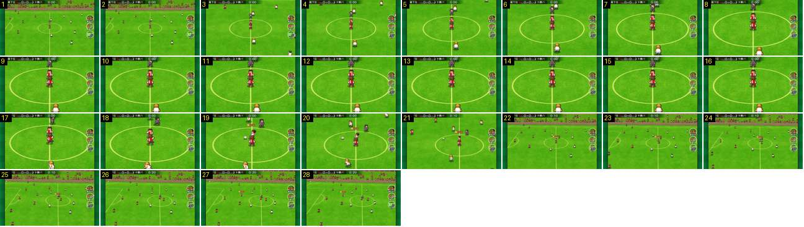

# Pontapé de saída: corte, zoom e saída pelo zoom-out

O pontapé de saída tem um grande plano próprio. A câmara corta do plano largo para os dois avançados no centro, aproxima-se e, mal a bola anda, afasta-se depressa e volta ao plano largo com um corte. A entrada é igual à do sorteio, mas a saída é um zoom-out em vez do preto.

- **Duração:** 2,8 s, 28 frames a 10 fps
- **Origem:** [0AWtZz7qiDM](https://www.youtube.com/watch?v=0AWtZz7qiDM&t=24s), de 24,8 s a 27,6 s, canal Booby
- **Etiquetas:** camara, pontape-de-saida, corte, zoom, zoom-out, grande-plano

## Frame a frame

- **1–2:** plano largo com o marcador «0-0 0:00» e os botões redondos à direita, que se mantêm durante todo o grande plano.
- **3:** corte para um plano ~2× mais próximo, centrado no círculo central, com os dois avançados vermelhos sobre a linha do meio e o árbitro atrás.
- **3–8:** o zoom continua e abranda, como no sorteio, até o círculo encher a largura do campo visível (~0,5 s).
- **8–18:** plano parado (1,0 s). Os jogadores estão quietos.
- **19:** o avançado toca a bola para o lado e aparece-lhe a etiqueta de nome («14 …»).
- **20–21:** a câmara recua depressa: o círculo encolhe ~20% por frame e o plano segue a bola.
- **22:** corte para o plano largo normal, já com a bancada no topo. O relógio passa de 0:00 para 0:10 em 21–22: o tempo de jogo só começa a contar quando a bola anda.
- **22–28:** plano largo a seguir a bola, a ~3 px por frame.
