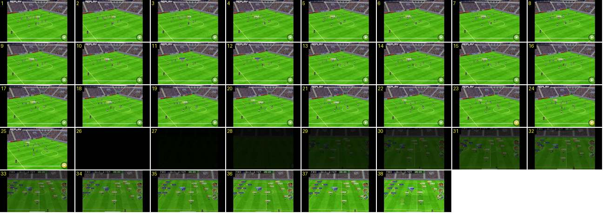

# Repetição de golo: «REPLAY» a piscar e saída pelo preto

O fim da repetição de um golo. O plano é alto e diagonal, com o estádio grande à volta, e mexe-se muito pouco. «REPLAY» pisca no canto e o botão ▶ fica amarelo quando se toca nele. Ao saltar a repetição, o ecrã corta para preto e clareia num fade de 1,2 s, já com o jogo pronto para recomeçar.

- **Duração:** 3,8 s, 38 frames a 10 fps
- **Origem:** [E_YQWZ21vP8](https://www.youtube.com/watch?v=E_YQWZ21vP8&t=202s), de 202,4 s a 206,2 s, canal しゃり
- **Etiquetas:** camara, replay, repeticao, golo, preto, fade, botao-avancar, piscar

## Frame a frame

- **1–25:** repetição num plano alto e diagonal, a partir do canto do campo: a baliza no topo à esquerda, bancadas altas cheias em três lados, e as etiquetas de nome por cima dos jogadores. Não há marcador nem botões redondos. Em baixo há uma linha branca fina, a barra de tempo, e o botão verde redondo com ▶ à direita. A câmara desliza devagar, ~1,5 px por frame (no ecrã de 640), sem zoom.
- **1–25 («REPLAY»):** o texto branco, com contorno, no canto superior esquerdo pisca: visível nos frames 1–4, 10–15 e 21–25, escondido em 5–9 e 16–20, ou seja, ~0,55 s aceso e ~0,5 s apagado. É o mesmo ritmo da repetição do fora de jogo.
- **23–25:** o botão ▶ passa de verde a amarelo: é o toque do jogador para avançar.
- **26:** corte seco para preto (brilho 0, contra 97).
- **26–38:** fade a partir do preto, linear, durante 1,2 s, com o brilho a subir ~9 por frame. Aparece o plano largo do jogo, com o marcador «0-1» de volta e os botões redondos. As etiquetas de nome de **todos** os jogadores estão visíveis, cada uma na cor da sua equipa, e os jogadores estão nas posições do pontapé de saída.
- **Antes do troço (não incluído):** a repetição começa a ~199 s: depois do resultado gigante (192–194 s) e de 3 s de plano da bancada com a claque, o ecrã escurece e clareia (~199 s) para a repetição. Depois deste troço, a faixa do marcador (foto, minuto, «Goals today», assistência) entra a ~206 s, e o pontapé de saída tem um grande plano, a 211 s.
