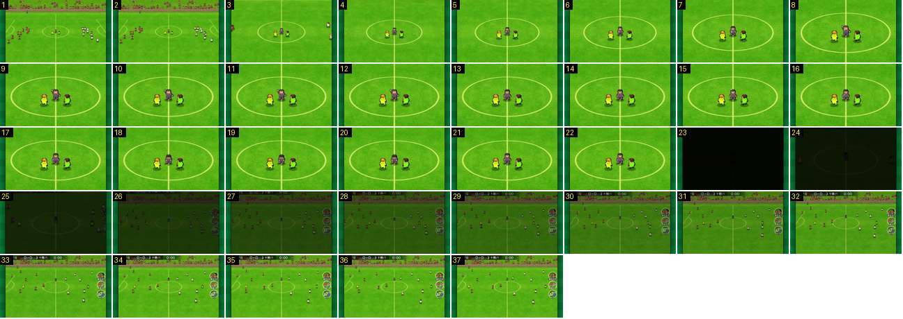

# Sorteio: corte, zoom e corte a preto

Depois de as equipas se espalharem, a câmara salta para o árbitro e os dois capitães no círculo central, aproxima-se mais um pouco e sai com um corte a preto e um fade de 1 s para o plano largo do pontapé de saída. É o padrão que o jogo usa em quase todos os grandes planos: entra com um corte e um zoom que abranda, e sai pelo preto.

- **Duração:** 3,7 s, 37 frames a 10 fps
- **Origem:** [0AWtZz7qiDM](https://www.youtube.com/watch?v=0AWtZz7qiDM&t=18s), de 18,9 s a 22,6 s, canal Booby
- **Etiquetas:** camara, sorteio, corte, zoom, fade, preto, grande-plano

## Frame a frame

- **1–2:** plano largo lateral, fixo. Os jogadores das duas equipas acabam de se espalhar pelo meio campo. O círculo central tem cerca de 140 px de largura (no ecrã de 640).
- **3:** corte seco para um plano mais próximo: o círculo passa de ~140 para ~260 px, de um frame para o seguinte. A 30 fps também não há frames intermédios, por isso é um corte e não um zoom rápido. A bancada desaparece do quadro.
- **3–8:** o zoom continua até o círculo ocupar ~510 px (perto de 2× em 0,5 s). É rápido no início e abranda no fim. A câmara fica centrada no árbitro.
- **8–22:** o plano fica parado (1,4 s). O árbitro levanta o braço e baixa-o, e os capitães, de amarelo e verde, ficam parados.
- **23:** corte seco para quase preto (brilho médio 10 em 255, contra 128 no frame 22). Não há fade de saída.
- **23–33:** fade a partir do preto, linear: o brilho sobe ~11 por frame durante 1,0 s, até 117. Já aparece o plano largo, com os jogadores nos lugares do pontapé de saída, e com a barra do marcador e os três botões redondos, que no sorteio não estavam lá.
- **34–37:** plano largo normal, a 0:00.
