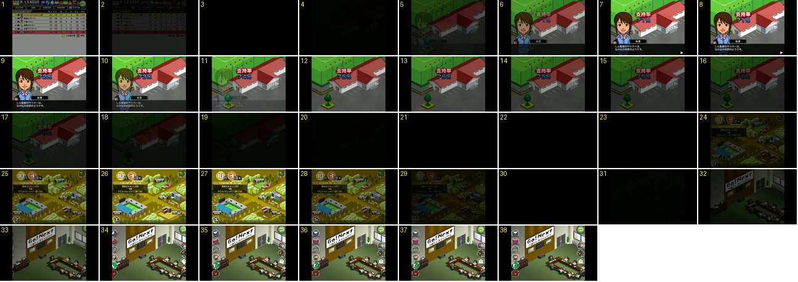

# Taxa de apoio a subir, mapa e entrada no escritório

No fim de uma jornada, a secretária mostra a taxa de apoio ao treinador («支持率») diante da casa do clube, e o número sobe de 71 % para 75 %. A seguir o treinador passa pelo mapa e entra no escritório, onde as colunas de botões entram a rolar. É a entrada que completa a saída de [escritorio-cidade-treino](../escritorio-cidade-treino/README.md).

- **Duração:** 3,8 s, 38 frames a 10 fps
- **Origem:** [4NhscqLQl5U](https://www.youtube.com/watch?v=4NhscqLQl5U&t=34s), de 34,0 s a 37,8 s, canal s (@shin_azarashi)
- **Etiquetas:** secretaria, apoio, contador, fade-preto, cidade, escritorio, botoes-redondos, rotacao

Gravado num tablet (área 4:3 com barras pretas).

## Frame a frame

- **1–2:** a tabela da liga escurece.
- **3–4:** preto (0,2 s).
- **5–7:** a casa do clube aparece em fade (um plano isométrico fixo, com o telhado vermelho e o campo de treino por trás). Ao mesmo tempo aparecem a secretária, o título «支持率» em letras brancas sobre um fundo vermelho e o número «71%» em azul com contorno branco. O texto do diálogo só aparece no 7–8, sem máquina de escrever visível.
- **8–12:** o número sobe 1 % por frame: 71 (8), 72 (9), 73 (10), 74 (11) e 75 (12). São 10 % por segundo, em passos inteiros e sem rolar. Enquanto conta, a secretária, a etiqueta «秘書» e a barra de diálogo desvanecem (a 50 % no 11 e desaparecidas no 12). Por baixo vê-se uma árvore que estava tapada pelo retrato.
- **13–14:** fica só «支持率 75%» sobre a casa do clube.
- **15–20:** tudo escurece devagar (0,6 s).
- **21–23:** preto (0,3 s).
- **24–27:** o mapa da cidade («10月3週») aparece em fade. O treinador toca logo no escritório do clube.
- **28–30:** o mapa escurece. O mapa ficou visível só cerca de 0,5 s, porque o toque foi imediato.
- **31:** preto.
- **32–33:** o escritório aparece em fade (o lema «Go! Next ~新しいステージへ~» na parede e a mesa de reuniões). As duas colunas de botões redondos estão nas bordas, rodadas 90°, com os rótulos ao alto.
- **34–36:** as colunas rolam para dentro: a da esquerda entra pela esquerda e a da direita pela direita. Estão rodadas cerca de 45° no 34, quase direitas no 35 e direitas no 36. O botão verde de voltar entra pelo canto superior direito. Demora 0,3 s e abranda no fim.
- **37–38:** parado.

Para o Pocket Basketball: os botões laterais entram e saem sempre a rolar (rodam enquanto deslizam a partir da borda), em cerca de 0,3 s, em todos os ecrãs que os têm (escritório, treino, liga).
