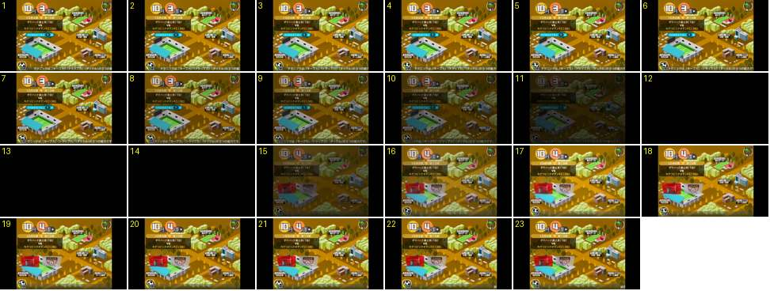

# Mapa da cidade: avançar a semana até à semana de jogo

O treinador avança a semana no mapa (de «10月3週» para «10月4週»), e a semana nova é a do jogo. A passagem é o mesmo «escurecer, preto, clarear» das mudanças de ecrã, só um pouco mais lento, e o mapa volta já mudado: o estádio tem os emblemas das duas equipas e o cartão «faltam N semanas» desapareceu.

- **Duração:** 2,3 s, 23 frames a 10 fps
- **Origem:** [82ITuK9RU-I](https://www.youtube.com/watch?v=82ITuK9RU-I&t=934s), de 934,3 s a 936,6 s, canal suzukisuzu85
- **Etiquetas:** cidade, mapa, semana, calendario, fade-preto, semana-de-jogo, estadio, emblemas

Gravado num tablet (área 4:3 com barras pretas). Mapa de outono, em tons dourados.

## Frame a frame

- **1–6:** o mapa está parado, com a data «10月» e «3週» em dois círculos (o mês amarelo-claro, a semana laranja) e uma pequena aba escura com ▶ à direita, que é o botão de avançar. Por baixo estão o cartão do jogo seguinte («10月4週 第19節», as duas equipas e as posições) e o cartão azul «次の試合まであと 1 週». O rodapé corre. O toque no ▶ não mostra nenhuma reação visível a 10 fps.
- **7–11:** o mapa escurece aos poucos durante 0,5 s (a 85 % no 7, 60 % no 9 e 25 % no 11). Escurece tudo junto, sem movimento de câmara.
- **12–14:** preto durante 0,3 s.
- **15–17:** o mapa volta em fade (a 40 % no 15, 75 % no 16 e cheio no 17). Já mostra:
  - a semana «4週» no círculo laranja;
  - o estádio com duas bandeiras grandes, uma vermelha e outra branca, com os emblemas das duas equipas penduradas na bancada (semana de jogo);
  - nenhum cartão azul «faltam N semanas».
  Nada entra com animação própria: tudo aparece com o fade.
- **18–23:** parado. As bandeiras quase não se mexem. O rodapé continua a correr.
- **Depois (937 s em diante, fora da sequência):** o adjunto aparece em retrato e pergunta se vamos para o estádio, com sim/não. Vê-se em [cena/cidade-mapa](../../../cena/cidade-mapa/README.md).

Ritmo: cerca de 0,5 s a escurecer, 0,3 s de preto e 0,3 s a clarear, ou seja, 1,1 s ao todo, mais lento do que as mudanças de menu (0,6–0,8 s). Não há relógio, contagem nem animação do calendário: a semana muda no escuro.
