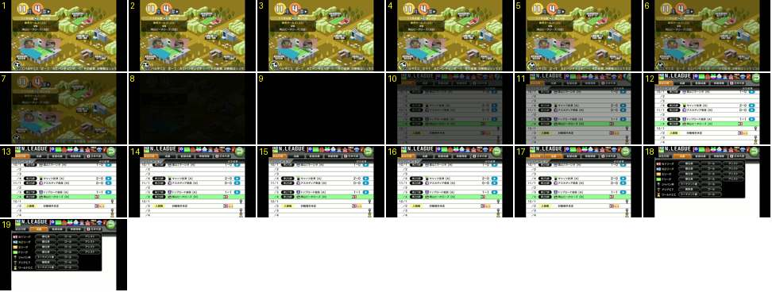

# Do mapa da cidade à federação (N.LEAGUE) e o menu de separador

Mostra o treinador a tocar na federação, no mapa, e a abrir o calendário da liga. Depois, um separador abre um menu por cima. É o mesmo «escurecer, preto, clarear» das outras mudanças de ecrã, aqui gravado noutro canal e num tablet (área de jogo 4:3, com barras pretas).

- **Duração:** 1,9 s, 19 frames a 10 fps
- **Origem:** [SCT6_NOvJDk](https://www.youtube.com/watch?v=SCT6_NOvJDk&t=8s), de 8,7 s a 10,6 s, canal しゃり
- **Etiquetas:** cidade, federacao, liga, fade-preto, separadores, menu-suspenso, botao-redondo, rotacao

## Frame a frame

- **1–5:** o mapa de outono («11月4週») está parado, com o rodapé a correr.
- **6–7:** o mapa escurece: a 80 % no 6 e a 40 % no 7. Não há zoom nem movimento de câmara na direção do edifício tocado.
- **8–9:** quase preto durante 0,2 s.
- **10–12:** o ecrã da N.LEAGUE aparece em fade (a 40 % no 10, a 80 % no 11 e cheio no 12). Entram ao mesmo tempo:
  - a faixa do topo, com o logótipo e os emblemas dos clubes;
  - a fila de separadores («試合日程», «成績», «監督成績», «移籍情報», «日本代表»), com o primeiro selecionado a laranja;
  - a lista do calendário, com riscas brancas e a jornada atual numa linha verde.
- **10–14:** o botão redondo verde de voltar entra pela direita a rodar. No 10 está metade fora e inclinado, no 11–12 já dentro e no 13–14 ainda roda um pouco até assentar. Faz o mesmo movimento que as colunas de botões em [escritorio-cidade-treino](../escritorio-cidade-treino/README.md).
- **15–16:** parado.
- **17:** ao toque, o separador «成績» fica laranja (selecionado) e o primeiro volta a cinzento-escuro. A troca é instantânea, sem animação.
- **18–19:** um menu escuro e translúcido aparece de uma vez por baixo dos separadores, sem deslizar e sem fade visível a 10 fps. Tem uma linha por competição (N1, N2, S, F, taça, ...) e botões em cápsula: «順位表», «ゴール», «アシスト», «トーナメント表».

Ritmo: cerca de 0,2 s a escurecer, 0,2 s de preto e 0,2–0,3 s a clarear, ou seja, 0,6–0,7 s ao todo.
