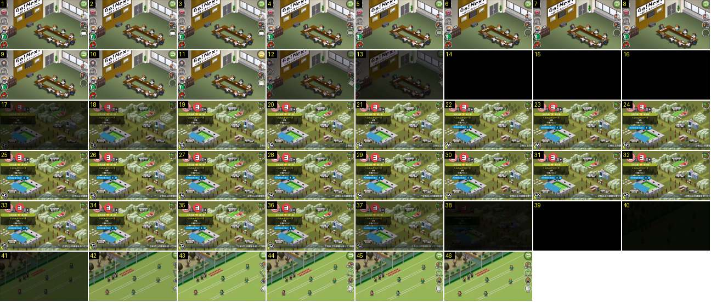

# Do escritório ao mapa e do mapa ao treino

Mostra a saída do escritório, o mapa da cidade e a entrada no campo de treino. Ensina três coisas: as colunas de botões redondos rodam para fora do ecrã e voltam a entrar a rodar, as mudanças de ecrã passam sempre por preto, e um edifício do mapa acende-se quando é tocado.

- **Duração:** 4,6 s, 46 frames a 10 fps
- **Origem:** [8GhUxHFSWD4](https://www.youtube.com/watch?v=8GhUxHFSWD4&t=519s), de 519,7 s a 524,3 s, canal ゲーム動画で行こう! Playing Games.
- **Etiquetas:** escritorio, cidade, treino, fade-preto, botoes-redondos, rotacao, botao-premido, destaque-edificio

## Frame a frame

- **1–7:** o escritório isométrico, com a câmara parada. Há uma coluna de botões redondos com ícone e rótulo de cada lado: à esquerda equipamento, emblema, nome, ...; à direita «経営状況», «チーム編成», «オファー». Em cima à direita está o botão verde de voltar, com seta.
- **7–10:** o botão «オファー» está vazio e só tem o contorno branco. O ícone pisca ou vai mudando, para chamar a atenção.
- **11:** ao toque no voltar, o botão verde fica amarelo durante um frame. É a mesma resposta ao toque dos botões sim/não. Ao mesmo tempo, o ícone das ofertas volta a aparecer.
- **12–13:** o ecrã escurece (60 % no 12, 30 % no 13). Ao mesmo tempo, as duas colunas de botões rodam cerca de 30° e deslizam para fora: a da esquerda vai para a esquerda e a da direita para a direita.
- **14–16:** preto total durante 0,3 s.
- **17–19:** o mapa aparece em fade a partir do preto (0,2–0,3 s). O cartão azul do próximo jogo entra com o salto de escala descrito em [regresso-cidade-proximo-jogo](../regresso-cidade-proximo-jogo/README.md).
- **19–34:** mapa parado. A câmara não se mexe e o rodapé corre.
- **35:** o jogador toca na casa do clube (o campo de treino com o edifício vermelho): o edifício e o relvado ficam mais claros, com um véu branco, durante um frame.
- **36–40:** o mapa escurece (36–38) e fica preto (39–40). São de novo 0,2 s de fade e 0,2 s de preto.
- **41–42:** o campo de treino isométrico aparece em fade. Os bonecos já estão a correr num exercício com cones.
- **42–45:** a coluna de botões da direita (dados dos jogadores, onze, treino especial, tática) entra pela direita a rodar. No 42 está inclinada e meio fora do ecrã, no 43 está quase direita e no 44–45 está assente. Entra em cerca de 0,3 s e abranda no fim.
- **46:** o ecrã do treino está pronto.

Ritmo de qualquer mudança de ecrã: cerca de 0,2 s a escurecer, 0,2–0,3 s de preto e 0,2–0,3 s a clarear, ou seja, 0,6–0,8 s ao todo.
