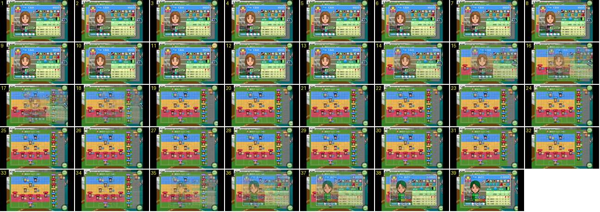

# Ficha do jogador: fechar uma e abrir outra

No ecrã da formação, antes do jogo, o treinador fecha a ficha de uma jogadora com o botão de voltar e abre logo a de outra. Mostra a resposta ao toque do botão redondo e o movimento da ficha: um deslize curto com fade, que nunca vai de fora a fora.

- **Duração:** 1,3 s, 39 frames a 30 fps
- **Origem:** [SCT6_NOvJDk](https://www.youtube.com/watch?v=SCT6_NOvJDk&t=32s), de 32,55 s a 33,85 s, canal しゃり
- **Etiquetas:** ficha-jogador, formacao, deslize, fade, botao-premido, botao-redondo, rotacao

## Frame a frame

- **1–10:** a ficha de «くるみ» está aberta por cima da formação, desviada para a esquerda. A formação aparece por trás, ligeiramente desfocada. À direita há um botão redondo «セットプレー» (bolas paradas) e, em cima, o botão verde de voltar.
- **11:** ao toque, o botão de voltar fica amarelo durante um só frame (33 ms). Não muda de tamanho.
- **12–13:** o botão já está verde outra vez e a ficha continua no sítio. A ficha só começa a reagir 2 frames depois do toque (66 ms).
- **14–18:** a ficha sai para a direita e desvanece ao mesmo tempo. A borda esquerda passa de x≈120 a x≈160 (14), 180 (15), 195 (16) e 205 (17), ou seja cerca de 40, 20, 15 e 10 px por frame: arranca depressa e abranda. Está a 70 % de opacidade no 15, a 40 % no 16, a 20 % no 17 e desaparece no 18. Ao todo são 5 frames (0,17 s). O botão «セットプレー» sai pela direita a rodar, ao mesmo tempo que a ficha.
- **18–34:** fica só a formação: faixas FW azul, MF amarelo e DF vermelho, os bonecos com nome e, à direita, o banco. Um ícone de estado ao lado de cada jogadora alterna entre um quadrado amarelo e um círculo azul, mais ou menos a cada 0,15 s.
- **35–38:** o treinador toca noutra jogadora («みどり») e a ficha dela entra com o movimento inverso: aparece a 20 % com a borda em x≈170 e desliza para a esquerda até x≈120, em 150 (36), 140 (37) e 130 (38), enquanto ganha opacidade (cheia no 38). Demora 4 frames (0,13 s) e abranda no fim. O botão redondo da direita volta a entrar inclinado (39).
- **39:** a ficha nova está assente.

Resumo para copiar o ritmo: a ficha abre e fecha em 0,13–0,17 s, com um deslize de 50–85 px (no ecrã de 640) e fade ao mesmo tempo. Não muda de escala.
