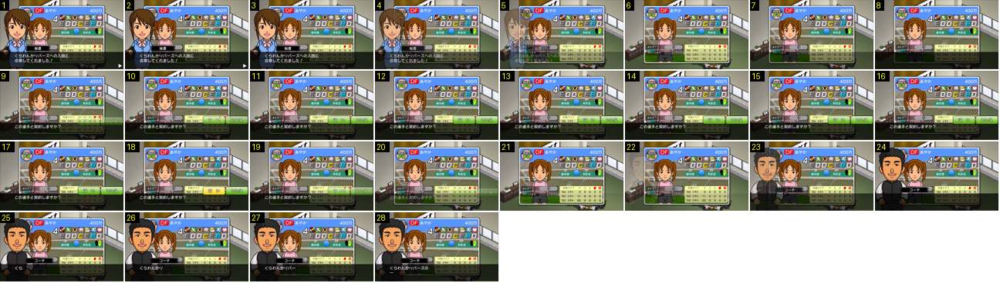

# Mercado: a secretária responde e o adjunto toma a palavra

Depois de escolher uma jogadora no mercado, a secretária confirma a entrada, pergunta «sim/não» para outro contrato e passa a palavra ao adjunto. Mostra como o jogo troca de personagem e de pergunta sem mudar de ecrã: tudo por fades curtos, com a ficha sempre parada por baixo.

- **Duração:** 2,8 s, 28 frames a 10 fps
- **Origem:** [8GhUxHFSWD4](https://www.youtube.com/watch?v=8GhUxHFSWD4&t=32s), de 32,8 s a 35,6 s, canal ゲーム動画で行こう! Playing Games.
- **Etiquetas:** mercado, secretaria, adjunto, dialogo, sim-nao, fade, botao-premido, texto-maquina-escrever

## Frame a frame

- **1–3:** a secretária em retrato grande à esquerda, à frente da ficha da jogadora (moldura azul, notas em letras). A barra de diálogo é preta translúcida, ocupa a largura toda e tem a etiqueta «秘書» por cima e um ▶ branco no canto. O fundo é o escritório isométrico, desfocado.
- **4–6:** o retrato, a etiqueta e a barra desaparecem juntos num fade de opacidade (cerca de 80 % no 4, 40 % no 5, nada no 6). Demora 0,2–0,3 s. Nada desliza e nada muda de escala. A ficha não se mexe.
- **7–8:** fica só a ficha sobre o escritório, sem barra de diálogo.
- **9–10:** a barra volta com a pergunta «この選手と契約しますか？» já inteira (sem efeito de máquina de escrever). Os dois botões, «はい» e «いいえ», aparecem por cima, à direita da barra: no 9 estão a meia opacidade, no 10 já cheios. É um fade de 0,2 s, sem escala. São retângulos verdes de cantos redondos, com contorno claro e lado a lado.
- **11–17:** parado, à espera do toque.
- **18:** ao toque, o «はい» fica amarelo vivo com letras escuras durante um só frame (0,1 s). O «いいえ» continua verde. O botão não muda de tamanho nem de posição.
- **19–20:** a barra, o texto e os dois botões desvanecem juntos (0,2 s).
- **21:** só a ficha.
- **22–24:** o retrato do adjunto («コーチ») entra em fade no mesmo sítio onde estava a secretária (a 30 % no 22, cheio no 24). Aparecem também a etiqueta do nome e a barra.
- **25–28:** o texto do adjunto aparece letra a letra, a 2–3 caracteres por frame (cerca de 25 caracteres por segundo).
