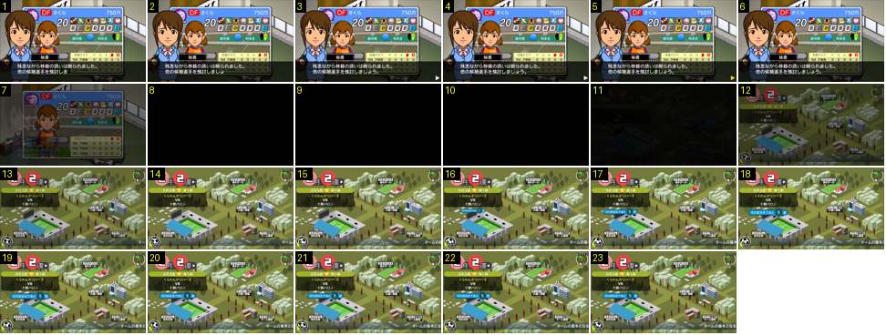

# Regresso ao mapa da cidade e o cartão do próximo jogo

Quando acaba a conversa no escritório, o jogo volta ao mapa da cidade passando por preto. O cartão «faltam N semanas para o jogo» entra com um salto de escala. É o modelo para a saída de qualquer ecrã de gestão para o mapa.

- **Duração:** 2,3 s, 23 frames a 10 fps
- **Origem:** [8GhUxHFSWD4](https://www.youtube.com/watch?v=8GhUxHFSWD4&t=40s), de 40,3 s a 42,6 s, canal ゲーム動画で行こう! Playing Games.
- **Etiquetas:** cidade, mapa, fade-preto, escala, ressalto, proximo-jogo, rodape

## Frame a frame

- **1–6:** a secretária com a ficha de uma jogadora que recusou a proposta. Aparece um ▶ amarelo no canto da barra quando o texto acaba (no 6).
- **7:** tudo escurece a 50 %. O retrato e a barra já desapareceram e só se vê a ficha, apagada.
- **8–10:** preto total durante 0,3 s.
- **11–13:** o mapa da cidade aparece em fade a partir do preto: muito escuro no 11, a 60 % no 12 e cheio no 13. Entra tudo de uma vez: data (círculos «2月» e «2週»), cartão do jogo à esquerda, etiquetas dos edifícios e rodapé. A câmara está parada e não há zoom.
- **14–15:** mapa parado. O cartão azul «次の試合まであと 5 週» ainda não existe.
- **16–20:** o cartão azul entra com um salto de escala a partir do centro: cerca de 0,68 da largura final no 16, 0,95 no 17, 1,08 no 18 e 1,09 no 19, e assenta a 1,0 no 20. Ultrapassa o tamanho em 8–9 % e volta atrás, numa curva com ressalto de 0,4 s. O centro fica fixo.
- **13–23:** o texto de ajuda no rodapé corre da direita para a esquerda a velocidade constante, à volta de 4–5 px por frame no ecrã de 640.
- **21–23:** parado.

Nota: a semana já tinha avançado antes deste troço. Aqui vê-se o regresso ao mapa e não o botão de avançar a semana.
