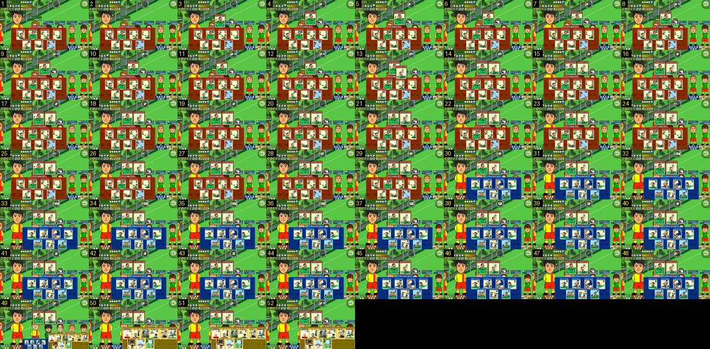

# Treino: arrastar cartas para cima da gaveta

Para treinar, arrasta-se uma carta da gaveta para cima. As cartas escolhidas ficam em fila por cima da gaveta, ao lado de um botão redondo «特訓開始» (começar o treino especial). Pode-se trocar de gaveta e juntar cartas de categorias diferentes.

- **Duração:** 5,2 s, 52 frames a 10 fps
- **Origem:** [UN9g62Rw7M4](https://www.youtube.com/watch?v=UN9g62Rw7M4&t=108s), de 108,4 s a 113,6 s, canal ぼくくんゲーム
- **Etiquetas:** treino, cartas, arrastar, gavetas-cartas, botao-redondo, combo

## Frame a frame

- **1:** a gaveta TECHNICAL aberta.
- **2–9:** a carta «フリーキック» sai da gaveta e segue o dedo até ao espaço por cima da aba. Na gaveta, o número dela desce de 14 para 13. Não há sombra nem mudança de escala: a carta só muda de sítio.
- **3–9:** à direita da carta aparece o botão redondo «特訓開始», com um apito desenhado.
- **10:** a carta pousada à esquerda, por cima da gaveta.
- **11–13:** a segunda carta («リフティング») sobe da mesma maneira.
- **14–29:** as duas cartas lado a lado por cima da gaveta, com o botão à direita.
- **30–32:** toque em PHYSICAL: a gaveta azul sobe da borda de baixo em 0,2 s e fica no lugar da vermelha. As cartas escolhidas não se mexem.
- **33–48:** a gaveta azul parada.
- **49–51:** toque em SUPPORT: a gaveta amarela sobe e cresce a partir do canto de baixo à direita, em 0,3 s.
- **52:** a gaveta amarela aberta.

Neste vídeo o jogador junta depois uma terceira carta, e o combo abre o «SPECIAL MENU» (a 120 s). Essa cerimónia está em [treino-combo-cartas-special-menu](../treino-combo-cartas-special-menu/README.md).
