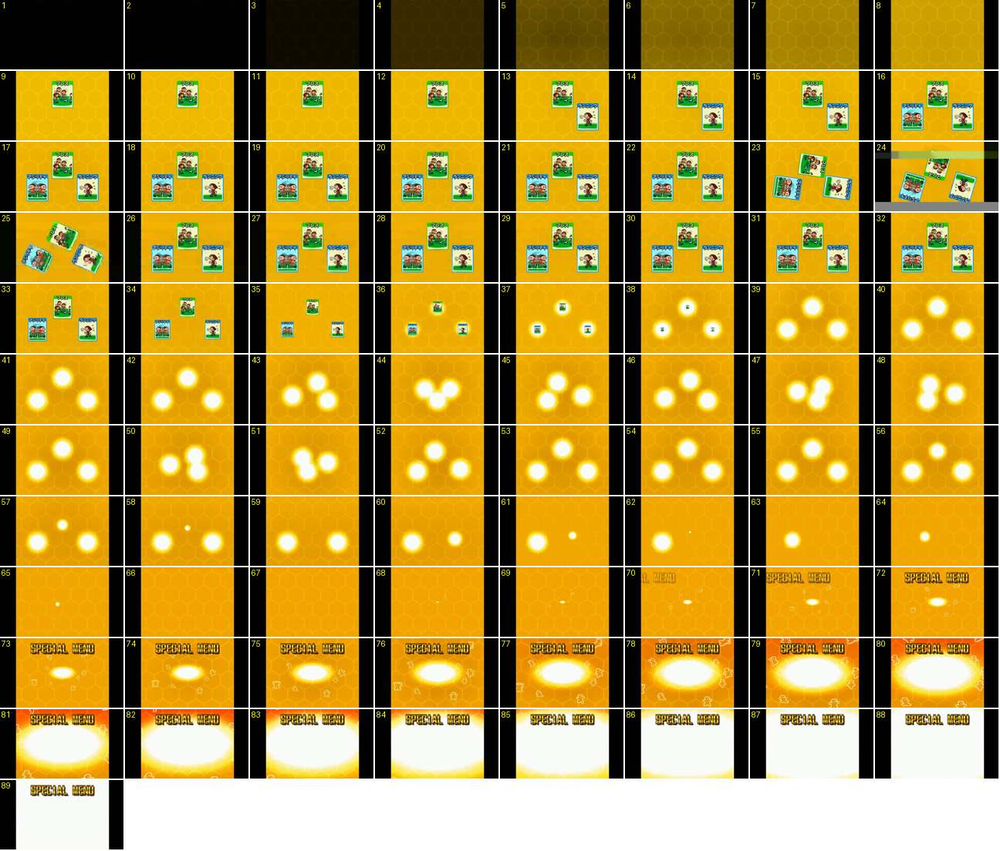

# Treino: três cartas fazem um combo e abrem o «SPECIAL MENU»

O treinador junta três cartas de treino que formam um combo. As cartas aparecem uma a uma sobre um fundo de favos, giram, encolhem até virarem bolas de luz, dançam e apagam-se, e um clarão revela o «SPECIAL MENU». É a cerimónia completa de um combo de cartas fora do campo, com cerca de 9 s.

- **Duração:** 8,9 s, 89 frames a 10 fps
- **Origem:** [82ITuK9RU-I](https://www.youtube.com/watch?v=82ITuK9RU-I&t=879s), de 879,9 s a 888,8 s, canal suzukisuzu85
- **Etiquetas:** treino, cartas, combo, special-menu, rotacao, escala, brilho, clarao, favos

Gravado num tablet: a área de jogo é 4:3, com barras pretas dos lados.

## Frame a frame

- **1–2:** preto. Vem do ecrã de cartas, onde o treinador carregou em «特訓開始» (começar o treino especial).
- **3–8:** o fundo amarelo com favos hexagonais aparece em fade a partir do preto, em cerca de 0,6 s. É mais lento do que as mudanças de menu.
- **9–12:** a primeira carta («プレス», moldura verde) aparece de uma vez, em cima ao centro, já no tamanho final. Não se vê escala nem deslize a 10 fps.
- **13–15:** a segunda carta («ランニング», moldura azul) aparece da mesma maneira, em baixo à direita, 0,4 s depois.
- **16–22:** a terceira («アジリティ», azul) aparece em baixo à esquerda, 0,3 s depois. As três formam um triângulo, como um «combo de 3».
- **23–25:** as três cartas giram muito depressa sobre si mesmas. No 23 estão todas viradas cerca de 80° no mesmo sentido. Os frames 24–25 têm um defeito da gravação (riscos horizontais), mas também mostram as cartas a rodar. A volta inteira dura uns 0,3–0,4 s.
- **26–32:** as cartas voltam a estar direitas e paradas, ainda com um pouco de arrasto de movimento no 26–27. Aproximam-se um pouco do centro.
- **33–36:** as cartas encolhem no sítio, cada uma para o seu centro: a cerca de 80 % no 33, a 50 % no 35 e a 40 % no 36. Abrandam ao chegar ao fim.
- **36–38:** cada carta ganha um halo branco e amarelo que cresce até ser uma bola de luz com a carta minúscula lá dentro (38). O fundo escurece ligeiramente à volta das bolas.
- **39–56:** as três bolas de luz «dançam». Juntam-se no centro (43–44), afastam-se de novo para o triângulo (45–46), juntam-se (47–48), afastam-se (49), juntam-se (50–51) e voltam ao triângulo (52–56). São três pulsações, cada uma com cerca de 0,3–0,4 s.
- **57–66:** as bolas encolhem e apagam-se uma de cada vez: primeiro a de cima (57–59), depois a da direita, que se aproxima do centro a encolher (60–62), e por fim a da esquerda (63–66). Cada uma demora cerca de 0,3 s.
- **67–69:** o fundo de favos fica vazio. No 69 aparece uma faísca branca minúscula ao centro.
- **70–72:** o título «SPECIAL MENU» aparece em fade no topo, e a faísca torna-se um oval branco pequeno.
- **72–89:** o oval branco cresce a partir do centro, mais na largura do que na altura, e acelera. O fundo fica laranja-avermelhado nas bordas e aparecem silhuetas brancas de bonecos (as mesmas de [treino-special-menu-descoberto](../treino-special-menu-descoberto/README.md)). No 84 já tapa quase tudo e no 87–89 é branco de ponta a ponta, só com o título por cima. Demora cerca de 1,7 s.
- **Depois (889 s, fora da sequência):** corte seco para a ilustração do treino especial («タフネスダイナモ»), com a mini-ficha da jogadora que treinou e as barras de atributos à direita.

Comparação: num combo de duas cartas (no mesmo vídeo, a 1832 s) o fundo é azul com favos e as cartas também giram e encolhem até virarem bolas. A cor do fundo parece seguir a categoria das cartas.
