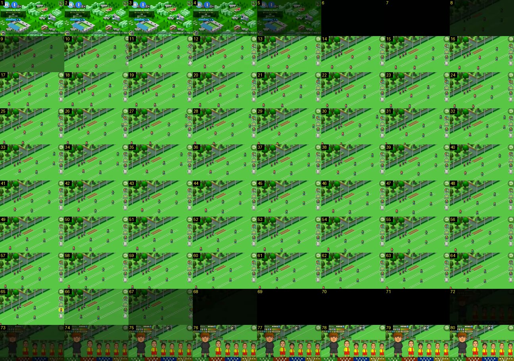

# Treino: do mapa ao centro de treino e à fila de jogadores

Do mapa da cidade entra-se primeiro no centro de treino, uma vista isométrica do campo com o plantel a treinar sozinho e uma coluna de botões redondos à direita. Só ao tocar em «特訓» (treino especial) se chega à fila de jogadores com as gavetas de cartas.

- **Duração:** 8,0 s, 80 frames a 10 fps
- **Origem:** [UN9g62Rw7M4](https://www.youtube.com/watch?v=UN9g62Rw7M4&t=35s), de 35,5 s a 43,5 s, canal ぼくくんゲーム
- **Etiquetas:** treino, centro-treino, mapa-cidade, fade-preto, botoes-redondos, fila-jogadores, gavetas-cartas

Gravado num telemóvel em 16:9, sem sobreposições.

## Frame a frame

- **1–4:** o mapa da cidade, já depois do toque no centro de treino. Não há realce visível do edifício.
- **5:** o mapa escurece num só frame.
- **6–7:** preto, 0,2 s.
- **8–10:** o centro de treino aparece em fade a partir do preto, em 0,3 s: o campo isométrico com as cerejeiras e a vedação, cones vermelhos e uma dúzia de bonecos pequenos em pixel art a correr.
- **10–12:** os quatro botões redondos entram a rolar pela borda direita, uns atrás dos outros, por baixo do botão verde de voltar: «選手データ» (dados dos jogadores), «スタメン» (onze inicial), «特訓» (treino especial) e «戦術» (tática). Cada um tem um ícone e o nome por baixo.
- **12–64:** o centro fica parado à espera. Os bonecos continuam a correr e a fazer exercícios. A câmara não se mexe.
- **65:** o botão «特訓» fica amarelo no frame do toque.
- **66–67:** o centro escurece em 0,2 s.
- **68–72:** preto, 0,5 s.
- **72–75:** a fila de jogadores aparece em fade, em 0,3 s.
- **76–80:** a fila parada. O que está no ecrã vem em [treino-fila-trocar-jogador](../treino-fila-trocar-jogador/README.md).

Na primeira visita (CbFU3oY9Al0, de 426 s a 452 s), a secretária e o adjunto explicam o treino em caixas de diálogo sobre o centro. Já na fila, o adjunto pergunta se queremos a explicação do «特訓», com botões sim/não.
