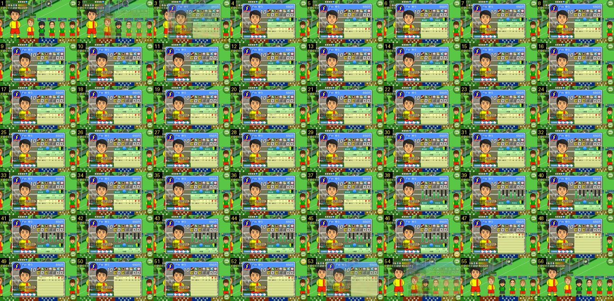

# Treino: abrir a ficha do jogador e ver as barras

Tocar no jogador da frente abre a ficha completa por cima da fila. Um botão redondo no canto troca a parte de baixo da ficha pelas barras dos atributos.

- **Duração:** 5,6 s, 56 frames a 10 fps
- **Origem:** [UN9g62Rw7M4](https://www.youtube.com/watch?v=UN9g62Rw7M4&t=92s), de 92,6 s a 98,2 s, canal ぼくくんゲーム
- **Etiquetas:** treino, ficha-jogador, fade, barras-atributos, botao-redondo

## Frame a frame

- **1:** a fila, com o avançado 10 à frente.
- **2–4:** a ficha aparece em fade e cresce um pouco a partir do centro, em 0,3 s. No 2 ainda se vê a fila através dela.
- **5–37:** a ficha completa, parada: moldura azul, emblema, posição e nome, preço («650万»), número grande, sete ícones com as notas em letras, cansaço numa bolinha, pé preferido, carreira, clubes, tipo, potencial em setas e o histórico de treinos especiais («特訓履歴») em losangos. Em baixo à direita há um botão redondo com setas.
- **38–46:** depois de um toque nesse botão, a carreira dá lugar a sete barras verticais verdes, uma por atributo, por baixo das notas. A troca é seca, num frame, e as barras não sobem.
- **47–52:** novo toque: volta a carreira, também num frame.
- **53–54:** a ficha desaparece em fade, em 0,2 s.
- **55–56:** a fila outra vez.
