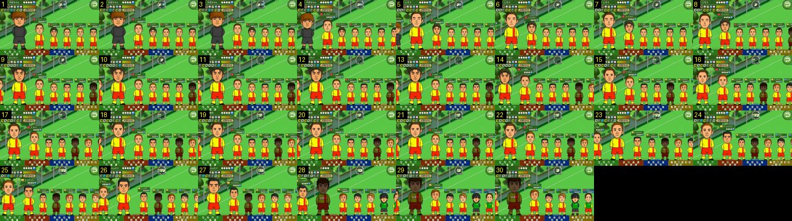

# Treino: a fila de jogadores e a troca de jogador

A fila de jogadores do treino é um carrossel. O jogador da frente aparece grande, de corpo inteiro, à esquerda, e os outros ficam em fila atrás, mais pequenos, cada um com uma etiqueta por cima. Arrastar a fila troca o jogador da frente, um de cada vez.

- **Duração:** 3,0 s, 30 frames a 10 fps
- **Origem:** [UN9g62Rw7M4](https://www.youtube.com/watch?v=UN9g62Rw7M4&t=43s), de 43,3 s a 46,3 s, canal ぼくくんゲーム
- **Etiquetas:** treino, fila-jogadores, carrossel, deslize, ficha-curta, etiquetas-jogador, gavetas-cartas

## O que está no ecrã

- **Em cima à esquerda:** a ficha curta do jogador da frente: a posição numa etiqueta de cor, o número e o nome, as estrelas de condição e uma bolinha azul, os sete ícones de atributos, o cansaço em setas amarelas, as sete notas em letras e o tipo («バランス») numa cápsula.
- **Em cima à direita:** o botão redondo «SPリスト» (lista de treinos especiais) e o botão verde de voltar.
- **Fila:** o jogador da frente é muito maior e fica cortado pela barra de baixo. Os outros vão diminuindo para a direita, e cada um tem uma etiqueta verde com a posição, o número, o nome e as estrelas. Os suplentes vestem um colete verde com «SUB». Um lesionado tem «ケガ» e uma cruz vermelha no peito.
- **Em baixo:** as quatro gavetas fechadas, lado a lado, como separadores: TACTICAL verde, TECHNICAL vermelha, PHYSICAL azul e SUPPORT amarela. Cada uma mostra as suas cartas em miniatura.

## Frame a frame

- **1–3:** o guarda-redes à frente.
- **4:** troca: o guarda-redes sai pela esquerda e o segundo da fila está a meio do crescimento. A ficha de cima já mostra o novo jogador.
- **5–7:** o novo jogador da frente, já no tamanho final. A troca dura um ou dois frames, cerca de 0,1–0,2 s, sem ressalto.
- **8–9, 15–16, 22–23 e 27–28:** mais quatro trocas iguais. O jogador desliza a fila depressa, por isso há uma troca a cada 0,4–0,7 s. No 28 a fila anda para trás um jogador.
