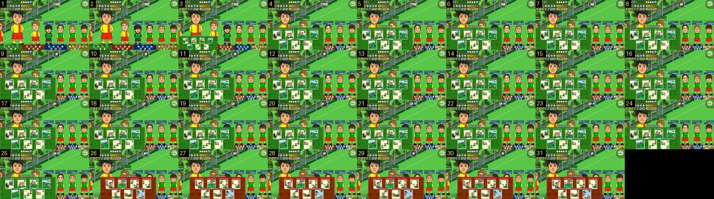

# Treino: abrir uma gaveta de cartas e trocar de gaveta

Tocar num dos separadores de baixo abre essa gaveta: um painel da cor da categoria sobe e mostra as cartas grandes, cada uma com o desenho, o nome e quantas restam.

- **Duração:** 3,1 s, 31 frames a 10 fps
- **Origem:** [UN9g62Rw7M4](https://www.youtube.com/watch?v=UN9g62Rw7M4&t=98s), de 98,3 s a 101,4 s, canal ぼくくんゲーム
- **Etiquetas:** treino, gavetas-cartas, cartas, deslize, cores-categoria

## Frame a frame

- **1–2:** a fila com as quatro gavetas fechadas em baixo.
- **3:** depois do toque em TACTICAL, a gaveta verde sobe da borda de baixo, ainda pequena e baixa.
- **4:** a gaveta aberta, em 0,2 s ao todo: um painel verde com o título «TACTICAL» numa aba e sete cartas em duas filas (4 + 3), cada uma com o desenho, o nome em cima e o número de cópias. Ao mesmo tempo a fila de jogadores desce: do jogador da frente só se veem a cabeça e os ombros, e os outros ficam atrás da gaveta.
- **5–24:** a gaveta parada. Os separadores das outras gavetas continuam à vista em baixo à direita.
- **25:** depois do toque em TECHNICAL, a gaveta verde encolhe.
- **26–31:** a gaveta vermelha «TECHNICAL» já aberta, no mesmo sítio. A troca de gaveta dura um ou dois frames.

As cartas têm a moldura da cor da gaveta. O que acontece depois está em [treino-colocar-cartas-e-trocar-gaveta](../treino-colocar-cartas-e-trocar-gaveta/README.md).
