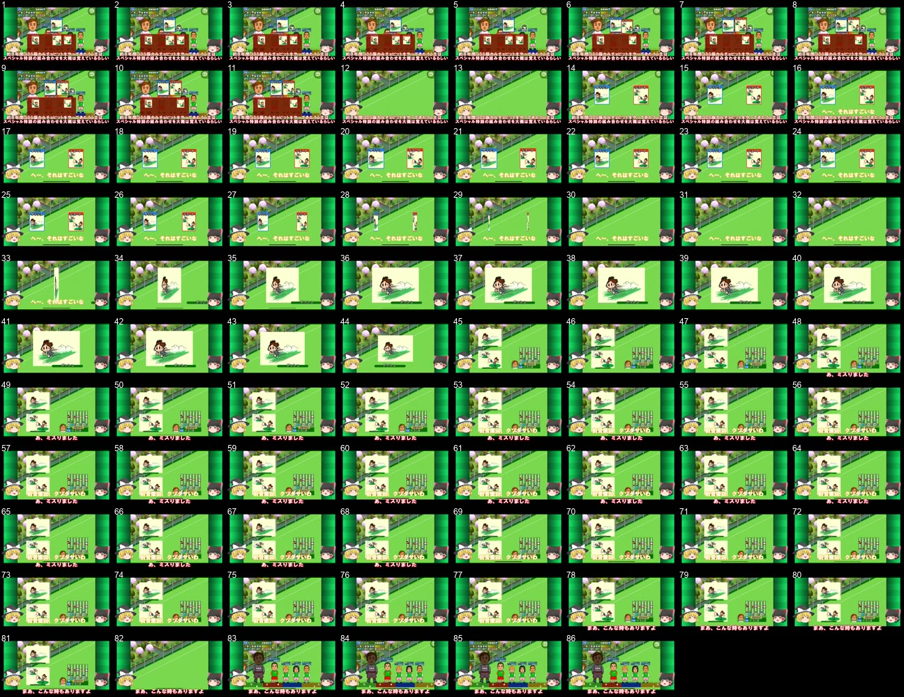

# Treino normal: duas cartas, sem combo

Um treino normal com duas cartas («ダッシュ» de Physical e «シュート» de Technical), que não fazem combo. As duas aparecem juntas, longe uma da outra, e viram-se ao mesmo tempo. Sai em grande a ilustração da primeira; enquanto ela encolhe, um toque salta o resto e corta para o quadro final com as duas ilustrações empilhadas à esquerda e a mini-ficha. Do toque em «特訓開始» à fila são cerca de 7 s.

- **Duração:** 8,6 s, 86 frames a 10 fps
- **Origem:** [a_AwLG5P3KM](https://www.youtube.com/watch?v=a_AwLG5P3KM&t=214s), de 214,0 s a 222,6 s, canal OZAKIチャンネル
- **Etiquetas:** treino, treino-normal, cartas, duas-cartas, carta-vira, ilustracao, mini-ficha, ganho-atributos, corte-seco

O vídeo é um «ゆっくり実況»: o jogo ocupa só a faixa do meio, com cortinas verdes dos lados, duas cabeças de comentadores em baixo e legendas amarelas e vermelhas. Nada disso é do jogo. É a versão com a fila de jogadores, a mesma de [treino-normal-uma-carta](../treino-normal-uma-carta/README.md).

## Frame a frame

- **1–11:** o avançado 11 «たしま» à frente da fila e a gaveta TECHNICAL aberta. A primeira carta (moldura azul) já está em cima; a segunda (moldura vermelha) sobe da gaveta e pousa ao lado dela por volta do 6, com o botão «特訓開始» à direita. O jogador toca no botão no 11.
- **12:** corte seco para o campo de treino vazio.
- **12–13:** o campo vazio, 0,2 s.
- **14:** as duas cartas aparecem de uma vez, no tamanho final, à mesma altura e bem afastadas, com um espaço vazio ao meio onde caberia uma terceira. Cada uma mantém a moldura da cor da sua gaveta.
- **14–27:** as duas paradas, 1,4 s.
- **28–29:** viram-se as duas ao mesmo tempo até serem riscas, 0,2 s.
- **30–32:** nada no ecrã, 0,3 s.
- **33–35:** sai só a ilustração da primeira carta («ダッシュ»), ao centro: estreita (33), mais larga (34), grande (35).
- **35–43:** a primeira ilustração grande, 0,9 s.
- **44:** começa a encolher no sítio.
- **45:** um toque corta tudo (visto a 30 fps, a meio do encolher): o quadro final aparece de uma vez, sem o retângulo verde a crescer. A segunda ilustração («シュート») nunca chega a aparecer em grande. As duas ilustrações ficam empilhadas do lado esquerdo do campo, a primeira em cima e a segunda por baixo, do mesmo tamanho (cerca de um terço da largura). A mini-ficha fica em baixo à direita, com as notas (D B E D E D E) e o tipo «バランス».
- **45–46:** a 30 fps, os ícones dos atributos aparecem 0,03 s depois das linhas e das letras, já à altura certa.
- **46–81:** tudo parado, 3,5 s, à espera do toque. Os ganhos ficam em letra pequena por baixo dos ícones: «+6», «+1» e «+3», um só número por atributo, com as duas cartas já somadas.
- **82:** corte: some tudo e fica o campo vazio durante um frame.
- **83–86:** corte seco para a fila. À frente fica o jogador que treinou, escurecido (pele e equipamento em castanho e cinzento-escuro) e com a etiqueta «特訓済» no peito, como depois de uma carta.

Com três cartas a cerimónia completa está em [treino-normal-tres-cartas-completo](../treino-normal-tres-cartas-completo/README.md): cada ilustração sai em grande, uma a uma, e a segunda vem da volta da primeira.
