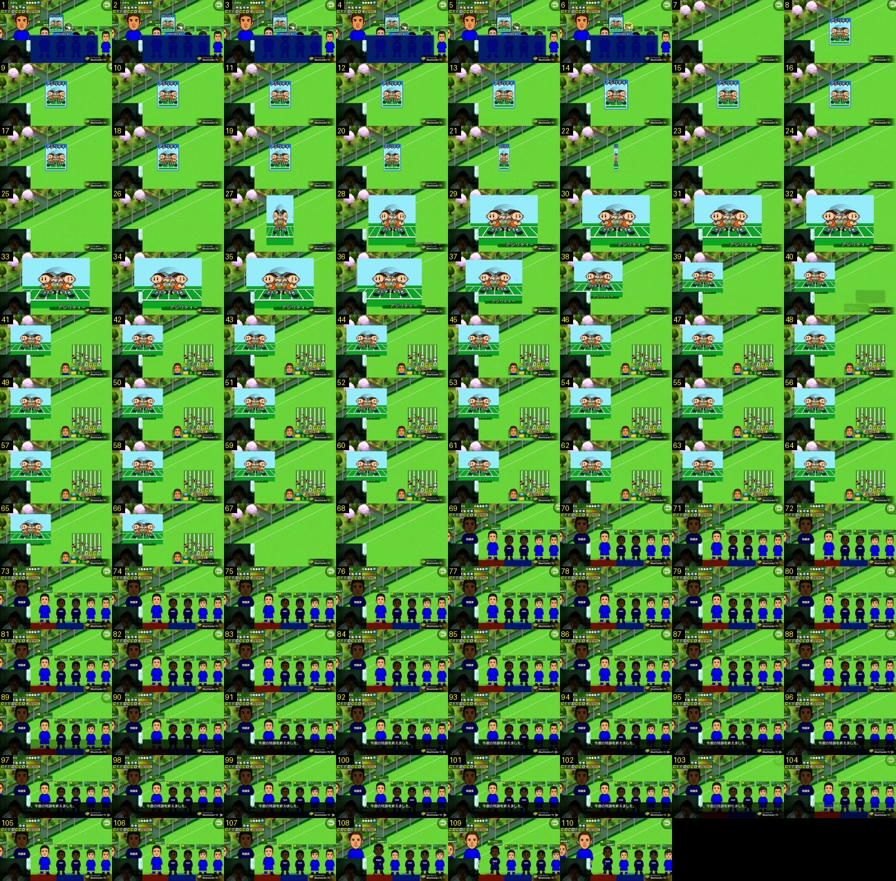

# Treino normal: ilustração animada e jogador já treinado

Outro treino normal de uma carta («アジリティー», agilidade, da gaveta Physical), com o mesmo fluxo de [treino-normal-uma-carta](../treino-normal-uma-carta/README.md). Aqui a ilustração mexe-se: os dois rapazes trocam de pose num ciclo rápido. Depois, ao tocar num jogador já treinado, aparece em baixo a frase «今週の特訓を終えました。» (já fez o treino especial desta semana).

- **Duração:** 11,0 s, 110 frames a 10 fps
- **Origem:** [CbFU3oY9Al0](https://www.youtube.com/watch?v=CbFU3oY9Al0&t=565s), de 565,0 s a 576,0 s, canal YS Studio 製作
- **Etiquetas:** treino, treino-normal, cartas, carta-vira, ilustracao-animada, mini-ficha, ja-treinado, caixa-texto

Gravado num emulador, com a cara do youtuber em baixo à esquerda e um logótipo em baixo à direita.

## Frame a frame

- **1–6:** a gaveta PHYSICAL aberta e a carta «アジリティー» já no espaço por cima dela, ao lado do botão «特訓開始». No 6 o botão fica amarelo: é o toque.
- **7:** corte seco para o campo vazio.
- **8–20:** a carta ao centro, parada, 1,3 s.
- **21–23:** a carta vira-se e fica uma risca, em 0,3 s.
- **24–26:** campo vazio, 0,3 s.
- **27–29:** a ilustração sai da volta, estreita e depois larga, em 0,3 s. Tem fundo azul-claro e uma pista verde com linhas brancas, e a faixa escura com o nome «アジリティー».
- **29–36:** a ilustração grande. Os dois rapazes de laranja alternam entre duas poses, um à frente do outro, com riscos de movimento à volta das cabeças: é uma animação de dois desenhos em ciclo, uma troca a cada um ou dois frames, como se estivessem a fintar-se.
- **37–40:** a ilustração encolhe para o canto de cima à esquerda, em 0,4 s, e continua animada.
- **40–41:** o retângulo verde translúcido e depois a mini-ficha, com os ganhos ao lado dos ícones.
- **41–66:** parado, 2,6 s, à espera do toque. A ilustração continua em ciclo.
- **67–68:** campo vazio, 0,2 s.
- **69:** corte seco para a fila. À frente está um jogador escurecido com «特訓済» no peito. Na fila já há outros três escurecidos, também com a etiqueta. Nos frames 69–70 as gavetas e o botão de voltar ainda não estão lá.
- **71–89:** a fila normal, com os botões e as gavetas.
- **90–91:** depois de um toque no jogador já treinado, as gavetas e o botão de voltar desaparecem e entra em baixo uma faixa escura translúcida com o texto «(nome)、今週の特訓を終えました。» e um ▶ no canto. Não há retrato do adjunto: é só a faixa de texto.
- **91–103:** o texto parado, 1,3 s.
- **104:** depois de um toque, a faixa desaparece e as gavetas voltam.
- **105–110:** o jogador desliza a fila para um jogador por treinar.

Cada jogador só pode fazer um treino por semana. O jogo não o impede com um aviso de erro, mas com esta frase calma e com o jogador escurecido na fila.
