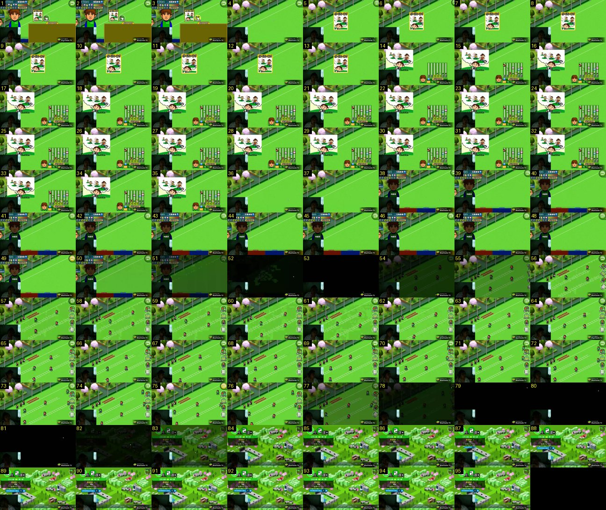

# Treino normal saltado, e sair do treino para o mapa

O último treino normal da semana («イメージトレーニング», treino mental), em que o jogador toca durante a carta e salta a volta e a ilustração grande: vai direto para a ilustração pequena com a mini-ficha. Depois sai do treino: o botão de voltar leva ao centro de treino, e um segundo voltar leva ao mapa da cidade.

- **Duração:** 9,5 s, 95 frames a 10 fps
- **Origem:** [CbFU3oY9Al0](https://www.youtube.com/watch?v=CbFU3oY9Al0&t=643s), de 643,0 s a 652,5 s, canal YS Studio 製作
- **Etiquetas:** treino, treino-normal, saltar, mini-ficha, ja-treinado, voltar, centro-treino, fade-preto, mapa-cidade

Gravado num emulador, com a cara do youtuber em baixo à esquerda e um logótipo em baixo à direita.

## Frame a frame

- **1–3:** a gaveta SUPPORT com a carta escolhida por cima e o botão «特訓開始». No 3 o botão fica amarelo.
- **4:** corte seco para o campo vazio.
- **5–13:** a carta ao centro, 0,9 s.
- **14:** corte seco direto para o fim: a ilustração já pequena no canto de cima à esquerda e a mini-ficha inteira em baixo à direita. Não há volta da carta nem ilustração grande. Tudo indica que um toque salta essa parte.
- **14–35:** parado, 2,2 s.
- **36–37:** campo vazio, 0,2 s.
- **38:** corte seco para a fila. Este era o último jogador da fila: só ele está à vista, escurecido e com «特訓済», e o resto da relva está vazio.
- **38–48:** a fila parada, com o botão verde de voltar em cima à direita.
- **49:** o botão de voltar fica amarelo no toque.
- **51–53:** a fila escurece até ao preto, em 0,3 s.
- **54–56:** o centro de treino aparece em fade, com os bonecos a correr. Os botões redondos da direita entram a rolar (55–57).
- **57–74:** o centro de treino parado, 1,8 s.
- **75:** o botão de voltar do centro fica amarelo.
- **77–79:** o centro escurece até ao preto, em 0,3 s.
- **79–82:** preto, 0,4 s.
- **83–86:** o mapa da cidade aparece em fade, em 0,4 s.
- **87–95:** o mapa, com o cartão do próximo jogo e a data.

Não há resumo do que se treinou na semana, nem comentário do adjunto à saída.
