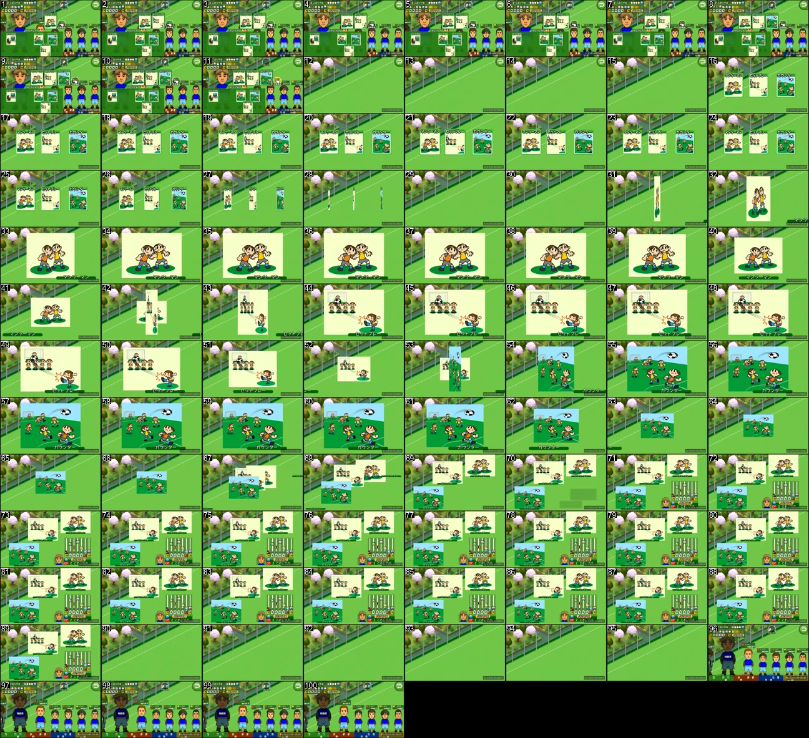

# Treino normal: três cartas sem combo, sem saltar nada

Um treino normal com três cartas táticas («マンツーマン», «セットプレー», «カウンター»), que não fazem combo, visto inteiro, sem toques a saltar. As três cartas aparecem juntas e viram-se as três ao mesmo tempo. Depois as ilustrações saem uma a uma ao centro, em grande, cada uma a encolher e a virar-se na seguinte. No fim as três abrem-se em leque para os seus lugares, em escada, e aparece a mini-ficha com um só ganho por atributo. Do toque em «特訓開始» à fila são cerca de 8,5 s, e 1,9 s disso são a espera pelo toque.

- **Duração:** 10,0 s, 100 frames a 10 fps
- **Origem:** [CtR9CmLxZ9I](https://www.youtube.com/watch?v=CtR9CmLxZ9I&t=193s), de 193,5 s a 203,5 s, canal シュンTV駿「駿猫」【ゲーム実況】
- **Etiquetas:** treino, treino-normal, cartas, tres-cartas, carta-vira, ilustracao, mini-ficha, ganho-atributos, leque, ja-treinado, corte-seco

Gravado num telemóvel em 16:9 (640×356, com uma risca preta em cima e em baixo), com a marca «DU SCREEN RECORDER» em baixo à direita, que não é do jogo. É a versão com a fila de jogadores, a mesma de [treino-normal-uma-carta](../treino-normal-uma-carta/README.md).

## Frame a frame

- **1–11:** a fila com o defesa 2 «こおりやま» à frente e a gaveta TACTICAL aberta. A terceira carta («カウンター») sobe da gaveta e pousa ao lado das outras duas (por volta do 9), com o botão «特訓開始» à direita. O jogador toca no botão no 11.
- **12:** corte seco para o campo de treino vazio, com as cerejeiras.
- **12–15:** o campo vazio, 0,4 s.
- **16:** as três cartas aparecem de uma vez, em fila um pouco acima do meio, já no tamanho final, cada uma com o nome numa faixa em cima. Não entram uma a uma.
- **16–26:** as três paradas, 1,1 s.
- **27–28:** as três viram-se ao mesmo tempo sobre o eixo vertical, até serem riscas, em 0,2 s.
- **29–30:** nada no ecrã, 0,2 s.
- **31–33:** do outro lado sai só a ilustração da primeira carta, ao centro: estreita e alta (31), mais larga (32) e grande (33), num quadro de fundo creme com o nome numa faixa verde-escura em baixo.
- **33–39:** a primeira ilustração grande, parada, 0,7 s.
- **40–41:** encolhe no sítio, ao centro, até cerca de um terço, em 0,2 s.
- **42–43:** o quadro pequeno vira-se como uma moeda e do outro lado vem a segunda ilustração («セットプレー»), que cresce ao mesmo tempo. A troca dura 0,2 s e não volta ao campo vazio.
- **44–50:** a segunda ilustração grande, 0,7 s.
- **51–54:** encolhe, vira-se e sai a terceira («カウンター»), da mesma maneira, em 0,3 s.
- **55–61:** a terceira grande, 0,7 s.
- **62–66:** a terceira encolhe e desliza um pouco para a esquerda, até ficar pequena ao centro, em 0,5 s.
- **67–69:** as três abrem-se em leque a partir desse ponto, as duas primeiras a sair de trás da terceira, e deslizam para os seus lugares em 0,3 s: a primeira em cima à direita, a segunda em cima ao meio, um pouco mais abaixo, e a terceira em baixo à esquerda. É a mesma escada que se vê quando se salta a cerimónia ([treino-normal-tres-cartas-taticas](../treino-normal-tres-cartas-taticas/README.md)).
- **70:** um retângulo verde translúcido cresce no canto de baixo à direita.
- **71:** a mini-ficha aparece inteira: as sete linhas, as notas (D D D D D A C), o tipo «バランス», a cara, a posição, o número e o nome. Os ícones dos atributos aparecem um frame a 30 fps depois das linhas, já à altura certa. Os ganhos ficam em letra pequena por baixo dos ícones: «+2», «+3», «+1», «+2», «+2»…, um só número por atributo, com as três cartas já somadas.
- **71–89:** tudo parado, 1,9 s, à espera do toque. Nenhuma nota muda de letra neste treino.
- **90:** corte: somem as ilustrações e a mini-ficha.
- **90–95:** o campo vazio, 0,6 s.
- **96–100:** corte seco para a fila. À frente fica o jogador que treinou, escurecido (pele e equipamento em tons escuros) e com a etiqueta «特訓済» no peito, como depois de uma carta.
