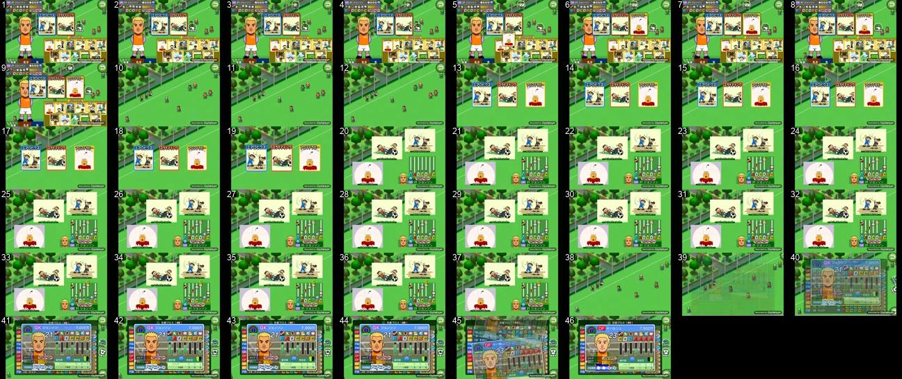

# Treino normal: três cartas de gavetas diferentes, sem combo

Um treino normal com três cartas de três gavetas («エアロビクス» de Physical, «スライディング» de Technical e «アロマテラピー» de Support), que não fazem combo. É o mesmo desenho do [treino com três cartas táticas](../treino-normal-tres-cartas-taticas/README.md), também saltado por um toque: as cartas aparecem juntas e não chegam a virar-se, um corte seco põe as três ilustrações em escada com a mini-ficha, e a nota que sobe salta da fila para cima do ícone. As cartas no campo mantêm a moldura com a cor da gaveta. Do toque em «特訓開始» à ficha são cerca de 3,1 s.

- **Duração:** 4,6 s, 46 frames a 10 fps
- **Origem:** [PiWp6WVzqQA](https://www.youtube.com/watch?v=PiWp6WVzqQA&t=91s), de 91,5 s a 96,1 s, canal エビゼト.
- **Etiquetas:** treino, treino-normal, cartas, tres-cartas, ilustracao, mini-ficha, ganho-atributos, subir-nota, corte-seco

Gravado num telemóvel em 16:10 (576×360), com bandas pretas dos lados para dar 640×360, e uma marca «Recorded by Mobizen» que não é do jogo. É uma versão de 2019: depois do treino volta-se à ficha completa do jogador.

## Frame a frame

- **1–5:** o guarda-redes 21 «ジョンソン» à frente e a gaveta SUPPORT aberta. As duas primeiras cartas (moldura azul e vermelha) já estão em cima; a terceira, de moldura amarela, sobe da gaveta a seguir o dedo.
- **6–9:** as três cartas lado a lado por cima da gaveta, com o botão «特訓開始» à direita.
- **10:** corte seco para o campo de treino vazio.
- **10–12:** o campo vazio, 0,3 s.
- **13:** as três cartas aparecem de uma vez, em fila acima do meio, no tamanho final. Cada uma tem a moldura com a cor da sua gaveta (azul, vermelha, amarela) e o nome em cima.
- **13–19:** as cartas paradas, 0,7 s. Nenhuma se vira.
- **20:** corte seco para o quadro final: a ilustração da primeira carta em cima à direita, a da segunda em cima ao meio, a da terceira em baixo à esquerda, todas do mesmo tamanho e com o nome numa faixa por baixo. A mini-ficha em baixo à direita mostra só as linhas, as letras (A D C D S C) e os ganhos; os ícones ainda não estão.
- **21:** os ícones aparecem já à altura de cada atributo. Os ganhos são «+1», «+4», «+7», «+5» e «+2», um número por atributo, já somados das três cartas.
- **21–32:** tudo parado, 1,2 s.
- **33:** a quarta nota sobe de D para C: a letra «D» some da fila e a nova letra aparece pequena por cima do ícone (o braço), no alto da linha. Fica um buraco na fila.
- **33–37:** parado, à espera do toque. Desde o 20 são 1,8 s.
- **38:** corte para o campo vazio, um frame.
- **39–40:** a ficha completa do jogador entra em fade.
- **41–44:** a ficha completa com a nota nova: «B A D C C S C».
- **45–46:** o jogador desliza a ficha para o jogador seguinte.
