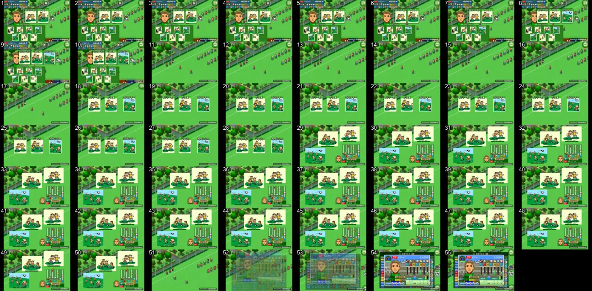

# Treino normal: três cartas táticas, sem combo

Um treino normal com três cartas da gaveta Tactical («マンツーマン», «プレス», «カウンター»), que não fazem combo. As três cartas aparecem juntas, de uma vez, em fila sobre o campo vazio, e não se viram: um corte seco troca-as pelas três ilustrações já pousadas em escada, com a mini-ficha ao lado. Quase de certeza o jogador tocou no ecrã para saltar a volta e as ilustrações grandes; a cerimónia inteira está em [treino-normal-tres-cartas-completo](../treino-normal-tres-cartas-completo/README.md). Há uma ilustração por carta e um só ganho por atributo. Uma nota que sobe de letra salta da fila para cima do ícone. Do toque em «特訓開始» à ficha do jogador são cerca de 4,4 s.

- **Duração:** 5,5 s, 55 frames a 10 fps
- **Origem:** [PiWp6WVzqQA](https://www.youtube.com/watch?v=PiWp6WVzqQA&t=79s), de 79,0 s a 84,5 s, canal エビゼト.
- **Etiquetas:** treino, treino-normal, cartas, tres-cartas, ilustracao, mini-ficha, ganho-atributos, subir-nota, corte-seco

Gravado num telemóvel em 16:10 (576×360), com bandas pretas dos lados para dar 640×360, e uma marca «Recorded by Mobizen» em baixo à direita, que não é do jogo. É uma versão de 2019: depois do treino volta-se à ficha completa do jogador e não à fila.

## Frame a frame

- **1–9:** a fila com o defesa 14 «ピローニ» à frente e a gaveta TACTICAL aberta. As três cartas já estão pousadas por cima da gaveta, lado a lado, com o botão redondo «特訓開始» à direita.
- **10:** o último frame da fila. O jogador toca no botão.
- **11:** corte seco: desaparecem a fila, a gaveta, a ficha curta e os botões. Fica o campo de treino vazio com os bonecos a correr ao fundo.
- **11–17:** o campo vazio, 0,7 s.
- **18:** as três cartas aparecem de uma vez, em fila, um pouco acima do meio do ecrã, já no tamanho final, cada uma com o nome numa faixa verde em cima. Visto a 30 fps: não entram uma a uma, não crescem e não deslizam.
- **18–28:** as três cartas paradas, 1,1 s. Nenhuma se vira.
- **29:** corte seco, sem volta nem clarão: as três cartas dão lugar às três ilustrações, já no sítio e todas do mesmo tamanho (cerca de um terço da largura do ecrã), em escada: a da primeira carta («マンツーマン») em cima à direita, a da segunda («プレス») em cima ao meio, um pouco mais abaixo, e a da terceira («カウンター») em baixo à esquerda. Cada uma tem o nome numa faixa escura por baixo. No canto de baixo à direita aparece a mini-ficha: as sete linhas brancas, as notas em letras (B A D B C S B), o tipo «バランス», a cara, a posição, o número e o nome. A 30 fps, no primeiro frame só há as linhas e as letras, e um frame depois (0,03 s) aparecem os ícones à altura de cada atributo e os ganhos.
- **29–42:** tudo parado. Os ganhos ficam em letra pequena entre os ícones e a fila de letras: «+4», «+3», «+1» e «+2», um número por atributo. Não há um ganho por carta: os das três cartas vêm já juntos.
- **41–43:** a terceira nota sobe de D para C: a letra «D» desaparece da fila (43) e a nova letra aparece pequena por cima do ícone do atributo, no alto da linha (visto a 10 fps a partir de 83,0 s). A fila fica com um buraco no lugar dessa letra. Sem som visível, brilho nem contagem.
- **43–50:** tudo parado com o buraco na fila, 0,8 s, à espera do toque. Desde o 29 são 2,2 s.
- **51:** corte: somem as ilustrações e a mini-ficha, e fica o campo vazio durante um frame.
- **52–53:** a ficha completa do jogador entra em fade, por cima do campo.
- **54–55:** a ficha completa, já com a nota nova: «B A C B C S B».

Comparação com [treino-normal-tres-cartas-completo](../treino-normal-tres-cartas-completo/README.md), sem saltos: lá as três cartas viram-se juntas e cada ilustração sai em grande, uma a uma, antes de abrirem em leque para esta mesma escada. Aqui o toque salta isso tudo e o quadro final vem de uma vez, como o salto com uma carta em [treino-normal-saltar-e-sair-para-mapa](../treino-normal-saltar-e-sair-para-mapa/README.md). Ver também [treino-normal-tres-cartas-mistas](../treino-normal-tres-cartas-mistas/README.md), com três cartas de gavetas diferentes.
