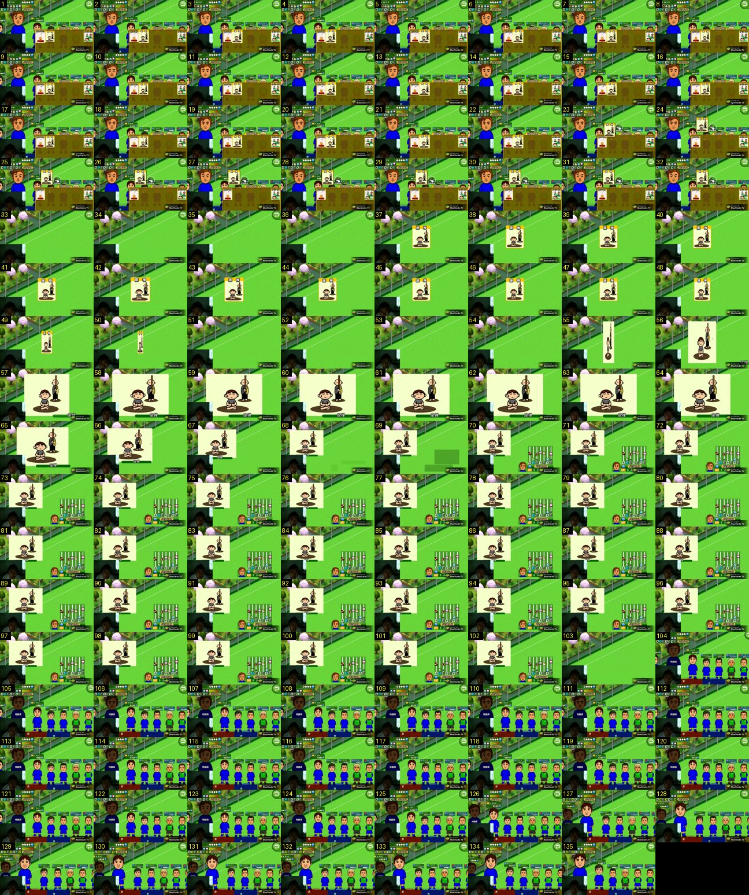

# Treino normal: uma carta, sem combo

Um treino normal com uma só carta («座禅», meditação zen, da gaveta Support). Não há «SPECIAL MENU», favos nem clarão. A carta aparece sozinha sobre o campo vazio, vira-se como uma moeda e do outro lado sai a ilustração do treino em grande. A ilustração encolhe para o canto, aparece a mini-ficha do jogador com os ganhos, e volta-se à fila com o jogador escurecido e marcado «特訓済» (já treinado). Do toque em «特訓開始» à fila são cerca de 7 s, e 3 s disso são a espera pelo toque do jogador.

- **Duração:** 13,5 s, 135 frames a 10 fps
- **Origem:** [CbFU3oY9Al0](https://www.youtube.com/watch?v=CbFU3oY9Al0&t=528s), de 528,0 s a 541,5 s, canal YS Studio 製作
- **Etiquetas:** treino, treino-normal, cartas, carta-vira, ilustracao, mini-ficha, ganho-atributos, ja-treinado, corte-seco

Gravado num emulador (BlueStacks) em 16:9. A cara do youtuber tapa o canto de baixo à esquerda e há um logótipo da gravação em baixo à direita; nada disso é do jogo.

## Frame a frame

- **1–22:** a gaveta SUPPORT aberta, com o médio 8 à frente da fila. O jogador procura a carta.
- **23–24:** a carta «座禅» sobe da gaveta e fica no espaço por cima dela, com o botão redondo «特訓開始» (um apito) à direita.
- **25–32:** a carta pousada. Por volta do 32 o jogador toca no botão.
- **33:** corte seco: desaparecem a fila, a gaveta, a ficha curta e os botões. Fica só o campo de treino vazio, com as cerejeiras.
- **33–36:** o campo vazio, 0,4 s.
- **37:** a carta aparece de uma vez ao centro, um pouco acima do meio, já no tamanho final (moldura amarela, o nome em cima e o desenho). Não se vê escala nem deslize.
- **37–48:** a carta parada, 1,2 s.
- **49–52:** a carta vira-se sobre o eixo vertical: fica cada vez mais estreita até ser uma risca, em 0,4 s.
- **53–54:** nada no ecrã, 0,2 s, o meio da volta.
- **55–57:** do outro lado sai a ilustração do treino, primeiro estreita e alta (55), depois larga (56), e no 57 já é um quadro grande de fundo creme ao centro do ecrã, com uma faixa verde-escura em baixo com o nome «座禅». A volta inteira dura cerca de 0,8 s.
- **57–64:** a ilustração grande, parada, 0,8 s: um rapaz sentado de pernas cruzadas e um monge de pau na mão atrás dele.
- **65–68:** a ilustração encolhe para cerca de metade e desliza para o canto de cima à esquerda, em 0,4 s.
- **69:** um retângulo verde translúcido cresce no canto de baixo à direita (visto a 30 fps: três frames, 0,1 s).
- **70:** a mini-ficha aparece inteira: sete linhas verticais brancas, uma por atributo, com o ícone do atributo à altura do valor, as sete notas em letras por baixo, o tipo, a cara pequena do jogador, a posição, o número e o nome. Ao lado de dois ícones há os ganhos: «+1» e «+6». Os valores já vêm no sítio: os ícones não sobem, as notas não mudam a piscar e não há som de contagem a ver.
- **70–103:** tudo parado, 3,3 s, à espera de um toque. Não há texto do adjunto nem caixa de diálogo.
- **103:** corte: some a ilustração e a mini-ficha, e fica o campo vazio durante um frame.
- **104:** corte seco para a fila. O médio que treinou está à frente, mas escurecido: a pele e o equipamento ficam azul-escuros, como uma silhueta, e no peito tem uma etiqueta branca «特訓済». A ficha curta em cima continua a ser a dele. As gavetas voltam fechadas em baixo.
- **104–125:** a fila parada com ele à frente.
- **126–135:** o jogador desliza a fila e passa ao seguinte, que está normal.

Comparação com o combo ([treino-combo-cartas-special-menu](../treino-combo-cartas-special-menu/README.md)): no combo há fundo de favos, as cartas giram, viram bolas de luz e um clarão revela o «SPECIAL MENU», em cerca de 9 s. No treino normal tudo se passa sobre o próprio campo de treino, numa carta só, sem títulos, em menos de metade do tempo.
