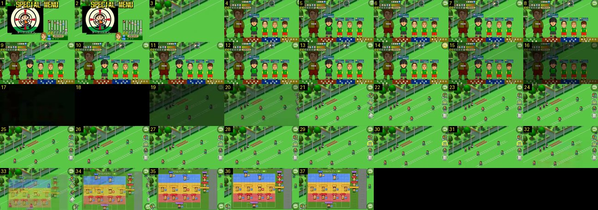

# Treino: do «SPECIAL MENU» à fila, e da fila ao centro de treino

Como acaba um treino especial e como se sai da fila. O «SPECIAL MENU» corta seco para a fila, com o jogador já escurecido. O botão de voltar leva ao centro de treino, onde se pode ir à equipa inicial ou à tática.

- **Duração:** 3,7 s, 37 frames a 10 fps
- **Origem:** [UN9g62Rw7M4](https://www.youtube.com/watch?v=UN9g62Rw7M4&t=196s), de 196,3 s a 200,0 s, canal ぼくくんゲーム
- **Etiquetas:** treino, special-menu, ja-treinado, voltar, centro-treino, fade-preto, botoes-redondos, corte-seco

## Frame a frame

- **1–2:** o fim do «SPECIAL MENU» «ターゲットマン»: a ilustração com o título por cima, e a mini-ficha com os ganhos.
- **3:** corte para o campo de treino vazio durante um frame.
- **4:** corte seco para a fila. O jogador que treinou está à frente, escurecido (equipamento castanho-escuro) e com «特訓済» no peito.
- **4–13:** a fila parada.
- **14:** o botão verde de voltar fica amarelo no toque.
- **15–16:** a fila escurece, em 0,2 s.
- **17–18:** preto, 0,2 s.
- **19–21:** o centro de treino aparece em fade, em 0,3 s.
- **21–23:** os quatro botões redondos entram a rolar pela borda direita.
- **24–29:** o centro de treino, com os bonecos a correr.
- **30:** o botão «スタメン» fica amarelo no toque.
- **33–35:** a janela da equipa inicial (o campo em faixas azul, amarela e vermelha) aparece por cima do centro em fade, crescendo um pouco, em 0,3 s.
- **36–37:** a equipa inicial aberta por cima do centro de treino.
