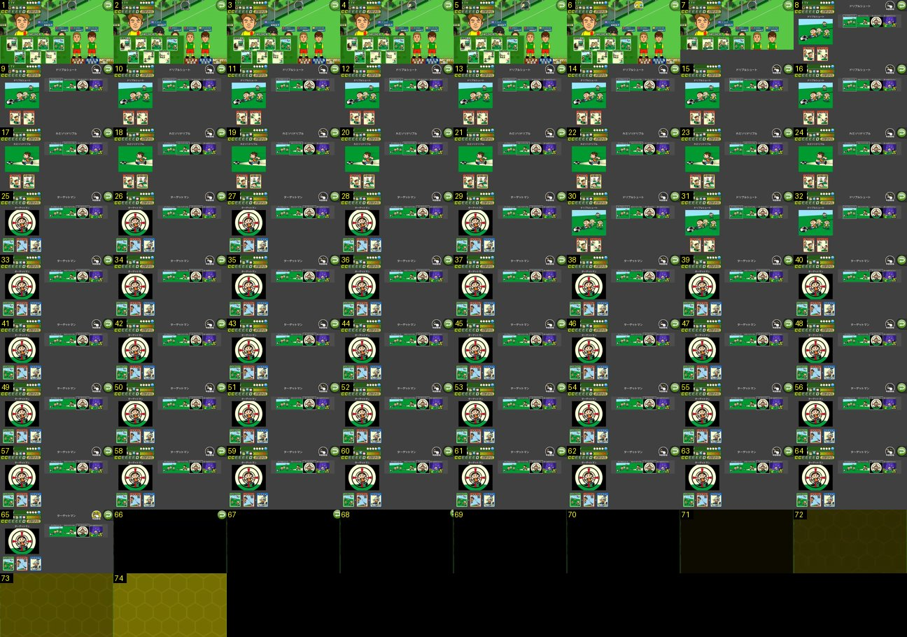

# Treino: a «SPリスト» (lista de treinos especiais)

O botão «SPリスト» abre a lista dos treinos especiais já descobertos. É um ecrã cinzento-escuro com a ilustração do treino escolhido, as cartas que ele pede e uma fila de miniaturas para escolher. Daqui pode-se começar o treino especial diretamente, sem procurar as cartas nas gavetas.

- **Duração:** 7,4 s, 74 frames a 10 fps
- **Origem:** [UN9g62Rw7M4](https://www.youtube.com/watch?v=UN9g62Rw7M4&t=177s), de 177,5 s a 184,9 s, canal ぼくくんゲーム
- **Etiquetas:** treino, special-menu, lista, miniaturas, cartas, botao-redondo, corte-seco, fade-preto

## Frame a frame

- **1–5:** a fila de jogadores com a gaveta TACTICAL aberta.
- **6:** o botão redondo «SPリスト», em cima ao meio, fica amarelo no toque.
- **7:** um frame de passagem: a metade de baixo já está cinzenta e a de cima ainda é a fila.
- **8:** o ecrã da lista, inteiro, num fundo cinzento-escuro liso:
  - em cima à esquerda continua a ficha curta do jogador;
  - em cima ao centro, o nome do treino escolhido («ドリブルシュート»);
  - em cima à direita, o botão «特訓開始» e o botão verde de voltar;
  - à esquerda, a ilustração do treino num quadro, com o nome por cima e, por baixo, as cartas que ele pede, ligadas por «+» e com quantas temos de cada;
  - à direita, uma fila horizontal de miniaturas dos treinos descobertos, com o nome por cima de cada uma. A escolhida tem uma moldura branca, e a mais recente tem a etiqueta «NEW».
- **8–16:** «ドリブルシュート», que pede «ドリブル» + «シュート».
- **17–24:** toque na segunda miniatura: «カミソリドリブル» (ドリブル + イメージトレーニング). A troca é seca, num frame.
- **25–29:** «ターゲットマン», que pede três cartas («カウンター» + «ヘディング» + «ウエイト»), de três cores.
- **30–32:** volta a «ドリブルシュート».
- **33–64:** de novo «ターゲットマン», parado.
- **65:** o botão «特訓開始» fica amarelo no toque.
- **66–71:** corte seco para o preto, 0,6 s.
- **72–74:** o fundo de favos amarelo aparece em fade e a primeira carta («カウンター») aparece. Daqui para a frente é a cerimónia de combo de [treino-combo-cartas-special-menu](../treino-combo-cartas-special-menu/README.md): favos, cartas a girar, bolas de luz e clarão.
