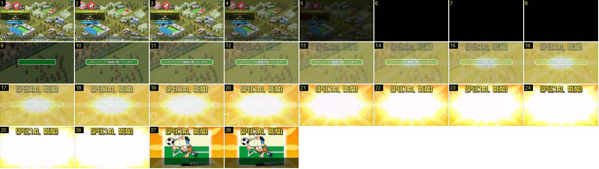

# Treino: «SPECIAL MENU» descoberto

Ao entrar no treino, o jogo avisa que chegou um vídeo do patrocinador e revela uma nova sessão especial de treino com um clarão. É a animação de recompensa mais forte fora do campo.

- **Duração:** 2,8 s, 28 frames a 10 fps
- **Origem:** [8GhUxHFSWD4](https://www.youtube.com/watch?v=8GhUxHFSWD4&t=42s), de 42,6 s a 45,4 s, canal ゲーム動画で行こう! Playing Games.
- **Etiquetas:** treino, special-menu, recompensa, clarao, fade-cruzado, faixa-aviso, raios

## Frame a frame

- **1–5:** o mapa da cidade escurece (fade de 0,3 s).
- **6–8:** preto durante 0,3 s.
- **9:** o campo de treino aparece escurecido (cerca de 60 %), com os bonecos parados. Ao meio surge uma faixa verde de cantos redondos e contorno claro, ainda vazia.
- **10–11:** o texto entra de uma vez: «スポンサーから動画が届いています。» (chegou um vídeo do patrocinador).
- **12–16:** o fundo amarelo e laranja com raios e o título «SPECIAL MENU» (letras amarelas e grossas com contorno preto, ao alto) aparecem em fade cruzado por cima do campo. A faixa verde continua por cima de tudo.
- **14–26:** um clarão branco e oval cresce a partir do centro: pequeno no 14, com metade do ecrã no 20 e branco de ponta a ponta no 25–26. À volta rodam os raios e há silhuetas brancas de bonecos (fantasminhas) espalhadas no fundo. A faixa verde desaparece no clarão por volta do 20–22. O clarão demora cerca de 1,2 s a encher o ecrã.
- **27:** corte seco: aparece a ilustração cómica da sessão (um guarda-redes a afastar a bola) num quadro com moldura branca difusa, sobre o fundo laranja com favos hexagonais. Em baixo há uma faixa escura inclinada com o nome «執念のクリア».
- **28:** a ilustração fica parada. Não há zoom.
- **Depois (45,5 s, fora da sequência):** a barra de diálogo aparece por cima: «スペシャルメニュー「執念のクリア」を発見しました！SPリストにも追加しておきました。», com o ▶ a piscar no canto. Ao toque, o «SPECIAL MENU» desaparece num corte e volta-se ao campo de treino.
