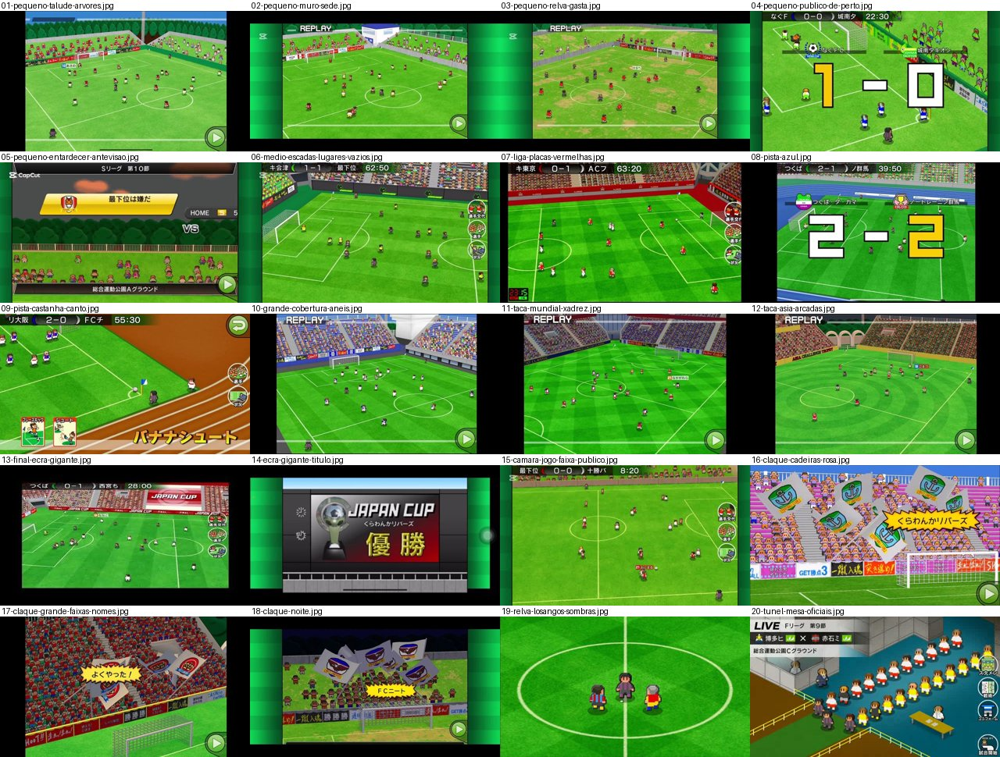

# Cenários do Calciobit A: estádios e campos

Estudo de como o Calciobit A monta os estádios, para redesenhar os pavilhões do Pocket Basketball. Tirado das imagens em [docs/referencias/calciobit](../../calciobit/README.md) e do [catálogo](../../calciobit/catalogo-completo.jsonl). Ver também [camara-e-estilo.md](../../calciobit/camara-e-estilo.md).

**São só referência.** Nada do aspeto do Calciobit entra no jogo. Levamos ideias de estrutura, não desenhos, cores, nomes nem logótipos.

## A ideia de base

- **Mistura de 3D e pixel art.** O estádio e o relvado são polígonos 3D lisos, com linhas brancas finas e suaves. Os jogadores e o público são bonecos de pixel art, sempre virados para a câmara.
- **O relvado manda.** Na câmara do jogo, o relvado ocupa quase todo o ecrã. O estádio é só uma moldura no topo.
- **Pouco pormenor, muita cor.** Cada camada tem uma ou duas cores lisas. O que dá vida são o público e as placas.

## As camadas, de trás para a frente

Proporções medidas em ecrãs de 640×360.

| Camada | O que é | Na câmara do jogo ([15](15-camara-jogo-faixa-publico.jpg)) | Na repetição larga ([10](10-grande-cobertura-aneis.jpg)) | Na câmara da claque ([16](16-claque-cadeiras-rosa.jpg)) |
|---|---|---|---|---|
| Céu | azul liso, às vezes com nuvens desenhadas | não se vê | 0–5 % | 0–30 % |
| Fundo | árvores, prédio do clube, cobertura, poste de luz | não se vê | 0–5 % | 5–10 % |
| Bancada | degraus ou talude, com escadas cinzentas | 0–12 % | 5–30 % | 10–60 % |
| Público | bonecos em filas, nas cores do clube | dentro da bancada | dentro da bancada | dentro da bancada |
| Muro e placas | muro baixo ou fila de placas de publicidade | 12–15 % | 30–35 % | 60–75 % |
| Pista ou margem | faixa entre o muro e o campo | 1–3 % | 3–5 % | quase nada |
| Relva | verde vivo, com riscas, xadrez, losangos ou círculos | 85 % | 65 % | 25 % |
| Linhas | brancas, finas, suaves | por cima da relva | | |

Notas:

- **Na câmara do jogo só se vê uma bancada,** a do lado de lá. A do lado de cá, a de trás da câmara, nunca aparece.
- **Quando a câmara desliza para a diagonal,** a bancada de trás da baliza entra pela direita e sobe ([plano-largo-para-diagonal](../../calciobit/sequencias/jogo-camara/plano-largo-para-diagonal/README.md)).
- **A câmara da claque é baixa e de frente.** Mostra céu, claque, placas e um pouco de relva, com a baliza à frente. É aqui que o estádio se vê melhor.

## Como varia o estádio

### Do pequeno ao grande

| Tipo | Bancada | Muro | Fundo | Imagens |
|---|---|---|---|---|
| Campo de bairro | sem bancada, ou um talude de relva com adeptos de pé, espalhados | muro cinzento baixo ou rede verde | árvores, céu, um poste de luz | [01](01-pequeno-talude-arvores.jpg), [05](05-pequeno-entardecer-antevisao.jpg) |
| Campo pequeno | talude ou 3–4 degraus, público ralo | muro cinzento, placas pintadas à mão | prédio branco do clube, árvores | [02](02-pequeno-muro-sede.jpg), [03](03-pequeno-relva-gasta.jpg), [04](04-pequeno-publico-de-perto.jpg) |
| Estádio médio | degraus de betão com cadeiras de cor, escadas cinzentas, lugares vazios | placas escuras com o emblema do clube repetido | bancada a fechar o canto | [06](06-medio-escadas-lugares-vazios.jpg), [07](07-liga-placas-vermelhas.jpg) |
| Estádio com pista | igual ao médio, mais longe | placas atrás da pista | | [08](08-pista-azul.jpg), [09](09-pista-castanha-canto.jpg) |
| Estádio grande | dois anéis altos, com cobertura branca e vidros, cheio | fila contínua de placas | cobertura e estrutura | [10](10-grande-cobertura-aneis.jpg) |
| Taça internacional | anéis altos, arcadas de tijolo, cheio | placas com o nome da prova, em letra dourada | arcos e árvores | [11](11-taca-mundial-xadrez.jpg), [12](12-taca-asia-arcadas.jpg) |
| Final | bancada cheia de uma só cor | todas as placas com o nome da final | ecrã gigante na bancada | [13](13-final-ecra-gigante.jpg) |

O que muda de um degrau para o outro:

- **Quantidade de público.** Nos pequenos há buracos e adeptos de pé, soltos. Nos grandes não se vê cadeira vazia.
- **Altura da bancada.** De nenhuma a dois anéis. Quanto mais alta, mais ecrã ocupa na repetição.
- **O muro.** Pedra ou betão cinzento, depois placas pintadas, depois placas escuras com o emblema, depois uma fila contínua com o nome da prova.
- **O fundo.** Árvores e céu nos pequenos; cobertura, vidros e estrutura nos grandes.
- **A relva.** Gasta, com manchas de terra, nos campos pequenos ([03](03-pequeno-relva-gasta.jpg)). Lisa ou com riscas na liga. Com xadrez, losangos ou círculos nos grandes e nas taças ([11](11-taca-mundial-xadrez.jpg), [12](12-taca-asia-arcadas.jpg), [19](19-relva-losangos-sombras.jpg)).

### Cada estádio tem a sua marca

- **Cor das cadeiras:** verde, azul, vermelho, rosa, amarelo. As cadeiras vazias mostram essa cor por entre o público ([16](16-claque-cadeiras-rosa.jpg)).
- **Cor da pista:** vermelha, azul ou castanha ([08](08-pista-azul.jpg), [09](09-pista-castanha-canto.jpg)).
- **Cor da margem:** num estádio da liga, o chão à volta do campo é vermelho-escuro ([07](07-liga-placas-vermelhas.jpg)).
- **Um elemento próprio:** arcadas, um prédio do clube, uma cobertura.
- **Nome do recinto:** aparece na antevisão e no túnel, por baixo das equipas ([05](05-pequeno-entardecer-antevisao.jpg), [20](20-tunel-mesa-oficiais.jpg)).

### Luz e hora

- **Dia:** céu azul liso, cores vivas. É o mais comum.
- **Entardecer:** céu cinzento-escuro com nuvens cor de laranja desenhadas ([05](05-pequeno-entardecer-antevisao.jpg)).
- **Noite:** céu azul-escuro quase preto e árvores pretas. O resto escurece um pouco e fica mais frio, mas a relva continua verde e legível ([18](18-claque-noite.jpg)).
- **Estádio fechado:** há pelo menos um, com bancadas cinzentas e luz artificial (só no catálogo, vídeo E_YQWZ21vP8; não há imagem local).
- **Chuva e neve:** não apareceram em nenhuma referência.
- **Fim de época:** no jogo do título a relva está muito gasta e as cores ficam mais quentes ([apito-final-titulo](../../calciobit/sequencias/entrada-saida/apito-final-titulo/README.md)). Não se confirmou se é da época do ano ou do estádio.
- **Holofotes:** só um poste de luz ao longe nos campos pequenos ([01](01-pequeno-talude-arvores.jpg)). Não há feixes de luz nem brilhos.

### Publicidade

- **Placas pintadas, como faixas de adeptos.** Muitas placas são frases de apoio em letra pintada à mão, algumas com o nome de um jogador do plantel («força, Fulano»). Misturam-se com marcas inventadas («SHOOT!», «GET 3 pontos») ([17](17-claque-grande-faixas-nomes.jpg)).
- **Cores fortes e alternadas:** vermelho, preto, branco, amarelo, azul, cada placa diferente da do lado.
- **Placas do clube:** num estádio médio, as placas são escuras e repetem o emblema da casa ([06](06-medio-escadas-lugares-vazios.jpg)).
- **Placas da prova:** nas taças e na final, todas as placas mostram o nome da prova, com o mesmo desenho ([12](12-taca-asia-arcadas.jpg), [13](13-final-ecra-gigante.jpg)).

### Claque e bandeiras

- **O público veste as cores do clube.** A bancada de trás da baliza é da casa. Num jogo, vê-se muitas vezes a cor do adversário também.
- **Bandeiras enormes com o emblema,** brancas, a balançar em arco, só quando a equipa marca. Num golo sofrido, a claque fica quieta e sem bandeiras ([claque-golo-marcado](../../calciobit/sequencias/golo-festejo/claque-golo-marcado/README.md)).
- **Balão de grito amarelo** com o nome do clube ou uma frase.
- **Nos campos pequenos,** os adeptos estão de pé na relva e invadem um pouco o campo no festejo ([04](04-pequeno-publico-de-perto.jpg)).

### Ecrã gigante

- **Na final,** está dentro da bancada, ao lado do campo, e mostra o nome da prova ([13](13-final-ecra-gigante.jpg)).
- **Na cerimónia,** o mesmo ecrã enche a imagem: moldura cinzenta-escura, ícones de relógio à esquerda, taça, nome do clube e a palavra do título em dourado. É verde-claro na liga e cinzento-escuro na taça ([14](14-ecra-gigante-titulo.jpg), [painel-trofeu-liga](../../calciobit/sequencias/entrada-saida/painel-trofeu-liga/README.md)).
- **No jogo normal** não há ecrã gigante. O resultado vai na barra do topo.

## Truques de desenho e de profundidade

- **Perspetiva real, câmara alta.** O campo é um plano 3D com fuga. As linhas convergem, e as riscas da relva também. Isto dá profundidade sem desenhar nada.
- **Bonecos com o mesmo tamanho em todo o campo, ou quase.** Ficam um pouco menores ao fundo, mas pouco. A legibilidade ganha à perspetiva.
- **Sombra oval por baixo de cada boneco.** Uma mancha escura translúcida, sem forma. Cola o boneco ao chão ([19](19-relva-losangos-sombras.jpg)).
- **Contorno escuro de 1 píxel** em todos os bonecos, jogadores e público. A bancada e o relvado não têm contorno.
- **O público é um só boneco repetido.** Cabeça grande, corpo pequeno, camisola da cor do clube, tom de pele a variar. Fica em filas certinhas sobre os degraus. Ao longe são só manchas de cor da cabeça e da camisola.
- **As escadas partem a bancada** em blocos. Isso dá ritmo e mostra a perspetiva dos degraus ([06](06-medio-escadas-lugares-vazios.jpg), [10](10-grande-cobertura-aneis.jpg)).
- **Lugares vazios de propósito:** a cor das cadeiras aparece entre o público e diz quão cheio está o estádio.
- **Relva com padrão de corte suave,** dois verdes muito próximos. Nunca compete com os bonecos.
- **Linhas suaves e finas** contra bonecos de píxel duro. O contraste separa o chão das personagens.
- **Paleta saturada e clara:** verde vivo, azul de céu, vermelhos fortes. Pouco cinzento, exceto no betão e no muro.
- **Animação do público só nos momentos.** Durante o jogo o público quase não se mexe. Nos golos, os bonecos saltam e as bandeiras balançam. As bandeiras são o que mais se mexe.
- **Margens laterais:** em ecrãs mais largos, o jogo enche os lados com faixas verdes às riscas ([02](02-pequeno-muro-sede.jpg)).

## O que levar para o basquetebol

Os nossos pavilhões já são quatro (`Campo do Bairro`, `Pavilhão Escolar`, `Pavilhão Municipal`, `Grande Arena`, em `src/ui/art/court.ts`). As ideias abaixo são para os tornar mais diferentes uns dos outros e mais vivos. São ideias, não decisões: cada uma deve ser confirmada com o utilizador antes de se fazer.

### Camadas de um pavilhão

De trás para a frente, na câmara do jogo:

1. **Parede ou teto ao fundo:** janelas altas no escolar, tijolo e vigas no municipal, escuro com estrutura e luzes na arena.
2. **Bancada do lado de lá,** em degraus, com escadas a partir em blocos. Numa faixa fina no topo, como no Calciobit (10–15 % do ecrã).
3. **Público** em filas, com as cores do clube, e lugares vazios a mostrar a cor das cadeiras.
4. **Fila de placas,** ao nível do campo, em vez do muro.
5. **Mesa de oficiais e bancos,** a meio da linha lateral (ver abaixo).
6. **Margem do campo,** de uma cor própria de cada pavilhão, como a pista do Calciobit.
7. **Soalho** com o padrão de tábuas, e a área pintada.
8. **Linhas.**

### Do bairro à final

| Pavilhão | Bancada | Placas | Fundo | Soalho |
|---|---|---|---|---|
| Campo do Bairro | nenhuma; adeptos de pé atrás da rede, poucos | faixas pintadas à mão presas à rede | prédios, árvores, céu, um poste de luz | alcatrão gasto, como a relva gasta |
| Pavilhão Escolar | 3–4 degraus de madeira retráteis, público ralo | cartazes de papel na parede | janelas altas, tabela de pontos manual | madeira clara, linhas de outros desportos por baixo |
| Pavilhão Municipal | degraus de betão, cadeiras de uma cor, escadas | placas com o emblema da casa repetido | tijolo, vigas, bandeiras penduradas | madeira cor de mel |
| Grande Arena | dois anéis, cheia, cobertura escura | fila contínua de LED | teto escuro, cubo de ecrãs suspenso | madeira polida, com reflexo |
| Taça e final | igual à arena, toda de uma cor | todas as placas com o nome da prova | faixas da prova no teto | logótipo da prova no centro |

### Ideias concretas

- **Cor das cadeiras por pavilhão.** É a forma mais barata de distinguir os pavilhões. Lugares vazios mostram essa cor. O número de vazios sobe e desce com a assistência.
- **Cor da margem por pavilhão,** como a pista vermelha, azul ou castanha do Calciobit.
- **Placas LED com frases dos adeptos.** Misturar marcas inventadas com frases de apoio e o nome de um jogador do plantel. É barato e dá muito carácter. As placas LED podem mudar de mensagem de vez em quando, ou todas ao mesmo tempo num cesto de 3 pontos.
- **Placas da prova nas taças.** Todas iguais, com o nome da taça, para o jogador sentir que é outro jogo.
- **Mesa de oficiais.** Uma mesa comprida a meio da linha lateral, do lado de lá, com dois ou três oficiais sentados e o marcador de faltas. Já aparece uma mesa no túnel do Calciobit ([20](20-tunel-mesa-oficiais.jpg)).
- **Bancos das equipas,** de um lado e do outro da mesa, com os suplentes sentados nas cores da equipa. Mostram as substituições sem interface.
- **Ecrã suspenso,** um cubo no teto da Grande Arena. Durante o jogo pode mostrar o resultado. No título, vira o painel de campeão, como o ecrã gigante do Calciobit ([14](14-ecra-gigante-titulo.jpg)).
- **Uma marca própria por pavilhão:** as janelas altas do escolar, as bandeiras de campeão penduradas no teto do municipal, o cubo de ecrãs da arena.
- **Claque atrás de um cesto,** com tambores e bandeiras do emblema, que só agita as bandeiras quando a equipa marca e fica quieta quando sofre.
- **Câmara da claque** para os cestos importantes: baixa, de frente para a bancada de trás do cesto, com as placas e a tabela à frente.
- **Luz por hora e por tipo:** os campos ao ar livre seguem o céu (dia, entardecer com nuvens cor de laranja, noite). Os pavilhões fechados não têm hora, mas a arena pode ter a luz concentrada no campo e a bancada mais escura.
- **Desgaste:** o campo do bairro com tinta apagada e manchas, como a relva gasta dos campos pequenos.
- **Sombra oval e contorno escuro** em todos os bonecos, jogadores, público e oficiais.
- **O soalho não deve competir com os bonecos:** tábuas em dois tons muito próximos, como o corte da relva.
- **Público parado durante o jogo,** a mexer-se só nos cestos, nos descontos de tempo e no fim. Poupa trabalho e torna os momentos mais fortes.

## Imagens nesta pasta

Todas copiadas de [docs/referencias/calciobit](../../calciobit/). Origem de cada uma:

| Ficheiro | Origem |
|---|---|
| [01-pequeno-talude-arvores.jpg](01-pequeno-talude-arvores.jpg) | `jogo/replay/replay-10.jpg` |
| [02-pequeno-muro-sede.jpg](02-pequeno-muro-sede.jpg) | `jogo/replay/replay-07.jpg` |
| [03-pequeno-relva-gasta.jpg](03-pequeno-relva-gasta.jpg) | `jogo/replay/replay-05.jpg` |
| [04-pequeno-publico-de-perto.jpg](04-pequeno-publico-de-perto.jpg) | `jogo/golo/golo-10.jpg` |
| [05-pequeno-entardecer-antevisao.jpg](05-pequeno-entardecer-antevisao.jpg) | `sequencias/entrada-saida/antevisao-faixas-entram/frame-0006.jpg` |
| [06-medio-escadas-lugares-vazios.jpg](06-medio-escadas-lugares-vazios.jpg) | `jogo/camara-geral/camara-geral-20.jpg` |
| [07-liga-placas-vermelhas.jpg](07-liga-placas-vermelhas.jpg) | `jogo/substituicao/substituicao-03.jpg` |
| [08-pista-azul.jpg](08-pista-azul.jpg) | `jogo/placar-resultado/placar-resultado-06.jpg` |
| [09-pista-castanha-canto.jpg](09-pista-castanha-canto.jpg) | `jogo/habilidade-especial/habilidade-especial-07.jpg` |
| [10-grande-cobertura-aneis.jpg](10-grande-cobertura-aneis.jpg) | `jogo/replay/replay-09.jpg` |
| [11-taca-mundial-xadrez.jpg](11-taca-mundial-xadrez.jpg) | `jogo/replay/replay-01.jpg` |
| [12-taca-asia-arcadas.jpg](12-taca-asia-arcadas.jpg) | `jogo/replay/replay-02.jpg` |
| [13-final-ecra-gigante.jpg](13-final-ecra-gigante.jpg) | `jogo/interface-durante-jogo/interface-durante-jogo-04.jpg` |
| [14-ecra-gigante-titulo.jpg](14-ecra-gigante-titulo.jpg) | `cena/cerimonia-trofeu/cerimonia-trofeu-12.jpg` |
| [15-camara-jogo-faixa-publico.jpg](15-camara-jogo-faixa-publico.jpg) | `sequencias/jogo-camara/plano-largo-para-diagonal/frame-0001.jpg` |
| [16-claque-cadeiras-rosa.jpg](16-claque-cadeiras-rosa.jpg) | `jogo/festejo/festejo-07.jpg` |
| [17-claque-grande-faixas-nomes.jpg](17-claque-grande-faixas-nomes.jpg) | `jogo/adeptos-claque/adeptos-claque-04.jpg` |
| [18-claque-noite.jpg](18-claque-noite.jpg) | `jogo/festejo/festejo-09.jpg` |
| [19-relva-losangos-sombras.jpg](19-relva-losangos-sombras.jpg) | `jogo/entrada-jogadores/entrada-jogadores-08.jpg` |
| [20-tunel-mesa-oficiais.jpg](20-tunel-mesa-oficiais.jpg) | `sequencias/entrada-saida/mapa-para-tunel-live/frame-0030.jpg` |

A `_folha.jpg` junta as 20 imagens. Foi feita com Python e Pillow.
