# Jogos de basquetebol em pixel art: campos e pavilhões

Estudo de como outros jogos desenham o campo, o piso, as paredes, as bancadas e o público.
São só referências de estudo. Nada daqui entra no jogo.

As capturas vêm de páginas públicas (Steam, App Store, itch.io, LaunchBox Games Database).
As grandes foram reduzidas para 1000 px de largura. As pequenas (consolas antigas) foram ampliadas por um inteiro, sem suavizar, para se verem os píxeis.

Notas sobre o rigor:

- O que se diz do piso, das bancadas e da paleta vem das capturas.
- O número de frames do público não se vê numa imagem parada. Quando o indico, é de memória e vai marcado «a confirmar».
- A resolução aparente é uma estimativa a partir do tamanho do píxel na captura.

Os nossos pavilhões têm quatro tipos (rua, escola, municipal, arena; ver `src/ui/art/court.ts`). As recomendações estão escritas a pensar neles.

---

## Hoop Land (Koality Game)

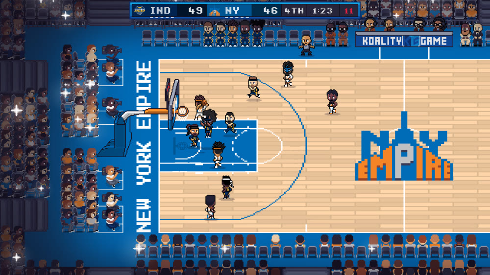
Arena de uma equipa de Nova Iorque: piso de madeira clara, área azul, nome pintado na faixa lateral.
Origem: https://store.steampowered.com/app/2453660/ (captura `ss_ca54ab84…`)

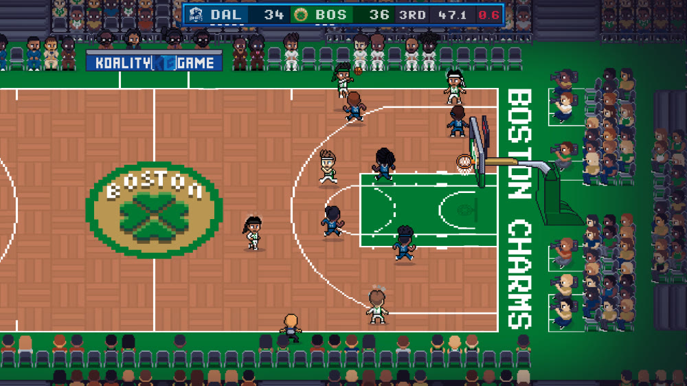
Parquet em espinha, faixas verdes, emblema verde no centro.
Origem: https://store.steampowered.com/app/2453660/ (captura `ss_0de922c6…`)

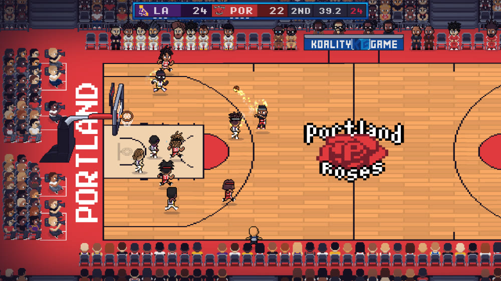
Arena vermelha: o fundo à volta do campo toma a cor da equipa da casa.
Origem: https://store.steampowered.com/app/2453660/ (captura `ss_bf530558…`)

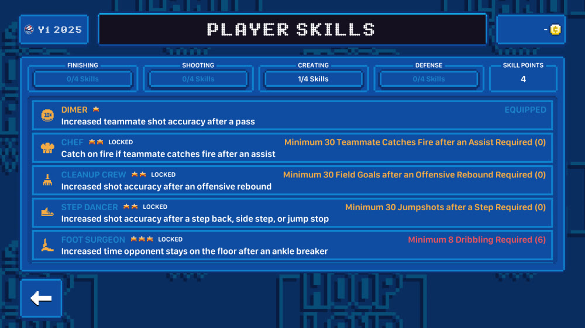
Jogo de seleções: piso claro e um emblema grande no meio.
Origem: https://store.steampowered.com/app/2453660/ (captura `ss_46d1dc3c…`)

- **Câmara:** quase de cima, muito pouca inclinação. O campo cabe quase todo no ecrã. Os bonecos são vistos de lado e de frente ao mesmo tempo.
- **Piso:** tábuas compridas em tons muito próximos (2 a 3 tons de bege). Sem reflexos. As linhas são de 1 píxel lógico, brancas ou da cor da equipa.
- **Identidade da casa:** é aqui que o jogo ganha. Cada equipa tem a sua cor na faixa fora das linhas, o nome em letras enormes ao longo da linha lateral, o emblema no círculo central e a área pintada. Em Boston até o desenho do piso muda (espinha).
- **Bancadas:** filas de cadeiras com encosto, desenhadas em grelha. Há cadeiras vazias à vista, o que dá escala. Fila de cadeiras do banco junto à linha.
- **Público:** cabeças e ombros com muitos tons de pele e cabelo. Fotógrafos agachados atrás da linha de fundo com flashes (estrelinhas brancas). Animação: as cabeças sobem e descem em vagas (a confirmar).
- **Variedade:** pavilhões por equipa, jogos All-Star e de seleções. Não vi rua nem ginásio nas capturas.
- **Paleta:** campo claro e quente, à volta tudo frio (azul escuro) ou na cor da equipa. Contraste forte entre campo e bancada.
- **Resolução aparente:** cerca de 480×270, ampliada.
- **Charme:** o campo «é» da equipa. Os flashes dos fotógrafos. A grelha de cadeiras, que se lê bem mesmo vazia.
- **Para nós, sim:** nome do clube pintado na faixa lateral; faixa fora das linhas na cor do clube; fila de fotógrafos com flash nos jogos grandes; cadeiras vazias visíveis nos pavilhões pequenos.
- **Para nós, não:** a câmara quase vertical. Tira a sensação de 2.5D que queremos.

## Basketball Classics (Namo Gamo, 2019) e Super Basketball Classics (por lançar)

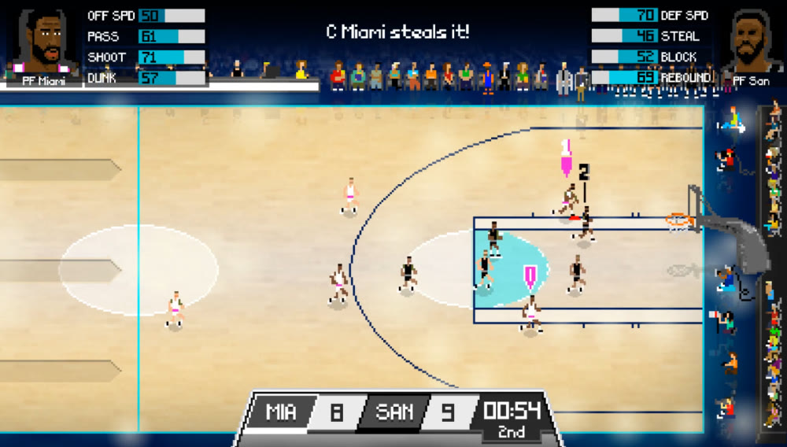
Arena com neblina de luz e reflexo da bancada no piso.
Origem: https://store.steampowered.com/app/819630/ (captura `ss_289fffda…`)

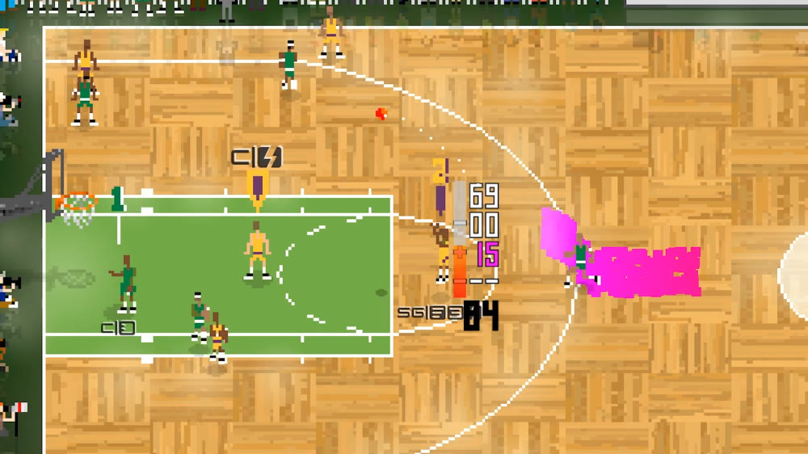
Modo clássico: vista mais alta, parquet em quadrados, cores verdes e roxas.
Origem: https://store.steampowered.com/app/819630/ (captura `ss_e3b8049c…`)

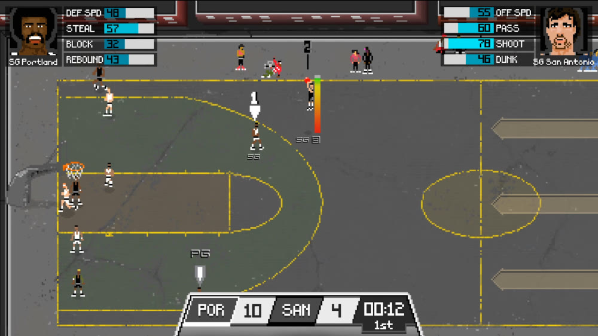
Campo de rua: cimento cinzento com fissuras, linhas amarelas, pintura gasta na área.
Origem: https://store.steampowered.com/app/819630/ (captura `ss_6eb7da5f…`)

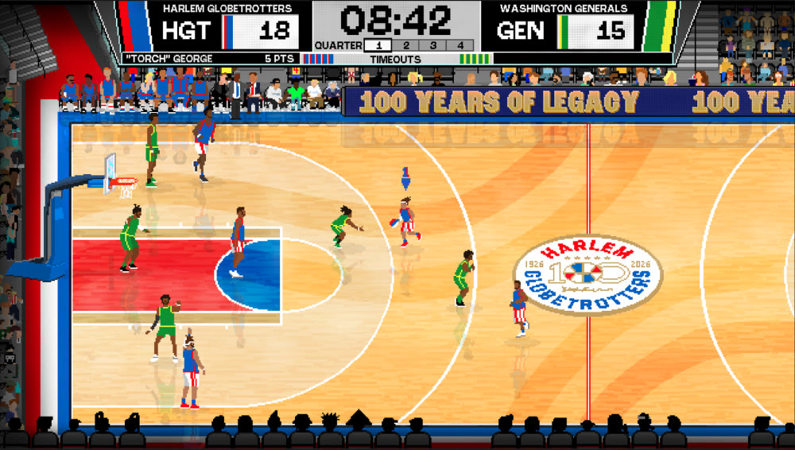
Super Basketball Classics: silhuetas pretas de cabeças em primeiro plano, faixa publicitária refletida no piso.
Origem: https://store.steampowered.com/app/4079160/ (captura `ss_0a0596b0…`)

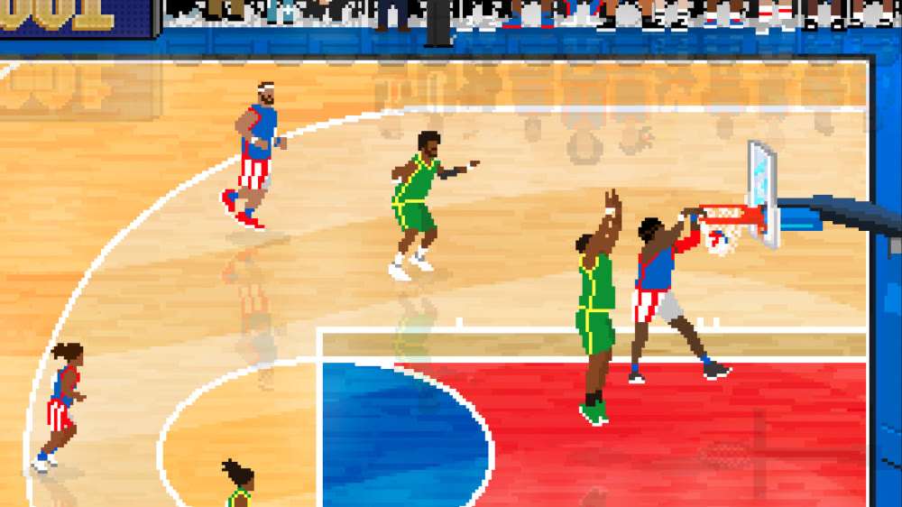
A câmara aproxima-se nas jogadas junto ao cesto.
Origem: https://store.steampowered.com/app/4079160/ (captura `ss_be1e27a9…`)

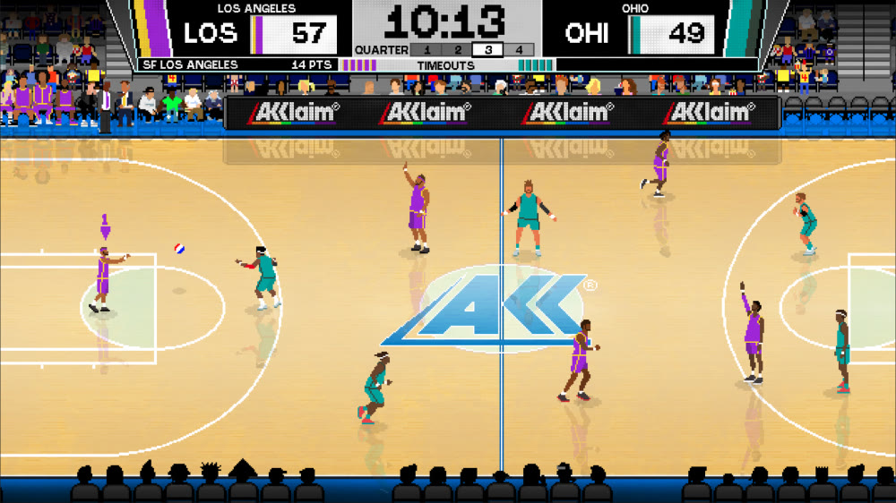
Pavilhão de patrocinador: piso quase branco, emblema grande no centro.
Origem: https://store.steampowered.com/app/4079160/ (captura `ss_02899ceb…`)

- **Câmara:** lateral e alta, com pouca perspetiva. Desliza de um lado ao outro. O Super aproxima nas jogadas perto do cesto.
- **Piso:** madeira com veios largos e manchas mais escuras em curva, como verniz gasto. No Super, a faixa de publicidade e a bancada refletem-se no piso, esbatidas.
- **Paredes e bancadas:** uma fila de público sentado junto à linha. Por trás, filas que se perdem no escuro. Faixa de publicidade comprida por cima da linha lateral de cima.
- **Público:** no Super há duas camadas. Atrás, gente colorida. À frente, silhuetas pretas de cabeças e ombros a tapar a linha de baixo. O primeiro plano dá profundidade sem custo.
- **Variedade:** arena moderna, arena clássica, campo de rua de cimento, pavilhão de patrocinador.
- **Paleta:** madeira quente e saturada. No modo moderno, névoa azul de holofote por cima de tudo.
- **Resolução aparente:** cerca de 640×360 no Super. O original mistura píxeis grandes e efeitos suaves.
- **Charme:** a névoa de luz, o reflexo no piso, e o campo de rua com fissuras e linhas amarelas.
- **Para nós, sim:** silhuetas escuras de cabeças em primeiro plano, na borda de baixo (o nosso «à frente»). Reflexo leve e esbatido das faixas no piso das arenas. Campo de rua com fissuras, linhas amarelas e pintura gasta.
- **Para nós, não:** a névoa por cima do campo inteiro. Tira contraste aos bonecos pequenos.

## Basketball Club Story (Kairosoft)

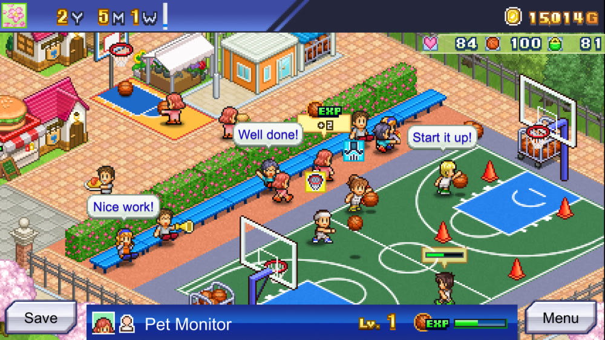
Vista da cidade: campos de treino ao ar livre entre casas, árvores e sebes.
Origem: https://store.steampowered.com/app/2102490/ (captura `ss_5eddf41b…`)

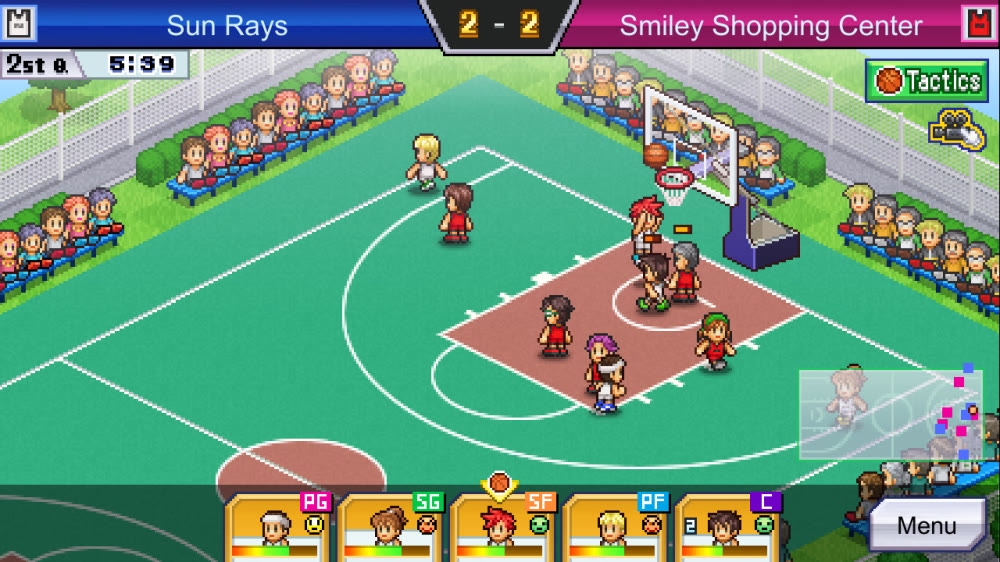
Jogo num campo exterior: piso verde, área cor de tijolo, bancadas baixas atrás de sebes.
Origem: https://store.steampowered.com/app/2102490/ (captura `ss_cd5689ee…`)

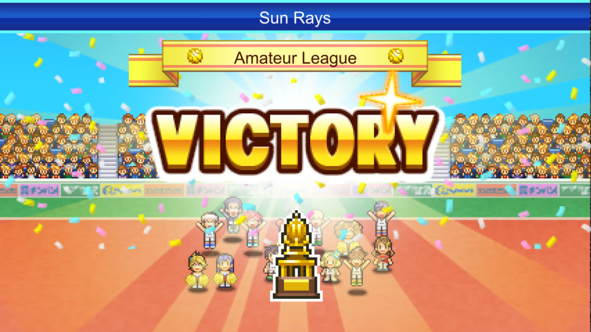
Vitória: bancada cheia ao fundo, confettis.
Origem: https://store.steampowered.com/app/2102490/ (captura `ss_f7f78360…`)

- **Câmara:** isométrica, de três quartos, com o campo na diagonal.
- **Piso:** cores lisas, sem textura (verde e cor de tijolo). As linhas são brancas e grossas. Sem reflexos.
- **Paredes e bancadas:** nos campos pequenos não há paredes. Há sebes, um muro baixo branco, árvores e uma rede. Bancos azuis corridos em vez de cadeiras.
- **Público:** poucos (15 a 25 por lado), todos sentados em fila, com cabelos de cores vivas. Saltam no lugar com 2 frames (a confirmar).
- **Variedade:** o clube começa em campos de bairro e sobe para pavilhões maiores. A cidade inteira é o menu.
- **Paleta:** viva, de tons pastel, com contorno escuro em tudo.
- **Resolução aparente:** arte desenhada a cerca de 2×, ecrã lógico perto de 480×270.
- **Charme:** o público é pouco mas cada pessoa lê-se. O campo de bairro é acolhedor: sebes, cerejeiras, um banco.
- **Para nós, sim:** no pavilhão de rua e da escola, poucos espectadores mas bem desenhados, em bancos corridos. Sebes, muros baixos e árvores à volta do campo de rua. Subir de campo à medida que o clube sobe.
- **Para nós, não:** o piso de cor lisa nos pavilhões grandes. Fica pobre perto da madeira.

## Pocket League Story (Kairosoft, futebol)

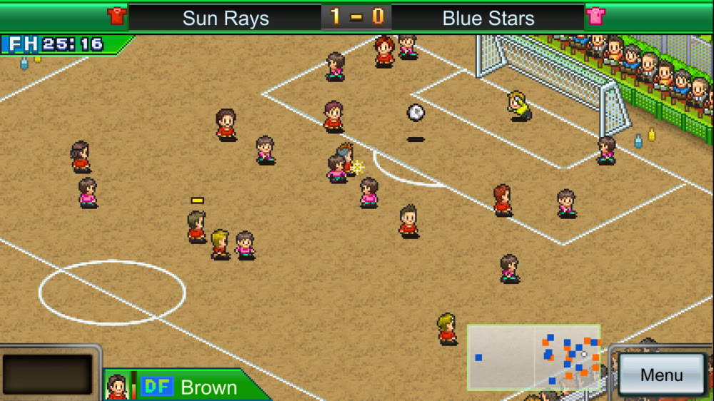
Campo de terra batida, sem bancada, para os primeiros anos.
Origem: https://store.steampowered.com/app/1923690/ (captura `ss_6d1939ad…`)

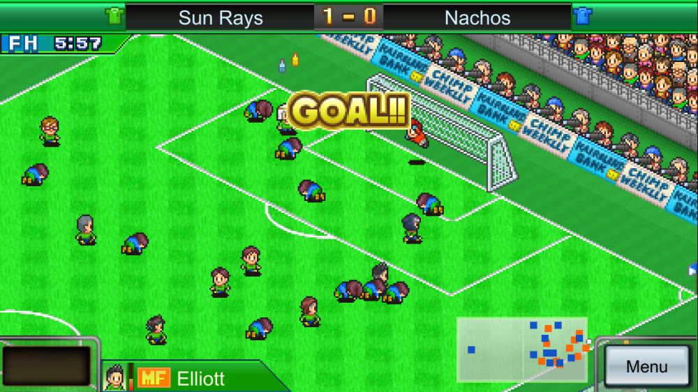
Estádio: relva às riscas, placas de publicidade, fotógrafos e bancada cheia.
Origem: https://store.steampowered.com/app/1923690/ (captura `ss_954e3b50…`)

- **Câmara:** isométrica, igual ao Basketball Club Story.
- **Piso:** relva em xadrez de dois verdes. A terra tem pequenas pedras soltas.
- **Paredes e bancadas:** placas de publicidade em fila, inclinadas, com patrocinadores inventados. Por trás, fotógrafos e bancada em degraus.
- **Público:** filas apertadas de cabeças com muitas cores de cabelo. Lê-se como uma massa, não como pessoas.
- **Variedade:** terra, relva simples, estádio. O campo melhora com o clube.
- **Charme:** a progressão visível. Começa-se na terra e acaba-se no estádio.
- **Para nós, sim:** a progressão de piso como recompensa. Placas de publicidade inventadas ao longo da linha nos pavilhões municipais e nas arenas.
- **Para nós, não:** nada a evitar em especial. Só a câmara isométrica, que não é a nossa.

## Double Dribble (Konami, NES, 1987)

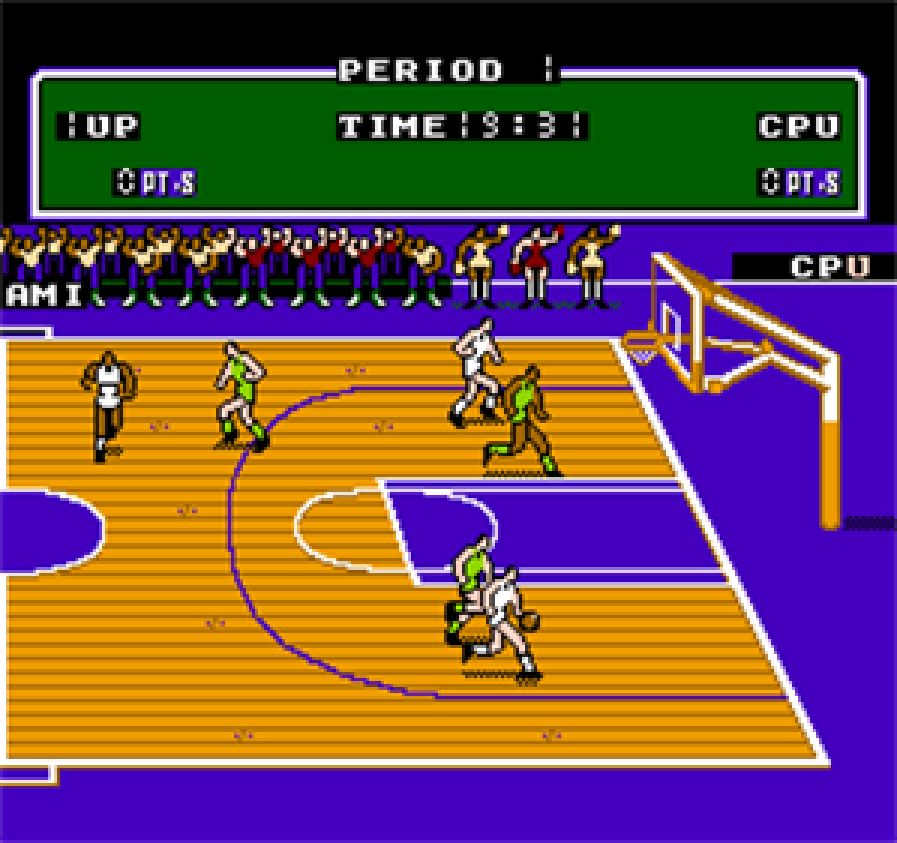
Perto do cesto, a câmara inclina o campo em perspetiva. Tábuas em riscas horizontais.
Origem: https://gamesdb.launchbox-app.com/games/details/325

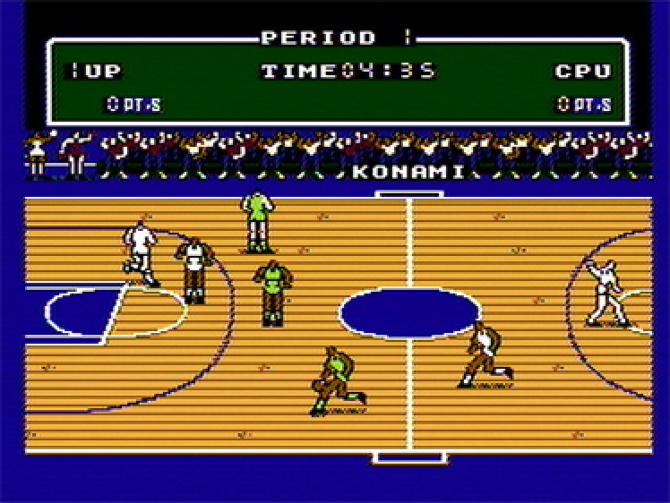
Meio-campo: faixa «KONAMI» por cima do público, cheerleaders na fila da frente.
Origem: https://gamesdb.launchbox-app.com/games/details/325

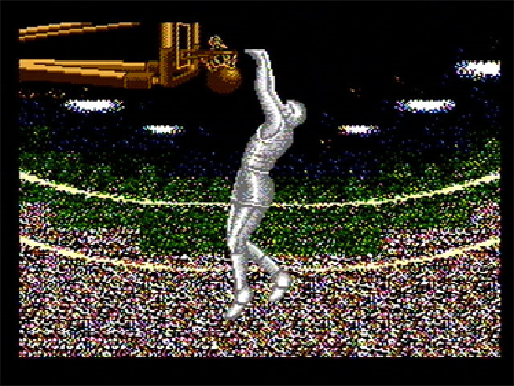
Cena do afundanço: o público vira um tapete de pontos coloridos.
Origem: https://gamesdb.launchbox-app.com/games/details/325

- **Câmara:** lateral, a deslizar. Perto do cesto, o piso corta-se num trapézio, com o cesto de lado. É um falso 2.5D com poucos meios.
- **Piso:** riscas horizontais em dois laranjas, com pequenas manchas de veio espalhadas. Fora das linhas, tudo roxo liso.
- **Paredes e bancadas:** uma fila só de público, em cima, recortada contra o roxo. A faixa da marca por cima.
- **Público:** figuras de braços no ar, repetidas, em 2 ou 3 cores. As cheerleaders agitam os pompons com 2 frames (a confirmar).
- **Cena especial:** no afundanço, o fundo enche-se de pontos coloridos. É uma bancada só de textura, por trás de um boneco grande.
- **Paleta:** a do NES. Laranja, roxo, verde e branco.
- **Resolução:** 256×240.
- **Charme:** pouco detalhe mas leitura imediata. O roxo à volta faz o laranja do campo saltar.
- **Para nós, sim:** fora das linhas numa cor só e forte, para o campo se destacar. Público de fundo feito de pontos de cor nos planos de perto.
- **Para nós, não:** público repetido em carimbo. Com bonecos tão pequenos como os nossos, a repetição vê-se logo.

## NBA Jam (Midway, arcada 1993, e SNES)

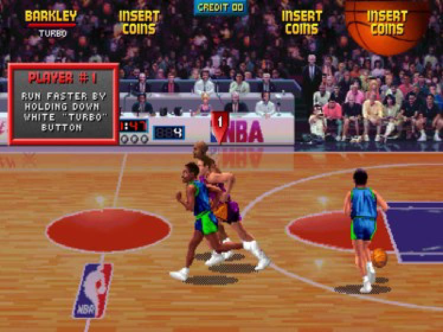
Arcada: público digitalizado de fotografias, mesa de imprensa, círculos vermelhos no piso.
Origem: https://gamesdb.launchbox-app.com/games/details/10554

- **Câmara:** lateral e baixa, um pouco inclinada. Desliza com a bola.
- **Piso:** madeira com reflexo vertical das pessoas e da mesa. Círculos e áreas em cor plana por cima.
- **Paredes e bancadas:** mesa de imprensa contínua com o logótipo da liga. Público em degraus por trás, muito denso.
- **Público:** fotografias digitalizadas, quase paradas. Muito detalhe, pouca vida.
- **Paleta:** fotográfica, com centenas de cores.
- **Resolução:** cerca de 400×254 na arcada.
- **Charme:** o reflexo no piso e a mesa de imprensa.
- **Para nós, sim:** reflexo vertical, curto e escuro, da mesa e da primeira fila no piso das arenas. A mesa de imprensa como peça do lado de cima do campo.
- **Para nós, não:** público fotográfico. Não é pixel art e não liga com os nossos bonecos cabeçudos.

## Arch Rivals (Midway, arcada 1989, e NES)

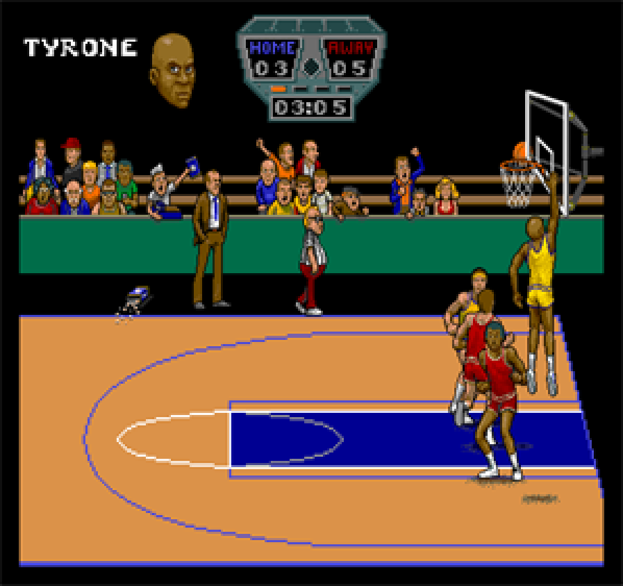
Arcada: público grande e caricatural atrás de um muro verde, treinador e árbitro à beira do campo.
Origem: https://gamesdb.launchbox-app.com/games/details/11623

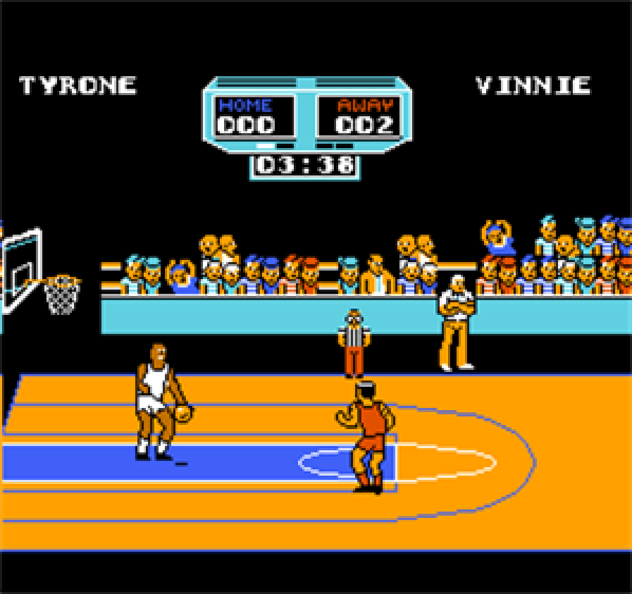
NES: o mesmo esquema com público em blocos e chão laranja liso.
Origem: https://gamesdb.launchbox-app.com/games/details/1559

- **Câmara:** lateral, com o campo cortado em trapézio. A linha lateral de baixo está inclinada.
- **Piso:** laranja liso, sem textura. Linhas finas azuis.
- **Paredes e bancadas:** um muro verde corrido, e por cima uma fila de público grande, desenhado à mão.
- **Público:** poucas pessoas, mas cada uma é uma caricatura: um senhor de boné, outro com um cartaz, um que grita. Animam-se com gestos isolados (a confirmar).
- **Paleta:** viva, com o fundo preto.
- **Charme:** o público tem personalidade. O treinador e o árbitro estão à vista.
- **Para nós, sim:** algumas personagens fixas na primeira fila (o sócio de boné, o miúdo com cartaz, a avó) que voltam jogo após jogo. Treinador e árbitro sempre visíveis à beira do campo.
- **Para nós, não:** fundo preto por cima da bancada. Corta o pavilhão a meio.

## Run and Gun (Konami, arcada, 1993)

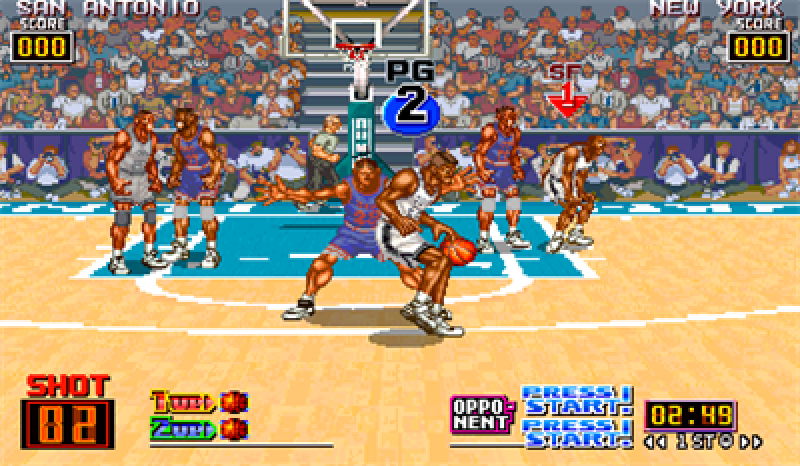
Câmara atrás da linha de fundo: o cesto fica em cima, a bancada inteira no fundo.
Origem: https://gamesdb.launchbox-app.com/games/details/38655

- **Câmara:** atrás da linha de fundo, a olhar para o cesto, com o campo em perspetiva forte. O ecrã muda de lado a cada ataque.
- **Piso:** madeira clara com tábuas finas. A área é azul-turquesa. Sombras redondas sob os bonecos.
- **Paredes e bancadas:** bancada alta que enche o fundo. Fotógrafos na primeira fila. Faixa roxa com publicidade.
- **Público:** centenas de caras pequenas, com algum detalhe. Lê-se como massa.
- **Resolução:** 384×224.
- **Charme:** a sensação de estar dentro do pavilhão.
- **Para nós, sim:** sombras redondas e escuras sob os bonecos, já no piso. A primeira fila de fotógrafos.
- **Para nós, não:** a câmara atrás do cesto. É boa para ação, má para ver a tática, que é o que importa num jogo de gestão.

## Super Dunk Shot / NCAA Basketball (HAL Laboratory, SNES, 1991–1992)

Nota: Super Dunk Shot é o nome japonês do NCAA Basketball da HAL, não da Konami.

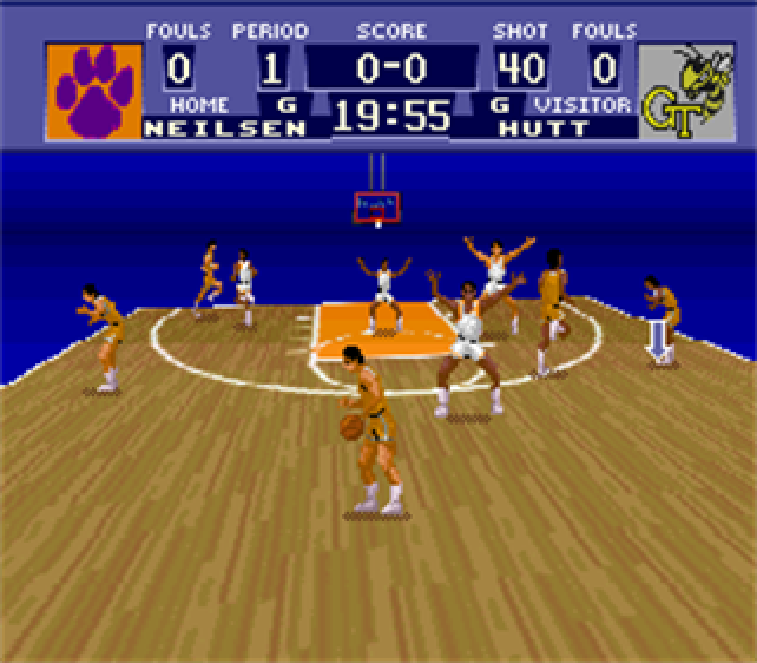
Piso em Mode 7: a madeira gira e encolhe com a câmara atrás do jogador.
Origem: https://gamesdb.launchbox-app.com/games/details/5431

- **Câmara:** atrás do jogador com a bola, em 3D falso (Mode 7). Roda com o ataque.
- **Piso:** tábuas compridas que convergem para o fundo. O piso esbate-se para azul à distância.
- **Paredes e bancadas:** quase nenhumas. O fundo é um degradê azul.
- **Charme:** a novidade técnica na época.
- **Para nós, sim:** só a ideia de escurecer o piso à distância para dar profundidade.
- **Para nós, não:** a câmara a rodar e o pavilhão vazio. Enjoa e não mostra o jogo inteiro.

## Nekketsu! Street Basket (Technōs, Famicom, 1993)

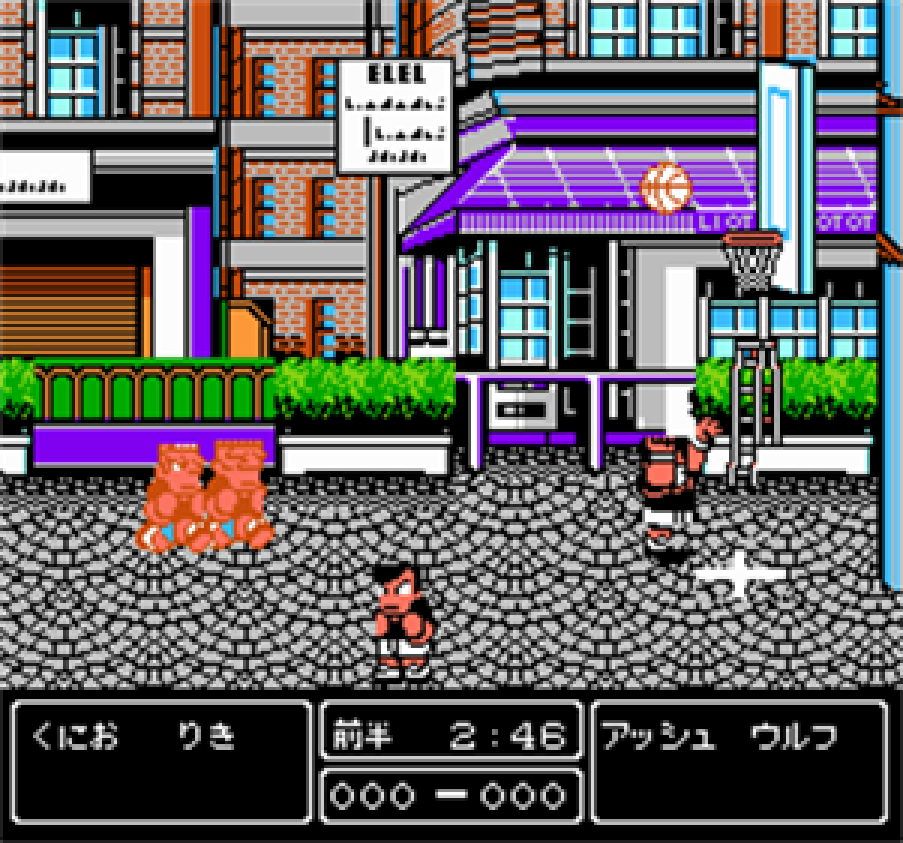
Campo de rua numa cidade: calçada, prédios, uma loja com toldo, um cesto na parede.
Origem: https://gamesdb.launchbox-app.com/games/details/26758

- **Câmara:** lateral e inclinada, como os jogos de luta da série Kunio.
- **Piso:** calçada de pedra com padrão de blocos. Sem linhas de campo.
- **Paredes:** os prédios da rua são a parede. Janelas, um toldo roxo, plantas.
- **Público:** quase nenhum. Os campos são lugares, não estádios.
- **Variedade:** grande. Cada jogo é num sítio diferente (ruas, telhados, sítios com obstáculos).
- **Resolução:** 256×240.
- **Charme:** o campo é um lugar da cidade, com história.
- **Para nós, sim:** no pavilhão de rua, o cenário à volta conta mais do que o público. Prédios, uma loja, um muro com o cesto.
- **Para nós, não:** a falta de linhas. No nosso jogo as linhas explicam as posições.

## Basketbrawl (Atari, 7800 em 1990 e Lynx em 1992)

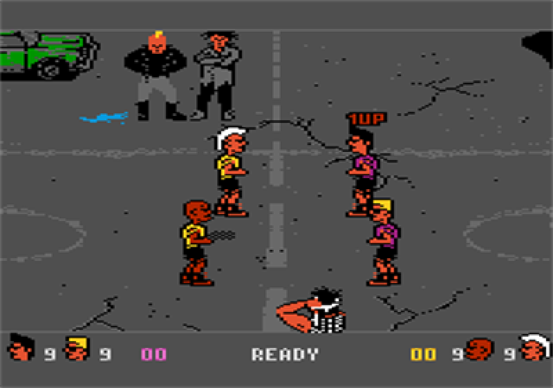
Atari 7800: asfalto cinzento rachado, um carro estacionado.
Origem: https://gamesdb.launchbox-app.com/games/details/20467

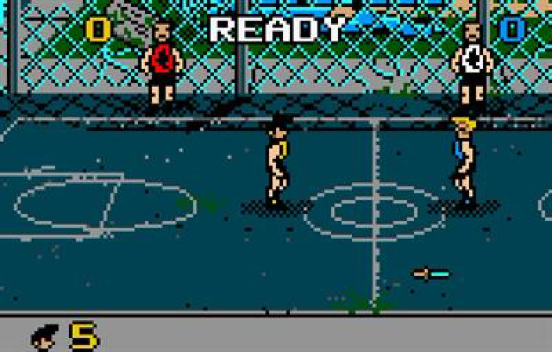
Lynx: vedação de rede ciano, asfalto verde-escuro, linhas pintadas.
Origem: https://gamesdb.launchbox-app.com/games/details/21766

- **Câmara:** de cima, um pouco inclinada.
- **Piso:** asfalto com fissuras pretas. Linhas cinzentas gastas.
- **Paredes:** a vedação de rede é desenhada em losangos, numa só cor clara. Chega para dizer «rua».
- **Paleta:** 3 a 4 cores por zona. Muito escura.
- **Resolução:** 160×102 no Lynx.
- **Charme:** a vedação diz tudo com um padrão só.
- **Para nós, sim:** vedação de rede em losangos, num tom claro, à volta do campo de rua. Fissuras finas e escuras no asfalto.
- **Para nós, não:** a paleta tão escura. Os nossos bonecos perdem-se.

## Retro Bowl College e Retro Goal (New Star Games)

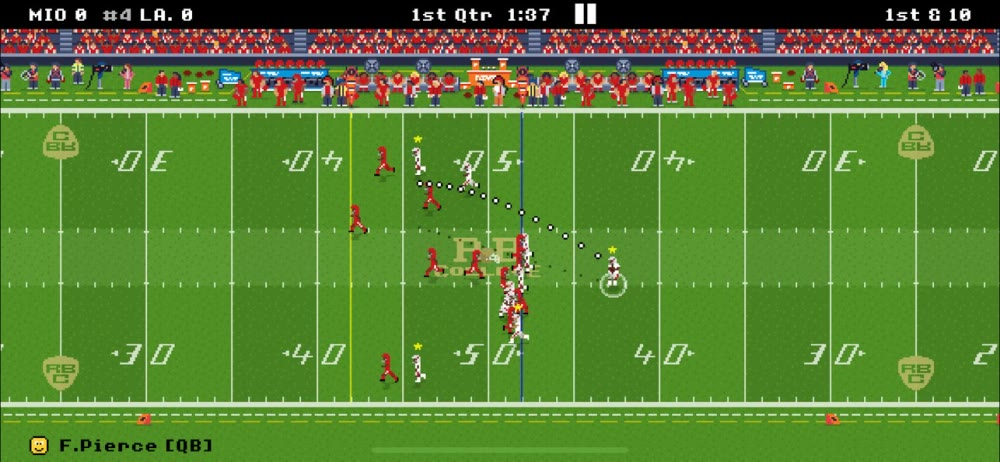
Retro Bowl College: relva às riscas, números pintados no campo, banco e fotógrafos na linha lateral.
Origem: https://apps.apple.com/us/app/retro-bowl-college/id1632904520

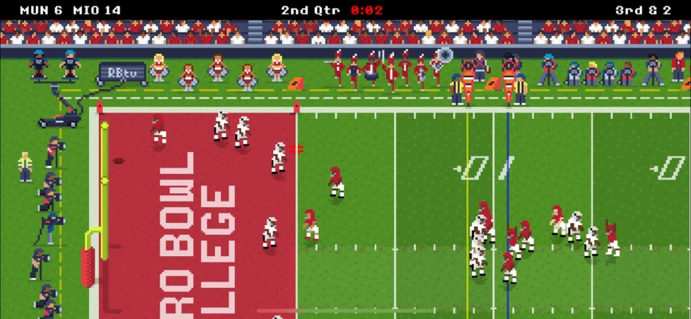
Zona de pontuação pintada com o nome do clube, bancada com a cor do clube.
Origem: https://apps.apple.com/us/app/retro-bowl-college/id1632904520

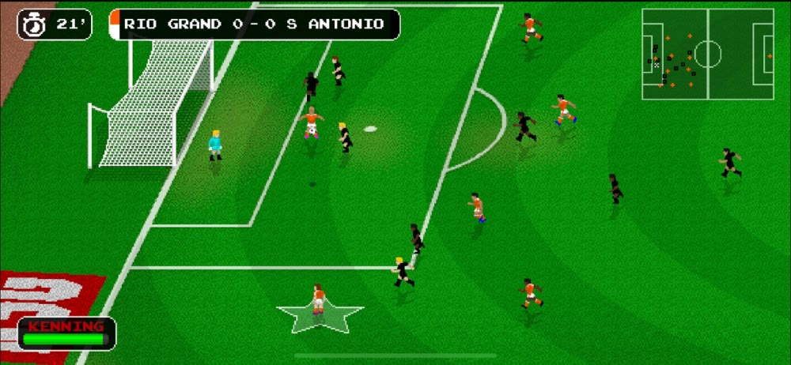
Retro Goal: relva às faixas, poucas linhas, mini-mapa no canto.
Origem: https://apps.apple.com/us/app/retro-goal/id1535765855

- **Câmara:** de lado e alta no Retro Bowl. De cima e na diagonal no Retro Goal.
- **Piso:** relva em faixas de 2 verdes, sem mais nada. Números e emblemas pintados, a meio tom.
- **Bancadas:** uma faixa fina no topo do ecrã. A linha lateral tem o banco, treinadores, fotógrafos e câmaras de TV.
- **Público:** pontos de cor em filas, na cor da equipa da casa. Quase sem detalhe.
- **Paleta:** pouca, limpa, de contraste alto.
- **Resolução aparente:** muito baixa (perto de 400 píxeis de largura), ampliada.
- **Charme:** a beira do campo cheia de vida. O emblema pintado a meio tom no relvado.
- **Para nós, sim:** emblema e nome do clube pintados a meio tom no piso. A beira do campo com banco, mesa e fotógrafos como zona viva. Bancada tingida na cor do clube da casa.
- **Para nós, não:** a bancada reduzida a uma faixa. Nós queremos a bancada como parte do ambiente.

## Super Sidekicks (SNK, Neo Geo, 1992, futebol)

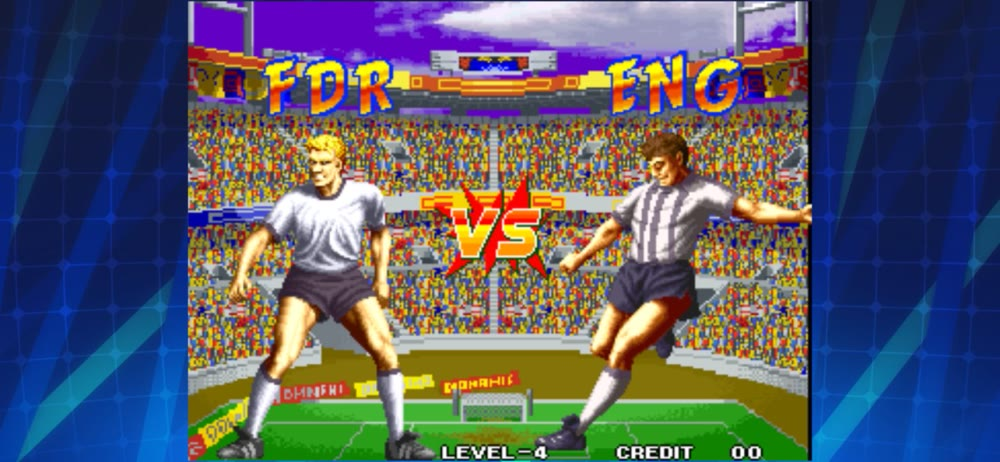
Ecrã de apresentação: estádio cheio com bandeiras e um céu ao pôr do sol.
Origem: https://apps.apple.com/us/app/super-sidekicks-aca-neogeo/id1607800886

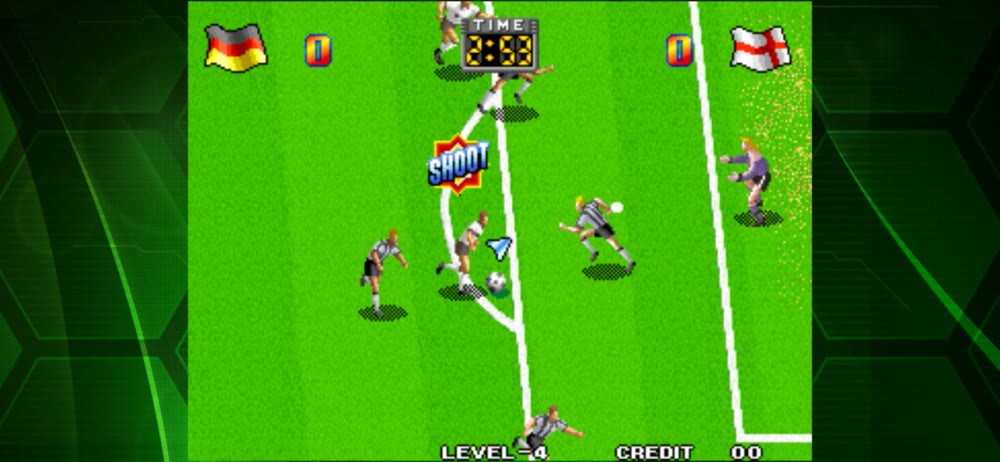
Jogo: câmara vertical e inclinada, relva em xadrez, sombras sob os jogadores.
Origem: https://apps.apple.com/us/app/super-sidekicks-aca-neogeo/id1607800886

- **Câmara:** alta e inclinada, a correr na vertical.
- **Piso:** relva com quadrados de dois verdes, um ruído fino de textura.
- **Público:** no jogo quase não se vê. Só nos ecrãs de apresentação, onde é uma massa colorida com bandeiras.
- **Resolução:** 320×224.
- **Charme:** os ecrãs de entrada com o estádio cheio criam a ocasião.
- **Para nós, sim:** um plano de entrada do pavilhão antes dos jogos grandes, com o público cheio e bandeiras.
- **Para nós, não:** esconder o público durante o jogo.

## Indies do itch.io

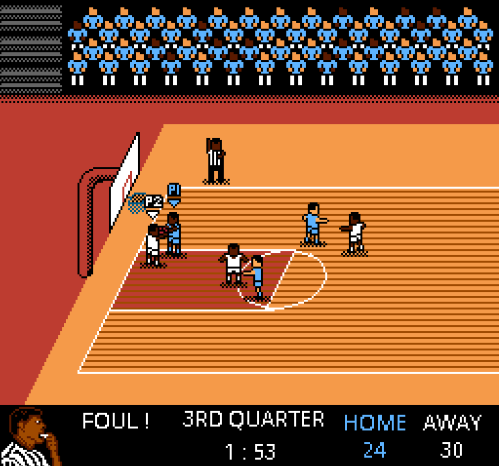
Pacote de recursos ao estilo NES (domínio público): campo em perspetiva com a bancada em cima.
Origem: https://chasersgaming.itch.io/asset-pack-basketball-nes

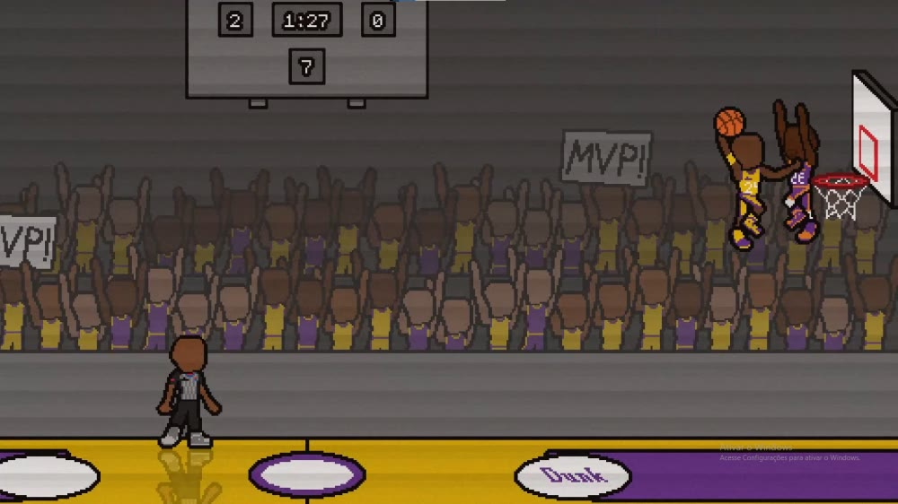
Basketball Takeover: vista lateral, público alto e escuro, cartazes «MVP», reflexo no piso.
Origem: https://rafaelbranco.itch.io/basketball-takeover

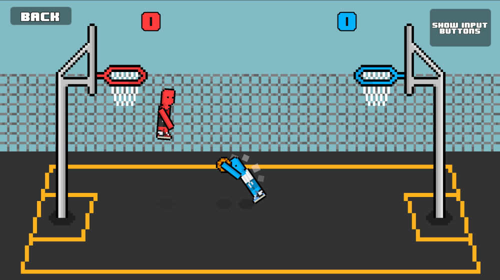
Court Clash: céu azul, vedação de rede, asfalto escuro com linhas amarelas.
Origem: https://simsimco.itch.io/court-clash

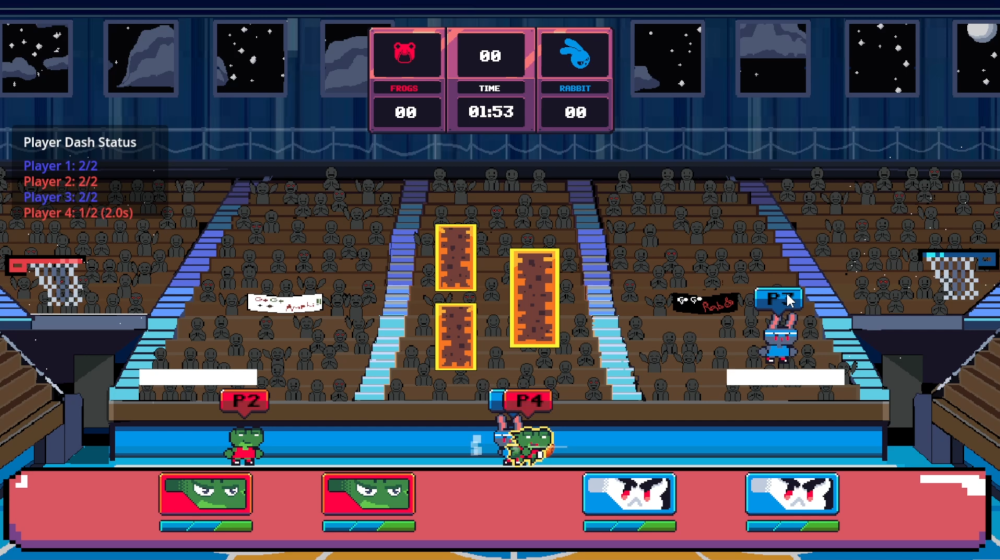
Pixel Dunking: arena vista de cima, bancadas em leque, holofotes em faixas de luz.
Origem: https://deadpixelmg.itch.io/pixel-dunking

- **Chasersgaming:** mostra como se faz uma bancada NES com só um padrão de cabeça repetido em 2 cores. Funciona como fundo distante.
- **Basketball Takeover:** cartazes erguidos no meio do público («MVP»). Uma ideia barata que dá vida.
- **Court Clash:** a rua lê-se com três coisas: céu, vedação e linhas amarelas.
- **Pixel Dunking:** feixes de luz verticais e bancadas em leque dão o ar de arena grande.
- **Para nós, sim:** cartazes erguidos no público, com o nome do clube ou de um jogador; feixes de luz suaves nas arenas.
- **Para nós, não:** usar estes pacotes. São só estudo.

---

## Padrões comuns

1. **O campo é a zona mais clara do ecrã.** À volta, tudo mais escuro ou numa cor forte e lisa. Assim os bonecos leem-se.
2. **O piso tem pouca textura.** Tábuas em 2 a 3 tons muito próximos, ou riscas. Os veios são raros e espalhados.
3. **A identidade está pintada no chão.** Emblema no centro, nome na faixa lateral ou na zona de fundo, cor do clube na área e fora das linhas.
4. **O reflexo, quando existe, é curto, vertical e escuro.** Mostra a mesa, a publicidade ou a primeira fila. Nunca os bonecos.
5. **O público tem camadas.** Fila da frente com detalhe (fotógrafos, banco, treinador, mesa), e atrás uma massa de cabeças com menos detalhe.
6. **A beira do campo é a zona mais viva.** Fotógrafos, câmaras de TV, banco, árbitro, cheerleaders.
7. **O tamanho do pavilhão é uma recompensa.** Os jogos de gestão (Kairosoft, Retro Bowl) começam pequenos e crescem com o clube.
8. **A rua diz-se com poucos sinais.** Vedação de rede, asfalto rachado, linhas amarelas, um prédio ou um carro.

## O que levar para o Pocket Basketball

Por tipo de pavilhão:

- **Rua:** asfalto com fissuras finas, linhas amarelas gastas, pintura apagada na área. Vedação de rede em losangos num tom claro. Um prédio, uma loja ou um carro atrás. Poucos espectadores, de pé, encostados à vedação.
- **Escola:** madeira com tábuas largas e poucos veios. Bancos corridos em vez de cadeiras. Paredes com o emblema da escola pintado. Poucos espectadores, bem desenhados.
- **Municipal:** cadeiras em grelha com lugares vazios à vista. Placas de publicidade inventadas ao longo da linha. Faixa fora das linhas na cor do clube.
- **Arena:** nome do clube pintado na faixa lateral. Emblema grande no centro. Mesa de imprensa e fotógrafos com flash. Reflexo curto e esbatido da mesa e das faixas no piso. Feixes de luz suaves por cima da bancada.

Para todos:

- **Silhuetas escuras de cabeças em primeiro plano**, na borda de baixo do ecrã. Dão profundidade sem desenhar mais nada. Encaixam com o nosso `depthScale` (maiores à frente).
- **Personagens fixas na primeira fila**: três ou quatro adeptos que voltam em todos os jogos em casa. Dão memória ao pavilhão.
- **Cartazes erguidos** no público, de vez em quando, com o nome do clube.
- **Bancada tingida na cor do clube da casa.** Nos jogos fora, a cor muda e o jogador sente que está noutro sítio.
- **Plano de entrada** antes dos jogos grandes, com a bancada cheia.
- **O campo cresce com o clube**, como na Kairosoft. Subir de divisão deve ver-se no pavilhão.

## O que evitar

- **Público fotográfico ou muito detalhado ao fundo** (NBA Jam, Run and Gun). Não liga com bonecos pequenos e cabeçudos, e tira o foco do jogo.
- **Público em carimbo repetido** (Double Dribble). Com bonecos pequenos, a repetição salta à vista. Variar pele, cabelo e roupa.
- **Câmara quase vertical** (Hoop Land) ou **atrás do cesto** (Run and Gun, Super Dunk Shot). A primeira mata o 2.5D. A segunda esconde a tática.
- **Névoa ou brilho por cima do campo inteiro** (Basketball Classics). Tira contraste aos bonecos.
- **Piso com veios fortes ou muito contraste.** Compete com os bonecos e com a bola.
- **Fundos pretos ou vazios por cima da bancada** (Arch Rivals, Super Dunk Shot). O pavilhão parece cortado.
- **Paletas muito escuras na rua** (Basketbrawl). Os bonecos perdem-se.
- **Reflexos dos jogadores no piso.** Custam muito e confundem a leitura da posição.
