# Cenários 2.5D em pixel art: técnicas e referências

Pesquisa para tornar o pavilhão de `src/ui/art/court.ts` mais bonito e com mais charme.
As imagens estão em `imagens/`. Servem só de referência: nada daqui entra no jogo.
Muitas capturas de jogos vêm da Wikipédia inglesa, onde estão como uso justo. Não as copiamos nem as usamos como base.

## O que o nosso campo já faz

Convém saber isto antes de ler as receitas.

- O chão é um plano em perspetiva, desenhado linha a linha, como o Modo 7 da Super Nintendo (`drawScene`).
- O chão tem três níveis de resolução (`floorLevels`) e várias amostras por píxel ao longe, para não haver moiré.
- As bancadas são planos inclinados com uma textura de cadeiras. O público são bonecos por cima, em 5 imagens (`CROWD_FRAMES`).
- A luz do teto está cozida no chão (`lightAt`): o centro de cada meio-campo brilha mais. É um gradiente contínuo.
- A cor escurece por multiplicação (`shade`) e a hora do dia é uma tinta multiplicada (`tinted`). O tom não muda ao escurecer.
- Já há reflexo dos jogadores no chão (`theme.reflection`), flashes no público (`theme.flashes`), poeira de quem sprinta e margens desfocadas.
- Os bonecos crescem à frente e encolhem atrás (`depthScale`).

O que falta é sobretudo luz com intenção: contraste entre o campo e a bancada, cor nas sombras e atmosfera ao longe.

## Jogos de referência

### HD-2D (Octopath Traveler, Triangle Strategy, Live A Live)

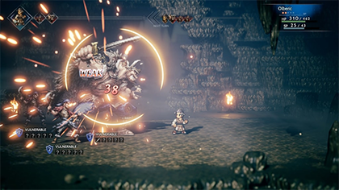
`hd2d-octopath-luz-e-desfoque.png`. Combate com luzes quentes, faíscas e fundo escuro desfocado. Origem: https://en.wikipedia.org/wiki/File:HD-2D_in_Octopath_Traveler.png

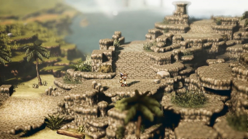
`hd2d-project-octopath-gameplay.jpg`. Cenário de dia: primeiro plano e fundo desfocados, faixa nítida ao meio. Origem: https://en.wikipedia.org/wiki/File:Project_Octopath_Traveler_gameplay_screenshot.jpg

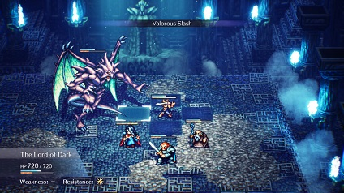
`hd2d-live-a-live-remake.jpg`. O mesmo estilo noutro jogo. Origem: https://en.wikipedia.org/wiki/File:Live_A_Live_remake_screenshot.jpg

- Bonecos 2D em cenário 3D, com luz dinâmica, profundidade de campo e efeito tilt-shift. O resultado parece uma maqueta.
- A faixa nítida é estreita. Tudo o que está muito perto ou muito longe fica desfocado.
- Luz pontual quente perto das personagens, nevoeiro volumétrico e vinheta escura nos cantos.
- Lição para nós: o charme vem do contraste. Zona de jogo clara e nítida, resto escuro e suave.

Fontes: https://en.wikipedia.org/wiki/HD-2D , https://www.unrealengine.com/en-us/developer-interviews/octopath-traveler-ii-builds-a-bigger-bolder-world-in-its-stunning-hd-2d-style

### Modo 7 (F-Zero, Super Mario Kart, Pilotwings)

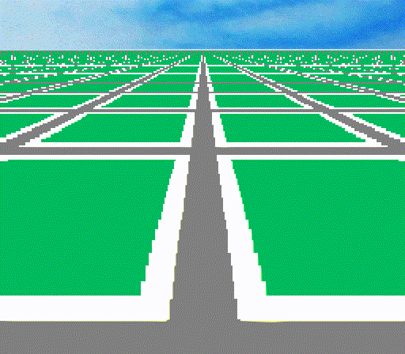
`mode7-plano-de-teste.png`. Uma textura plana posta em perspetiva. Origem: https://commons.wikimedia.org/wiki/File:Mode_7_Test-0000.png

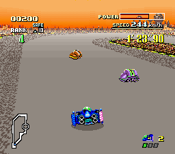
`mode7-f-zero-snes.png`. Pista em Modo 7, cidade em parallax no horizonte. Origem: https://en.wikipedia.org/wiki/File:SNES_F-Zero.png

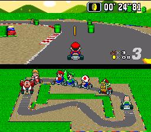
`mode7-super-mario-kart.jpg`. Chão em Modo 7, karts em sprites por cima. Origem: https://en.wikipedia.org/wiki/File:Super_Mario_Kart_screen_shot.jpg

- A consola muda a matriz em cada linha do ecrã. É isso que dá a perspetiva. O nosso `drawScene` faz o mesmo em software.
- O horizonte é sempre uma faixa separada: céu ou cidade em parallax, que só desliza na horizontal.
- Ao longe a textura vira ruído. Os jogos escondiam isso com nevoeiro, horizonte escuro ou texturas com pouco contraste.
- Os karts usam desenhos feitos para poucos tamanhos fixos. Escalar à pressa um boneco pequeno estraga-o.

Fontes: https://en.wikipedia.org/wiki/Mode_7 , https://www.sneslab.net/wiki/Mode_7

### Desporto visto de cima ou inclinado (Tecmo Super Bowl, NBA Jam, Neo Turf Masters, Golf Story, Kairosoft)

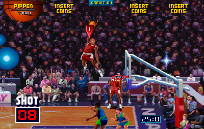
`nba-jam-afundanco-publico.png`. Público denso e escuro, campo claro, brilho em estrela no cesto. Origem: https://en.wikipedia.org/wiki/File:Nba-jam-dunk.png

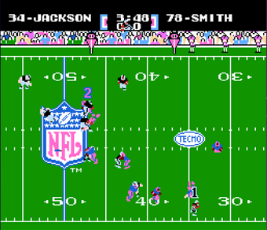
`tecmo-super-bowl-estadio.png`. O público é só uma faixa de pontos de cor no topo. Lê-se como multidão. Origem: https://en.wikipedia.org/wiki/File:Tecmosuperbowl.png

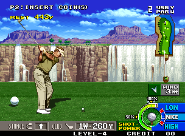
`neo-turf-masters-inclinado.png`. Fundo em camadas com perspetiva atmosférica: o longe é mais pálido e azulado. Origem: https://en.wikipedia.org/wiki/File:NEOGEO_Neo_Turf_Masters_(Big_Tournament_Golf).png

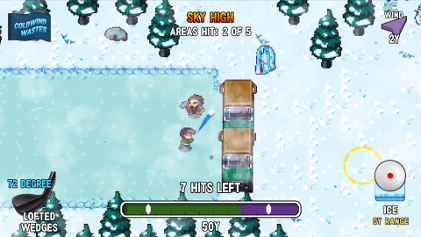
`golf-story-gameplay.jpg`. Pixel art moderna a 16 bits, com sombras suaves e efeitos de ambiente. Origem: https://en.wikipedia.org/wiki/File:Golf_Story_gameplay_screenshot.jpg

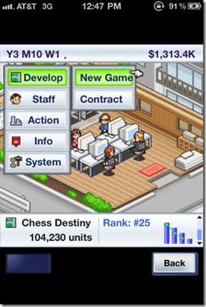
`kairosoft-game-dev-story.png`. Escritório isométrico em miniatura, muito detalhe pequeno e vivo. Origem: https://en.wikipedia.org/wiki/File:GameDevscreen.png

- NBA Jam: a multidão é escura e o campo é claro. O olho vai sempre para o campo.
- Tecmo: com poucos píxeis, uma multidão é ritmo de cor, não pessoas. Linhas de 1 píxel com cores alternadas chegam.
- Golf Story e Sports Story: a crítica destaca efeitos de ambiente, árvores a abanar e multidões de sprites.
- Kairosoft: o charme está em muitos detalhes minúsculos a mexer. Ninguém está parado.
- Sensible Soccer e Super Sidekicks: campo visto de cima, bancada como uma faixa texturada à volta. Não encontrámos capturas livres. Ver a referência do Calciobit em `docs/referencias/calciobit/`.

### Palcos de jogos de luta (Street Fighter III, Garou, The King of Fighters)

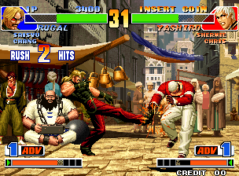
`kof98-palco-com-publico.png`. Público animado à volta do palco, figuras em primeiro plano. Origem: https://en.wikipedia.org/wiki/File:NEOGEO_The_King_of_Fighters_%2798_(The_King_of_Fighters_%2798_-_The_Slugfest_-_The_King_of_Fighters_%2798_-_Dream_Match_Never_Ends).png

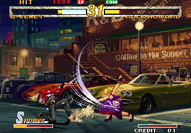
`garou-motw-palco.png`. Rua ao fim do dia, néon, candeeiro aceso, carros com reflexos. Origem: https://en.wikipedia.org/wiki/File:NEOGEO_Garou_-_Mark_of_the_Wolves.png

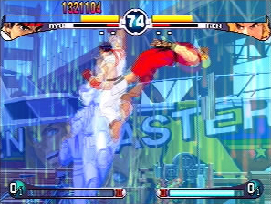
`sf3-2nd-impact-palco.jpg`. Palco com néon e luz colorida. Origem: https://en.wikipedia.org/wiki/File:Street_Fighter_III_2nd_Impact_-_Screeny.jpg

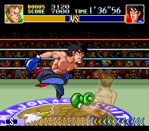
`super-punch-out-publico-ringue.png`. Público em filas escuras à volta do ringue, ringue muito iluminado. Origem: https://en.wikipedia.org/wiki/File:Super_Punch-Out!!_-_Dragon_Chan.png

- O público destes palcos tem 2 a 4 imagens por pessoa. Cada pessoa anda no seu ritmo, por isso nunca saltam todos ao mesmo tempo.
- Há personagens com personalidade: alguém a comer, a dormir, a abanar uma bandeira. Um ou dois por palco chegam.
- A luz conta uma hora do dia: néon, candeeiros, céu ao fim da tarde.
- Super Punch-Out: o ringue é o palco iluminado e o público fica em sombra. É o mesmo truque que queremos.

Fontes: https://www.denofgeek.com/games/the-best-fighting-game-stages-of-the-90s/ , https://www.engadget.com/2014-09-29-scenes-of-calm-and-chaos-artists-on-fighting-game-backgrounds-w.html

### Indies com luz e cor (Sea of Stars, Hyper Light Drifter, Celeste, Eastward)

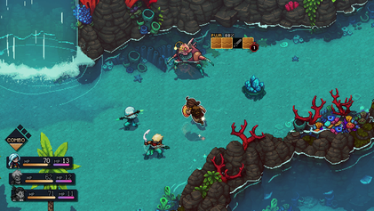
`sea-of-stars-gameplay.png`. Luz dinâmica sobre pixel art, água com brilhos. Origem: https://en.wikipedia.org/wiki/File:Sea_of_Stars_gameplay.png

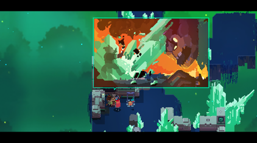
`hyper-light-drifter-cor-e-luz.png`. Paleta limitada e saturada, sombras coloridas em vez de cinzentas. Origem: https://en.wikipedia.org/wiki/File:Hyper_Light_Drifter_Screenshot.png

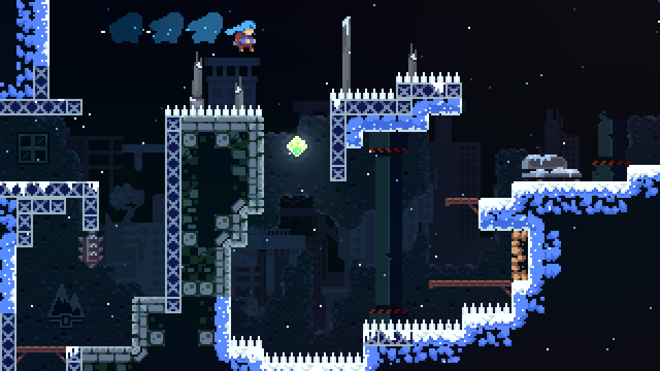
`celeste-luz-e-particulas-02.png`. Origem: https://commons.wikimedia.org/wiki/File:Celeste_screenshot_02.png

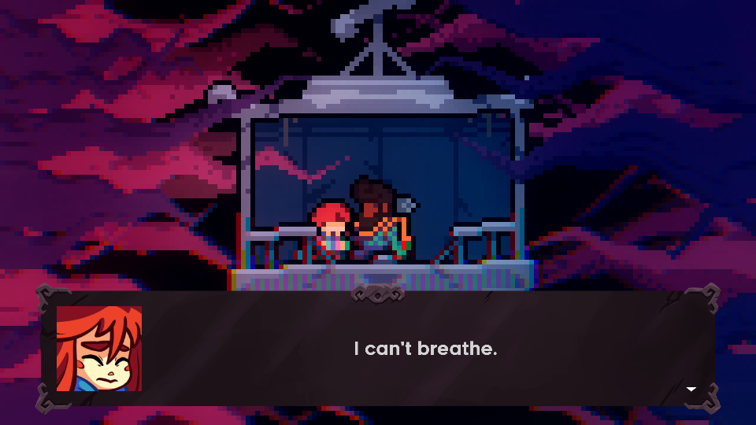
`celeste-luz-e-particulas-03.png`. Fundo roxo escuro, foco quente na cabine. Origem: https://commons.wikimedia.org/wiki/File:Celeste_screenshot_03.png

- Sea of Stars usa um pipeline próprio com luz dinâmica. A luz muda de leste para oeste com a hora.
- Hyper Light Drifter e Celeste: as sombras são roxas ou azuis, as luzes são quentes. Nunca se escurece só para preto.
- Celeste: partículas lentas no ar (neve, poeira) dão vida a cenas paradas.
- Eastward: não há captura livre. Ver a página do jogo para a mistura de luz quente e cenários densos.

Fontes: https://megavisions.net/the-art-of-sea-of-stars-a-sea-of-pixels , https://www.pcgamer.com/sea-of-stars-is-a-gorgeous-retro-rpg-from-the-makers-of-the-messenger

### Pavilhões reais

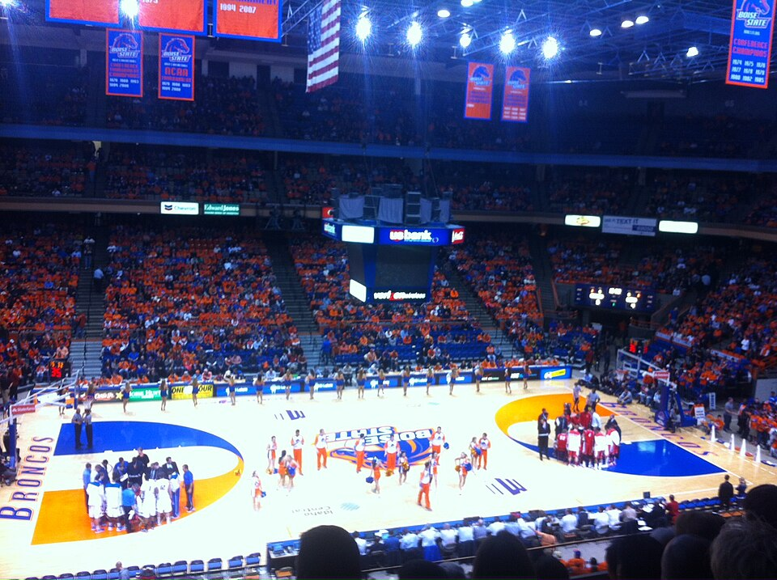
`real-pavilhao-taco-bell-arena.jpg`. Teto escuro com focos, faixas de títulos penduradas, piso brilhante com reflexos, marcador ao centro. Origem: https://commons.wikimedia.org/wiki/File:Boise_State_vs_New_Mexico_Lobos_men%27s_basketball,_Taco_Bell_Arena_Interior_2013.jpg

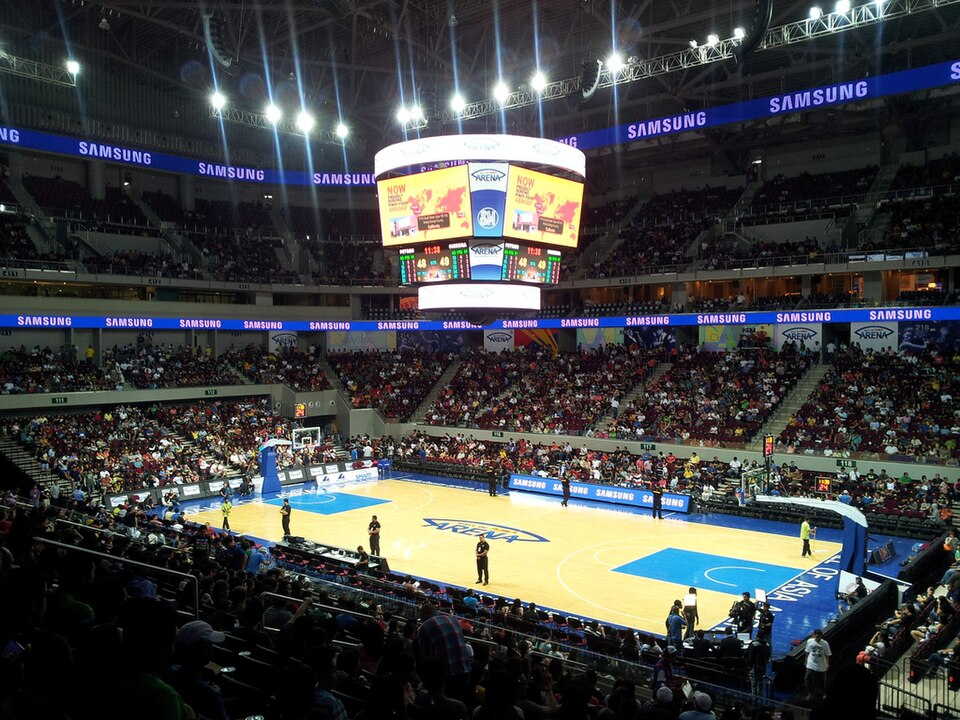
`real-pavilhao-mall-of-asia-arena.jpg`. Origem: https://commons.wikimedia.org/wiki/File:Mall_of_Asia_Arena_Basketball_2012.jpg

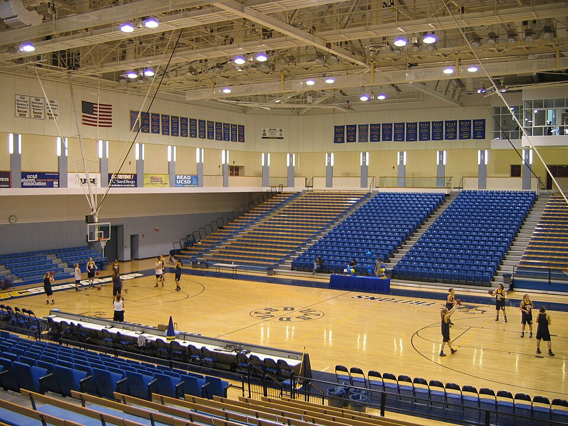
`real-pavilhao-liontree-arena.jpg`. Pavilhão universitário mais pequeno. Origem: https://commons.wikimedia.org/wiki/File:LionTree_Arena_interior,_RIMAC_Sports_Complex,_UC_San_Diego.jpg

- O piso envernizado reflete os focos como manchas alongadas na vertical, não como espelho.
- A bancada de cima perde-se no escuro. O teto quase não se vê, só os pontos dos focos.
- Faixas penduradas, cartazes e o marcador dão identidade ao clube.

### Estádio de arte livre

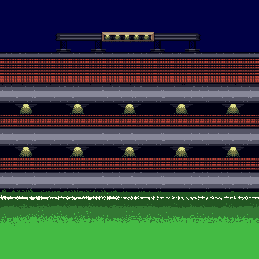
`oga-estadio-16-bits-cc-by.png`. Bancadas em faixas, focos em linha, céu escuro. Licença CC-BY 3.0. Origem: https://opengameart.org/content/stadium-background-16-bit

## Técnicas

### Ordenação de profundidade e escala

- Desenhar de trás para a frente pelo y dos pés. Nós já fazemos isso.
- A escala contínua dos bonecos (`depthScale`) é uma exceção já aceite no AGENTS.md. Atenção ao boneco pequeno: abaixo de certo tamanho, um desenho próprio lê-se melhor do que um encolhido (lição do Super Mario Kart).
- Objetos altos (cesto, poste) cortam os bonecos que passam atrás. O cesto já tem parte de trás e parte da frente.

### Nevoeiro e perspetiva atmosférica

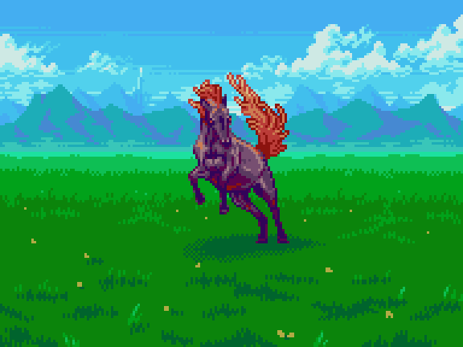
`slynyrd-perspetiva-atmosferica-vale.png`. Cada plano mais longe fica mais claro e mais perto da cor do céu. Origem: https://slynyrd.com/blog/2026/5/27/pixelblog-62-landscape-backgrounds

- Ao ar livre, o longe aproxima-se da cor do céu. Num pavilhão, o longe aproxima-se do escuro do teto.
- O contraste também baixa ao longe. Isso esconde o ruído da textura, como no Modo 7.
- Graveyard Keeper faz nevoeiro com várias camadas horizontais. Os topos altos ficam por cima de menos camadas. Fonte: https://slava.lazybeargames.com/graveyard-keeper-how-the-graphics-effects-are-made

### Iluminação: focos, cones, bloom falso

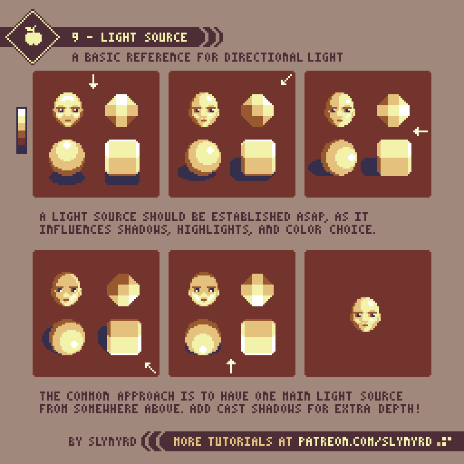
`slynyrd-fonte-de-luz.gif`. A mesma forma com a luz a mudar de sítio. Origem: https://www.slynyrd.com/blog/2018/6/15/pixelblog-6-light-and-shadow

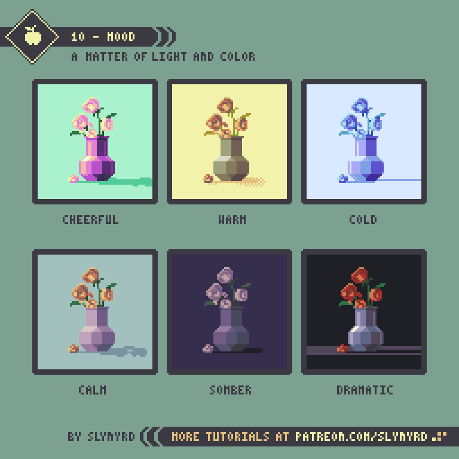
`slynyrd-luz-e-ambiente.png`. A mesma cena com luzes diferentes muda de sentimento. Mesma origem.

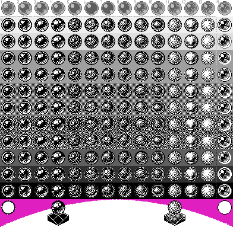
`pixel-art-luz-2-bits-bolas.gif`. Volume com poucas cores, só pela posição do brilho. Origem: https://commons.wikimedia.org/wiki/File:2-bit_pixel_art_balls_ani.gif

- Escolher a fonte de luz primeiro. No pavilhão é de cima: focos no teto sobre o campo.
- Campo claro, bancada escura. O jogador lê melhor a jogada e a cena parece um palco.
- Cone de luz falso: um trapézio de cor um pouco mais clara, com dithering ou poucos degraus, nunca um gradiente suave.
- Bloom falso: um anel de 1 a 2 píxeis de cor intermédia à volta de cada luz. Não precisa de desfoque.
- Graveyard Keeper muda a luz por hora com tabelas de cor (LUT) feitas por um artista. Mesma fonte acima.

### Reflexos no piso polido

- Os pisos de madeira envernizada refletem os focos e as placas como faixas verticais esbatidas (ver fotos reais).
- Nos jogos 2D, o reflexo é um espelho em ecrã: copia-se o que está acima da linha de base, virado, mais escuro e com poucas linhas.
- Basta refletir o que é claro: luzes, placas, marcador. O resto pode ficar de fora.

### Sombras

- Uma mancha escura por baixo dos pés ancora o boneco ao chão. Sem ela, flutua.
- Com vários focos, cada jogador tem várias sombras fracas em estrela. Graveyard Keeper faz até 4 sombras por objeto.
- Ar limpo dá sombras duras. Pavilhão com fumo ou chuva lá fora dá sombras suaves (Slynyrd, Pixelblog 6).

### Dithering

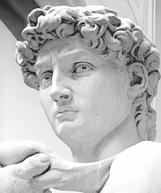 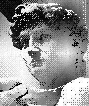 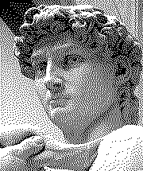
`dither-original-david.png`, `dither-bayer-david.png`, `dither-floyd-steinberg-david.png`. O mesmo gradiente sem dithering, com padrão ordenado (Bayer) e com difusão de erro. Origem: https://en.wikipedia.org/wiki/Dither

- Bayer é ordenado e estável. Não treme quando a imagem muda. É o que serve num jogo.
- Floyd-Steinberg fica bonito parado mas cintila em movimento. Não serve para nós.
- O padrão deve ficar preso ao mundo (texels), não ao ecrã. Senão desliza quando a câmara roda.

### Paletas limitadas e rampas de cor com mudança de tom (hue shifting)

`slynyrd-rampa-de-cor-hue-shift.png`. Uma rampa de vermelhos: ao escurecer vai para o roxo, ao clarear vai para o laranja. Origem: https://slynyrd.com/blog/2018/1/10/pixelblog-1-color-palettes

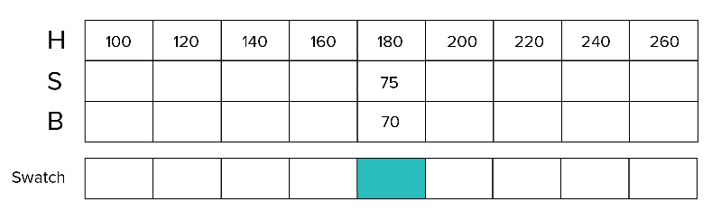
`slynyrd-escalas-de-paleta.png`. Várias rampas lado a lado, mesma lógica. Mesma origem.

`lospec-paleta-sweetie-16.png`. Paleta de 16 cores muito usada. Origem: https://lospec.com/palette-list/sweetie-16

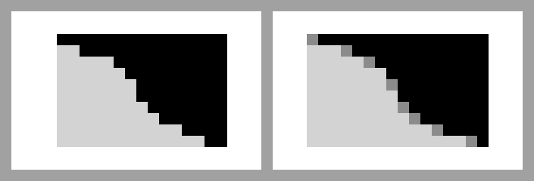
`pixel-art-aa-em-cachos.png`. Píxeis em cachos limpos, com transições à mão. Origem: https://commons.wikimedia.org/wiki/File:Pixel_Art_Anti_Aliasing_in_Clusters_Bigx4.png

- Escurecer multiplicando dá cores sujas e cinzentas. Escurecer rodando o tom para o frio dá cores vivas.
- Regra prática: sombras para azul ou roxo, luzes para amarelo. A saturação sobe no meio da rampa e desce nas pontas.
- Menos cores dão uma cena mais coesa. Poucas rampas partilhadas por todo o pavilhão.

### Parallax

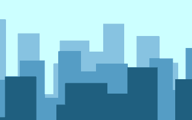
`parallax-camadas-animado.gif`. Origem: https://commons.wikimedia.org/wiki/File:Parallax_scroll.gif

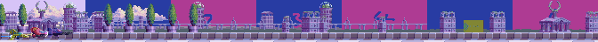
`slynyrd-camadas-parallax.png`. Origem: https://www.slynyrd.com/blog/2023/9/25/pixelblog-46-anti-gravity-racing-scene

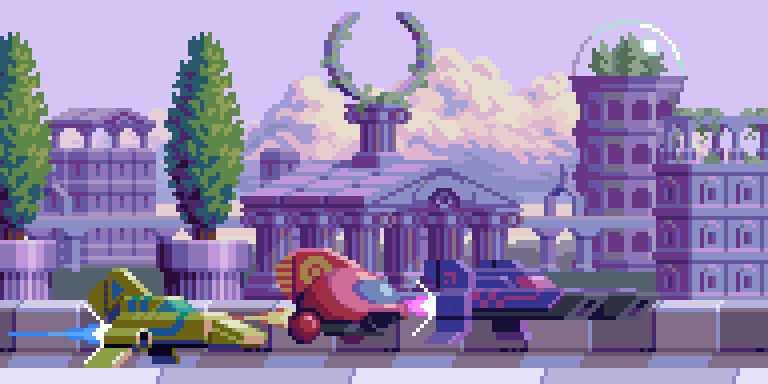
`slynyrd-corrida-parallax-cena.png`. As camadas de longe são mais claras e com menos contraste. Mesma origem.

- O mais perto mexe mais depressa. O longe tem menos contraste e mais cor do ar.
- No nosso pavilhão, as bancadas já são planos 3D, por isso o parallax é verdadeiro. Fica para o fundo: céu, cidade e janelas do campo de rua.

### Animação barata do público

- 2 a 4 imagens por pessoa, cada uma com uma fase própria (já fazemos parecido com as 5 imagens e as pessoas alternadas).
- Onda: uma fase que corre na horizontal pela bancada. Cada boneco levanta-se quando a onda passa pelo seu x.
- Flashes de câmara: 1 píxel branco e uma cruz de 3 píxeis, durante 1 ou 2 imagens. Mais nos jogos grandes e nos momentos decisivos.
- Cartazes, cachecóis e bandeiras: um retângulo de cor por cima da cabeça, a balançar 1 píxel.
- Uma ou duas personagens com piada (alguém a dormir, já existe o `sleeperFan`). Não mais, senão perde a graça.

### Detalhes ambientes

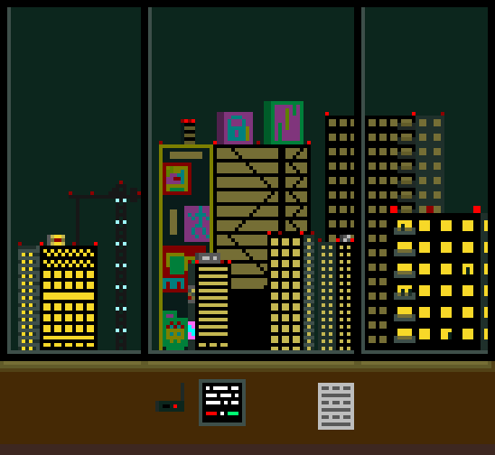
`pixel-art-cidade-de-noite.png`. Janelas acesas em padrão irregular contra o escuro. Origem: https://commons.wikimedia.org/wiki/File:Upscaled_pixel_art_of_a_city_at_night.png

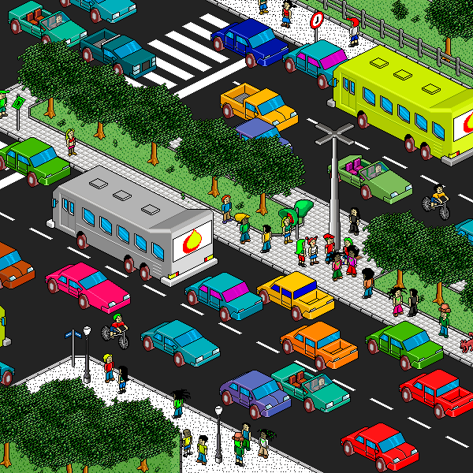
`pixel-art-isometrico-peterson-freitas.gif`. Cena isométrica animada com pequenos detalhes vivos. Origem: https://commons.wikimedia.org/wiki/File:Isometric_Pixel_Art_by_Peterson_Freitas_(enlarged).gif

- Poeira nos cones de luz: poucos píxeis claros a flutuar devagar, só dentro do cone.
- Confettis e serpentinas no fim de um jogo grande.
- Fumo de pirotecnia ou névoa leve no topo dos pavilhões grandes.

### Dia, noite e chuva

- Dia: luz entra pelas janelas e desenha paralelogramos claros no chão.
- Noite: janelas azul-escuras, focos mais fortes, contraste maior entre campo e bancada.
- Chuva: riscos nas janelas, sombras mais suaves, ao ar livre poças que refletem os focos.
- Uma tabela de cor por hora (como as LUT do Graveyard Keeper) dá mais carácter do que multiplicar por uma tinta.

## Formas de construir o cenário

O Modo 7 de hoje não é a única forma de fazer o pavilhão, e cada campo pode usar a sua.
Comparo aqui o que temos com quatro alternativas. Em todas, a arte é gerada por código e escalada por píxeis inteiros.

### 0. O que temos: chão e bancadas em Modo 7

- **No ecrã:** chão em perspetiva verdadeira e bancadas como planos inclinados, amostrados píxel a píxel. A câmara roda e inclina com a bola.
- **Exemplos:** `mode7-super-mario-kart.jpg`, `mode7-f-zero-snes.png`.
- **Câmara e bonecos:** câmara livre, de transmissão. Os bonecos escalam com `depthScale`, o que obriga ao campo suave e às bordas um pouco suaves.
- **Custo:** já está feito. Cada pormenor novo (faixas, focos, janelas) tem de ser uma função do texel, o que torna difícil desenhar coisas com forma, como um marcador ou uma mesa. Há o risco de moiré e de artefactos a arrastar quando a câmara roda.

### 1. Cena isométrica ou inclinada feita de blocos, com o campo inteiro visível (estilo Kairosoft)

- **No ecrã:** o campo inteiro cabe no ecrã, como uma maqueta. Chão em losangos (isométrico 2:1) ou em retângulos vistos de cima e inclinados (como o Tecmo). As bancadas são degraus de blocos à volta, com bonecos pequenos sentados. Todos os píxeis ficam nítidos, sem escala suave.
- **Exemplos:** Game Dev Story e outros da Kairosoft, a peça isométrica do Peterson Freitas, o Tecmo Super Bowl (vista de cima com o público numa faixa).
- **Câmara:** quase não há câmara. Ou fica parada, ou desliza um pouco sem rodar nem fazer zoom. Acabam-se as viragens para o cesto e as inclinações de transmissão.
- **Bonecos:** todos do mesmo tamanho e mais pequenos, com 12 a 20 píxeis de altura. Só precisam de 2 direções desenhadas e espelhadas (isométrico) ou de 4. O `depthScale` deixa de servir. A ordem de desenho passa a ser x+y. O lançamento lê-se pela sombra da bola, já que a altura não se vê bem.
- **Custo por código:** baixo a médio. Um bloco é um losango com 3 faces e 3 tons de uma rampa. O campo, as linhas e as bancadas saem de uma grelha. Cozido uma vez, é só copiar imagens. Desenhar as linhas curvas do campo em isométrico pede cuidado (elipses de píxel). O maior custo é refazer os bonecos noutro tamanho e noutro ângulo, e perde-se o ar de transmissão. Combina bem com um modo «ver o jogo inteiro» ou com os campos pequenos (bairro, escola).

### 2. Fundo pintado em camadas planas com parallax por cima de um chão em perspetiva (o estádio como cenário de teatro)

- **No ecrã:** o chão continua em perspetiva (Modo 7 ou um trapézio fixo). Por trás, em vez de bancadas 3D, há 3 a 5 painéis planos pintados de frente: placas, primeira fila, bancada, bancada alta no escuro, teto com focos. Cada painel desliza na horizontal a uma velocidade própria. Parece um cenário de teatro com bastidores.
- **Exemplos:** o horizonte do F-Zero e do Super Mario Kart, os fundos do Neo Turf Masters, as camadas do Slynyrd.
- **Câmara:** pode seguir a bola na horizontal e subir ou descer um pouco. Não pode rodar muito: com a câmara virada para o cesto, os painéis não rodam e o truque nota-se. O zoom tem de ser em múltiplos inteiros ou não existir.
- **Bonecos:** em campo ficam como hoje, com escala pela profundidade. O público passa a ser pintado no painel, com 2 a 4 imagens por painel, ou bonecos pequenos presos ao painel. As bancadas dos topos ficam de fora ou passam a ser painéis de lado.
- **Custo por código:** baixo. Cada painel é uma imagem desenhada uma vez (filas, cadeiras, focos, faixas), com pormenor livre, porque é desenho 2D de frente e não uma função do texel. Fica muito mais fácil pôr marcador, mesa, faixas e luzes com halo. Perde-se a perspetiva verdadeira das bancadas e os topos do campo. É uma boa escolha para pavilhões grandes vistos de lado.

### 3. Vista lateral de transmissão, com a bancada em camadas e parallax (estilo NBA Jam e jogos de luta)

- **No ecrã:** câmara baixa e de lado. O chão é uma faixa larga e pouco inclinada em baixo, com a bancada em pé por trás, como um muro de gente. Há público em primeiro plano, à frente da câmara, desfocado ou escuro. A cena parece um palco de jogo de luta: muita gente, muita cor, muito movimento.
- **Exemplos:** NBA Jam (cesto grande, público denso por trás), palcos do KOF e do Garou, o ringue do Super Punch-Out.
- **Câmara:** desliza na horizontal ao longo do campo e faz zoom em degraus inteiros nos momentos fortes. Não roda. Num campo de 28 m, a câmara anda de cesto a cesto e mostra cerca de metade do campo.
- **Bonecos:** maiores, com 32 a 48 píxeis, e quase do mesmo tamanho à frente e atrás (escala em 2 ou 3 degraus, ou nenhuma). Ganham pormenor e animação, mas ler a posição dos 10 jogadores fica mais difícil. Pede um minimapa ou um esquema tático por cima.
- **Custo por código:** médio. Bancada em 3 camadas (filas da frente, meio e cima) com parallax, público de 2 a 4 imagens com fases próprias, e silhuetas no primeiro plano. Tudo é desenho 2D de frente, fácil de fazer por código. O custo grande está nos bonecos, que teriam de ser refeitos maiores, e na leitura tática do jogo de gestão.

### 4. Híbrido: sprites de cenário pré-desenhados colocados no mundo 3D como billboards

- **No ecrã:** chão em Modo 7, como hoje. O pavilhão é feito de peças desenhadas de frente e colocadas no mundo: blocos de bancada com público, marcador suspenso, mesa dos oficiais, bancos, câmaras de TV, fotógrafos, faixas, focos. Cada peça é projetada com `camera.project` e escalada com a profundidade, como os bonecos. É a ideia do HD-2D e dos canos do Super Mario Kart.
- **Exemplos:** HD-2D (personagens e adereços 2D num mundo 3D), os canos e objetos do Super Mario Kart, e a foto do pavilhão real como lista de peças a desenhar.
- **Câmara:** pode continuar a rodar e a inclinar como hoje. As peças estão viradas para a câmara e, com rotações pequenas, não se nota. Rotações grandes mostrariam que são planas. Se for preciso, desenhar 2 ou 3 ângulos por peça.
- **Bonecos:** não mudam. As peças entram na mesma lista ordenada por profundidade, por isso os jogadores podem passar à frente da mesa ou atrás de um fotógrafo.
- **Custo por código:** médio. Cada peça é uma função que desenha num canvas uma vez, como os bonecos. Já temos o público em bonecos por cima da textura (`sideFanSpot`), por isso é um passo natural. A escala contínua deixa as peças com bordas suaves, a mesma exceção já aceite para os bonecos. Para poupar, cada peça pode ter 3 ou 4 tamanhos pré-desenhados, escolhidos pela profundidade. Os riscos são o custo por imagem com muitas peças e a ordenação das peças grandes, como um bloco de bancada que fica ao mesmo tempo à frente e atrás de alguém.

### Comparação

| Forma | Campo inteiro visível | Câmara de transmissão | Bonecos atuais servem | Pormenor fácil (marcador, faixas) | Custo |
|---|---|---|---|---|---|
| 0. Modo 7 atual | não | sim | sim | difícil | feito |
| 1. Isométrico de blocos | sim | não | não (mais pequenos) | fácil | médio (bonecos novos) |
| 2. Teatro com parallax | não | só na horizontal | sim | fácil | baixo |
| 3. Lateral de transmissão | não | só na horizontal e zoom | não (maiores) | fácil | alto (bonecos novos) |
| 4. Híbrido com billboards | não | sim | sim | fácil | médio |

**Leitura:** a forma 4 é a que mais charme acrescenta sem deitar nada fora, e pode crescer peça a peça.
A forma 2 é a mais barata para pavilhões grandes vistos de lado. A forma 1 serve para campos pequenos ou para um modo de ver o jogo inteiro.
Como cada campo pode usar a sua forma, uma divisão pode ser um campo de rua isométrico e outra um pavilhão em Modo 7 com peças. O que tem de se manter igual são o tamanho dos bonecos e a leitura da jogada, ou a mudança de campo vai parecer outro jogo.

## Receitas para o court.ts

Ideias concretas para o nosso renderizador. Não há código no jogo. Todas respeitam o AGENTS.md: tudo gerado por código, sem imagens, e a arte continua em píxeis inteiros (só o campo já tem a exceção da escala suave).
Qualquer uma passa pelo agente revisor do skill visual-design.

### 1. Luz do teto em degraus com dithering Bayer

- **No ecrã:** em vez de um gradiente liso, a luz no chão cai em 3 ou 4 degraus, com uma margem de pontos entre eles. Lê-se como pixel art, não como foto.
- **Como:** em `courtTextures`, quantizar o valor de `lightAt` para poucos níveis. Escolher o nível com um limiar Bayer 4×4 indexado pelo texel (i, j). Fica preso ao mundo e é cozido uma vez.
- **Custo e risco:** zero por imagem. Ao longe, os níveis de `floorLevels` fazem a média dos pontos e voltam a ser liso, o que é o que queremos. Risco de moiré perto se o padrão tiver menos de 2 píxeis de ecrã: verificar com `browser-check` em 640×360.

### 2. Sombras frias, luzes quentes (hue shifting)

- **No ecrã:** os cantos escuros do campo e as filas de trás ficam azul-arroxeados, o centro do campo fica creme-dourado. Cores vivas em vez de cinzentas.
- **Como:** trocar `shade(c, k)` na cozedura por uma função que, além de multiplicar, mistura um pouco de azul/roxo quando k < 1 e um pouco de amarelo quando k > 1. Usar duas cores por tema (`shadowHue`, `lightHue`), definidas como `tint`.
- **Custo e risco:** só na cozedura. Risco de mudar a leitura das cores dos clubes: limitar a mistura a 10–20 %.

### 3. Palco e plateia: campo claro, bancada a escurecer para cima

- **No ecrã:** a primeira fila vê-se bem, as de cima perdem-se num escuro quente. O teto passa a quase preto com pontos de luz.
- **Como:** em `buildWall`, escurecer a bancada com a altura z mais do que hoje (`crowd.dim` e o `fade` por fila). No teto, preencher com quase preto e uma grelha de focos de 1–2 texels. Os bonecos do público (desenhados por cima) usam o mesmo fator por fila.
- **Custo e risco:** cozido. Risco: num pavilhão pequeno de dia, ficar demasiado escuro. Ligar ao tema (`ambient`) e à hora.

### 4. Focos com halo (bloom falso)

- **No ecrã:** cada foco do teto e cada placa luminosa tem um anel suave à volta. Dá brilho sem desfoque.
- **Como:** ao cozer a parede, à volta de cada texel de foco pintar 1–2 texels de uma cor intermédia entre a luz e o fundo, em cruz ou diamante. Nada em tempo real.
- **Custo e risco:** cozido. Como a parede é amostrada sem filtro, o halo pode sumir ao longe. Aceitável.

### 5. Cones de luz sobre o campo

- **No ecrã:** quatro feixes pálidos descem dos focos até ao campo, nos pavilhões grandes ou à noite.
- **Como:** desenhar, depois de `drawScene` e antes dos bonecos, trapézios projetados com `camera.project` a partir de pontos do mundo (foco no teto, elipse no chão). Pintar com padrão Bayer de 25 % numa cor clara, preso ao ecrã mas com vértices em píxeis inteiros. Ou cozer o pé do cone no chão, como uma mancha mais clara com dithering.
- **Custo e risco:** poucos polígonos por imagem. O padrão em ecrã pode parecer deslizar quando a câmara roda (ver a memória sobre artefactos que arrastam). Preferir o pé do cone cozido no chão e uma versão discreta do feixe.

### 6. Nevoeiro ao longe (perspetiva atmosférica)

- **No ecrã:** o topo do campo e as bancadas do fundo ficam um pouco mais escuros e menos contrastados que os da frente. Mais profundidade e menos ruído.
- **Como:** em `drawScene`, o `floorT` é igual em toda a linha do chão. Calcular um fator de nevoeiro por linha e misturar com a cor do nevoeiro do tema. Para as paredes, usar `hit` e uma tabela de 16 degraus em vez de uma curva contínua. Misturar em degraus de 1/8 para não criar cores novas sem fim.
- **Custo e risco:** uma mistura por píxel nas paredes. Barato. A cache `lastScene` mantém-se. Risco de lavar as cores ao longe: força baixa, maior só nos pavilhões grandes.

### 7. Reflexo do pavilhão no piso envernizado

- **No ecrã:** as placas de publicidade e os focos aparecem esbatidos no chão, em faixas verticais curtas, por baixo da bancada.
- **Como:** depois de desenhar o chão, para cada coluna, nas N linhas logo abaixo da base da parede, misturar a cor do píxel espelhado acima da base (reflexo em ecrã). Força dada por `theme.reflection`. Só misturar quando a cor de cima é clara (luminância acima de um limiar). Decair por linha com uma tabela.
- **Custo e risco:** N×largura misturas por imagem. Com a bancada inclinada (`slope > 0`), o espelho em ecrã não é exato, mas para faixas curtas não se nota. Risco de reflexo do público, que fica feio: limitar às placas (z < `BOARD_HEIGHT`).

### 8. Sombras em estrela dos focos

- **No ecrã:** cada jogador tem uma sombra principal escura nos pés e 2–4 sombras fracas, curtas, em direções diferentes. Lê-se logo como pavilhão com vários focos.
- **Como:** junto ao `drawReflection` em `match-view.ts`, desenhar elipses achatadas deslocadas para cada foco, com padrão Bayer de 25 % em vez de transparência. Usar a posição dos focos do tema.
- **Custo e risco:** 4 elipses por jogador. Barato. Risco de sujar o campo: só nas divisões de cima, e força baixa.

### 9. Onda do público e cartazes

- **No ecrã:** num momento de festa, uma onda corre pela bancada lateral. Em jogos grandes, alguns adeptos levantam cartazes ou cachecóis.
- **Como:** nos bonecos do público (`sideFanSpot`, `endFanSpot`), calcular uma fase pelo x: levantar quem está perto da frente da onda, que avança uns metros por segundo. Cartaz: um retângulo de 4×3 píxeis nas cores do clube por cima da cabeça, a oscilar 1 píxel.
- **Custo e risco:** barato. Deve respeitar `reducedMotion`. Risco de distrair da jogada: só em tempos mortos ou depois de cestos grandes.

### 10. Flashes de câmara melhores

- **No ecrã:** em vez de manchas, pequenas estrelas brancas de 1 píxel com cruz de 3, que duram 1–2 imagens. Mais flashes atrás do cesto num afundanço.
- **Como:** nos flashes já existentes (`theme.flashes`), desenhar a forma em cruz e concentrar a probabilidade perto do x da jogada. Alinhar a píxeis inteiros.
- **Custo e risco:** quase nenhum. Risco de cintilar demais: limite de flashes por segundo.

### 11. Faixas e marcador pendurados

- **No ecrã:** faixas verticais com as cores do clube e anos de títulos penduradas da bancada lateral do fundo. Dão identidade a cada casa.
- **Como:** cozer na textura da parede, na zona alta da bancada lateral, retângulos com o emblema e a cor do clube (já há `banner` e `emblemCanvas`). Número de faixas pelos títulos do clube, se a interface tiver esse dado.
- **Custo e risco:** cozido. A textura muda por clube, mas já é assim (`clubVenue`). Risco de poluir: no máximo 3–5 faixas.

### 12. Poeira na luz e confettis

- **No ecrã:** alguns píxeis claros flutuam devagar dentro dos cones de luz. No fim de uma final, confettis caem sobre o campo.
- **Como:** partículas como a poeira de quem sprinta, mas presas ao mundo e só dentro da área iluminada. Confettis: pequenos retângulos de 1×2 píxeis, cores do clube, que trocam de cor a cada 2 imagens para parecer que rodam.
- **Custo e risco:** barato. Respeitar `reducedMotion`. Poucas partículas, senão parece ruído.

### 13. Tabela de cor por hora em vez de tinta

- **No ecrã:** fim de tarde dourado com sombras roxas, noite azul com focos amarelos. Cada hora com carácter próprio.
- **Como:** em `underSky`, em vez de `tint` multiplicado, definir para cada hora duas ou três cores de mapa (sombra, meio, luz) e mapear a luminância de cada cor cozida para essa rampa, mantendo parte da cor original.
- **Custo e risco:** só na cozedura. Risco de perder o contraste das linhas do campo: as linhas já são desenhadas à parte (`drawCourtLines`), testar que continuam legíveis.

### 14. Luz das janelas de dia

- **No ecrã:** nos pavilhões com janelas, de dia, entram faixas inclinadas de sol que pintam paralelogramos claros no chão.
- **Como:** na cozedura do chão, para cada texel, testar se está dentro de um paralelogramo projetado de cada janela segundo a direção do sol. Clarear com dithering em 2 níveis. Só com `sky.hour === 'day'` e `sun`.
- **Custo e risco:** cozido. As janelas e a direção do sol têm de bater certo com a parede, senão nota-se.

### Por onde começar

Recomendação: 3 (palco e plateia), 2 (hue shifting) e 1 (degraus com dithering). São só cozedura, não custam nada por imagem e mudam o ar do pavilhão todo.
Depois, 6 (nevoeiro) e 7 (reflexo das placas) para a profundidade e o piso. As partículas e a onda ficam para o fim.

## Mais fontes

- Slynyrd, Pixelblog 1, paletas: https://slynyrd.com/blog/2018/1/10/pixelblog-1-color-palettes
- Slynyrd, Pixelblog 6, luz e sombra: https://www.slynyrd.com/blog/2018/6/15/pixelblog-6-light-and-shadow
- Slynyrd, Pixelblog 46, parallax e perspetiva atmosférica: https://www.slynyrd.com/blog/2023/9/25/pixelblog-46-anti-gravity-racing-scene
- Graveyard Keeper, efeitos gráficos: https://slava.lazybeargames.com/graveyard-keeper-how-the-graphics-effects-are-made
- Modo 7: https://en.wikipedia.org/wiki/Mode_7
- HD-2D: https://en.wikipedia.org/wiki/HD-2D
- Pixel Joint, Lospec, ArtStation e r/PixelArt: a pesquisa por «stadium», «crowd» e «arena» não deu peças livres e úteis. Vale a pena procurar à mão, só para inspiração.
