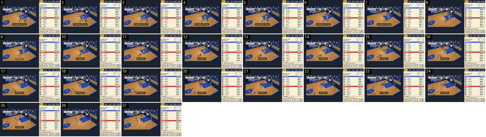

# Afundanço de Força: dois avisos seguidos para a mesma jogada

O movimento especial mais forte, que acaba em cesto. É o momento mais próximo de um golo do Calciobit: um movimento com nome (como a [habilidade](../../../../calciobit/sequencias/golo-festejo/habilidade-entrada-cartas-nome/README.md)) e um cesto festejado logo a seguir (como o [resultado gigante](../../../../calciobit/sequencias/golo-festejo/resultado-entra-golo-sofrido/README.md)). Do movimento ao fim do último aviso passam ~2,5 s, e o jogo nunca para.

- **Duração:** 2,7 s, 27 frames a 10 fps
- **Origem:** `npm run sequences` (commit 2de1e62), vídeo `jogo.mp4`, de 51,9 s a 54,6 s (momento «movimento-powerDunk»)
- **Etiquetas:** movimento-especial, afundanco, nome-movimento, aviso, mais-dois, balao-adepto, sem-abrandamento
- **Calciobit:** [habilidade-entrada-cartas-nome](../../../../calciobit/sequencias/golo-festejo/habilidade-entrada-cartas-nome/README.md), [resultado-entra-golo-sofrido](../../../../calciobit/sequencias/golo-festejo/resultado-entra-golo-sofrido/README.md)

## Frame a frame

- **1 (52,0 s):** entra por um corte do salto da gravação, com o movimento já anunciado: a palavra «AFUNDANÇO» dourada no meio da área, por cima de Falcão (CLA), e o aviso «Afundanço de Força!» em baixo. O painel diz «CLA: Afundanço de Força de Falcão!». Barra: «MAR 20 · P2 0:38 · 14 CLA». No canto superior esquerdo, dois balões de adeptos sobrepostos («TI», «H GUARDE…»), cortados pela barra.
- **1–4:** Falcão corre para o cesto da direita. A palavra fica parada onde nasceu, à esquerda dele.
- **5–7 (0,3 s):** salta para o aro, de braço esticado. A palavra não sobe com ele.
- **8 (52,6 s):** a bola entra. No mesmo frame: 14 → 16 na cápsula, «+2» à esquerda do aro, e o aviso «Afundanço de Força!» desaparece.
- **9:** entra o aviso novo, «Afundanço!», ainda meio transparente.
- **10:** «Afundanço!» opaco, no mesmo sítio do anterior.
- **1–16:** a palavra «AFUNDANÇO» fica ~1,6 s e sai sem fade (frame 17).
- **8–22 (1,5 s):** o «+2» junto ao aro; sai no frame 23.
- **9–25 (1,7 s):** o aviso «Afundanço!»; aos 27 já saiu.
- **8–27:** os jogadores voltam para o meio-campo e o Marítimo repõe. O relógio nunca para (0:38 → 0:35). Aos 26, um balão novo, «JÁ PRONTO…», substitui os anteriores.

## Notas

- O jogo não abranda, não aproxima a câmara e não mostra as cartas que deram o movimento. Ao jogador chegam quatro textos para a mesma jogada (palavra, aviso do movimento, aviso do cesto e linha do painel), três deles com quase a mesma palavra.
- Pelo código, um afundanço faz também tremer a imagem 0,2 s, e quem levou o afundanço põe as mãos na cabeça (`handsHead`, 12 ticks); a 10 fps não se vê.
