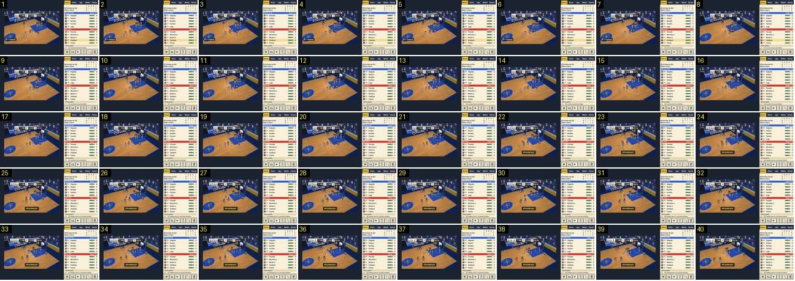

# Afundanço: aviso, «+2», balão e tremor no mesmo frame

Um afundanço normal (sem carta), a 25 fps. É o cesto mais festejado do jogo corrente: tudo o que o Pocket Basketball tem para um cesto chega no mesmo frame em que a bola entra, e o jogo não para. Compara-se com a [entrada do resultado gigante](../../../../calciobit/sequencias/golo-festejo/resultado-entra-golo-sofrido/README.md), que no Calciobit tem tempos (resultado antigo, 0,33 s, algarismo novo a 125 %, 0,33 s, encolhe em 0,3 s), e com a [claque](../../../../calciobit/sequencias/golo-festejo/claque-golo-marcado/README.md), que aqui fica reduzida a balões na bancada.

- **Duração:** 1,6 s, 40 frames a 25 fps
- **Origem:** `npm run sequences` (commit 2de1e62), vídeo `jogo.mp4`, de 43,0 s a 44,6 s (momento «lancamento», que neste jogo acaba em afundanço)
- **Etiquetas:** cesto, afundanco, aviso, mais-dois, balao-adepto, tremor, sem-paragem
- **Calciobit:** [resultado-entra-golo-sofrido](../../../../calciobit/sequencias/golo-festejo/resultado-entra-golo-sofrido/README.md), [claque-golo-marcado](../../../../calciobit/sequencias/golo-festejo/claque-golo-marcado/README.md)

## Frame a frame

- **1–13:** confusão debaixo do cesto da direita depois de um lançamento falhado; o painel diz «ressalto ofensivo de Zambujo». Barra: «MAR 4 · P1 1:24 · 2 CLA». No canto superior esquerdo do campo há um balão de adepto de um lance anterior, «ISS…», quase todo tapado pela barra do marcador.
- **14–21 (0,3 s):** Zambujo sobe para o aro com a bola, de braços esticados.
- **22 (43,84 s):** a bola entra, e tudo aparece neste frame, sem pré-aviso:
  - a cápsula da CLA passa de 2 a 4, sem animação;
  - o «+2» amarelo à esquerda do aro;
  - o aviso «Afundanço!» em baixo, ao centro do campo, a ~80 % da altura: letras douradas grossas numa caixa escura com contorno dourado e sombra, ~95 × 22 px (no ecrã de 640);
  - um segundo balão branco de adepto, «IST…», à esquerda do primeiro e também cortado pela barra;
  - o painel: «CLA: Zambujo marca 2, assistência de Nunes».
- **22–23:** o código manda o aviso subir 14 px em 0,18 s (4 passos) e a imagem tremer 0,2 s, 1 píxel de arte a 15 Hz. Nos frames quase não se nota: o aviso já está no sítio no frame 22, e o canto do campo desce 2 px neste frame e não volta.
- **22–40:** o aviso e o «+2» ficam parados. Os jogadores voltam para trás. O relógio não parou (1:23).
- **~34–40:** o balão antigo sai e o novo aparece por inteiro do lado esquerdo, «ISTO É…»; o resto da frase continua por baixo da barra do marcador.
- **Depois (vista geral a 0,25 s):** o «+2» sai por volta dos 45,3 s (1,5 s) e o aviso aos ~45,6 s (1,8 s). Nada sai com animação.

## Notas

- A frase inteira é uma das linhas de src/ui/crowd.ts (por exemplo «ISTO É CINEMA»). Os balões são caixas retangulares brancas com contorno escuro e um bico pequeno, desenhados no canvas; a barra do marcador é HTML por cima, por isso tapa-os. Dois balões seguidos também se tapam um ao outro.
- O som do momento (`swish` e `bigCheer`) não se ouve na gravação.
