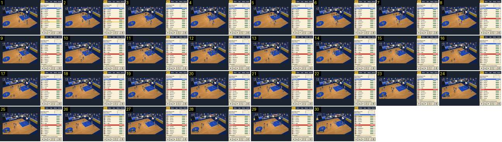

# Cesto normal: «+2» ao lado do aro e o jogo continua

Um cesto de dois pontos qualquer, a meio do 1.º período. O resultado muda na cápsula da barra no mesmo frame em que a bola entra, aparece um «+2» amarelo ao lado do aro durante 1,5 s, e o jogo nunca para. É o que acontece dezenas de vezes por jogo, por isso compara-se com o [resultado gigante](../../../../calciobit/sequencias/golo-festejo/resultado-entra-golo-sofrido/README.md) só para mostrar a diferença de escala: no Calciobit um golo para tudo, aqui um cesto é uma pequena nota.

- **Duração:** 3,0 s, 30 frames a 10 fps
- **Origem:** `npm run sequences` (commit 2de1e62), vídeo `jogo.mp4`, de 29,4 s a 32,4 s (troço «jogo-corrido»)
- **Etiquetas:** cesto, mais-dois, marcador, sem-paragem, bancada, camara
- **Calciobit:** [resultado-entra-golo-sofrido](../../../../calciobit/sequencias/golo-festejo/resultado-entra-golo-sofrido/README.md)

## Frame a frame

- **1–7:** a Barra Clara (CLA, amarelo) ataca o cesto da direita; um jogador lança de perto, debaixo do aro. Barra do marcador: «MAR 2 · P1 1:45 · 0 CLA», com «–» no lugar do relógio de posse. A câmara alta e diagonal desliza devagar.
- **8 (30,1 s):** a bola entra. No mesmo frame, sem animação nenhuma: o «0» da cápsula da CLA passa a «2»; aparece o «+2» em algarismos grandes amarelos com sombra escura, à esquerda do aro, logo por baixo da barra; o marcador levanta um braço; e uns quantos adeptos da fila de trás levantam-se de braços no ar. O painel da direita ainda diz «Crossover de Noronha» (o movimento que preparou este cesto, aos 28 s) e só passa a «CLA: Noronha marca 2, assistência de Nunes» entre os frames 10 e 12.
- **8–23 (1,6 s):** o «+2» fica preso ao aro (desliza com a câmara) e sobe só uns píxeis nos primeiros frames. Não cresce nem pisca.
- **24:** o «+2» desaparece de um frame para o outro, sem fade.
- **9–30:** o jogo nunca parou: o relógio continua (1:44 → 1:42), o Marítimo repõe a bola e sobe o campo, e a câmara vai atrás dele para a esquerda. A partir do frame 23 aparece «11» no relógio de posse. Não há aviso em baixo, nem balão de adepto, nem ressalto de escala no marcador.

## Notas

- No código, o «+N» vive 30 ticks (1,5 s de jogo) e sobe até 10 píxeis de arte (`drawFloaters` em src/ui/match-view.ts). Os lances livres usam o mesmo «+1».
- A bancada só se levanta por inteiro num cesto que vale muito (`basketWorth`: 0,35 num cesto normal, 0,6 num triplo ou afundanço, mais no fim de um jogo equilibrado).
