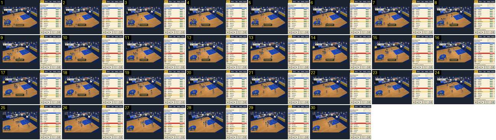

# Movimento especial: crossover, palavra e aviso

O movimento especial crossover, que vem das cartas de treino. O nome aparece duas vezes ao mesmo tempo: pequeno e dourado por cima de quem o fez, e grande no aviso em baixo. Não há cartas no ecrã, o nome não se escreve letra a letra, e o jogo não abranda nem muda de câmara. Compara-se com a [habilidade do Calciobit](../../../../calciobit/sequencias/golo-festejo/habilidade-entrada-cartas-nome/README.md), que mostra as cartas e escreve o nome em 0,7 s.

- **Duração:** 3,0 s, 30 frames a 10 fps
- **Origem:** `npm run sequences` (commit 2de1e62), vídeo `jogo.mp4`, de 46,5 s a 49,5 s (momento «movimento-crossover»)
- **Etiquetas:** movimento-especial, crossover, nome-movimento, aviso, balao-adepto, sem-abrandamento
- **Calciobit:** [habilidade-entrada-cartas-nome](../../../../calciobit/sequencias/golo-festejo/habilidade-entrada-cartas-nome/README.md), [habilidade-banana-canto](../../../../calciobit/sequencias/golo-festejo/habilidade-banana-canto/README.md)

## Frame a frame

- **1:** o vídeo entra por um corte do salto da gravação, com o movimento acabado de acontecer (a pose de crossover fica antes do corte). Já está tudo no ecrã: a palavra «CROSSOVER» em letras douradas pequenas com sombra, sem caixa, por cima de Noronha, do Marítimo, à entrada da área; o aviso «Crossover!» em baixo, ao centro, na caixa escura com contorno dourado; um balão de adepto, «JÁ VIMOS P…», no canto superior esquerdo, com o resto da frase tapado pela barra do marcador; e a etiqueta «ESC Noronha» no canto inferior esquerdo. Barra: «MAR 4 · P1 0:58 · 7 CLA», relógio de posse 9.
- **1–17 (1,7 s):** a palavra não segue o jogador: fica no sítio onde nasceu, sobe uns píxeis no início e depois só desliza com a câmara. Noronha passa a bola e os jogadores juntam-se por baixo dela.
- **18:** a palavra desaparece de um frame para o outro.
- **1–19:** o aviso fica parado em baixo; aos 22 já saiu. Ao todo, ~1,8 s.
- **1–22:** o balão do adepto fica; aos 25 já saiu.
- **1–30:** o relógio anda ao ritmo normal (0:58 → 0:56, posse 9 → 6) e a câmara continua a seguir a bola, sem zoom. Esta jogada não acaba em cesto dentro do troço.

## Notas

- No código, a palavra (`MOVE_LABELS`) e o aviso (`MOVE_INFO[move].name`) são textos diferentes: «CROSSOVER» e «Crossover!», «AFUNDANÇO» e «Afundanço de Força!». O som é `bigCheer`, e a bancada da casa levanta-se se o movimento for dela.
- O mesmo crossover aconteceu no jogo corrido aos 28 s e, dois segundos depois, deu o cesto de [cesto-normal-mais-dois](../cesto-normal-mais-dois/README.md). Esse cesto não teve aviso nenhum: o movimento e o cesto que ele preparou não ficam ligados no ecrã.
