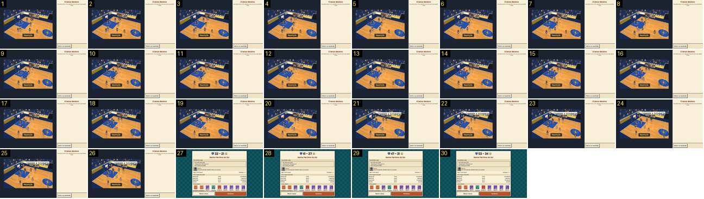

# Repetição do lance decisivo, no relatório

O único sítio onde o Pocket Basketball repete um cesto: no relatório do fim do jogo, o botão «Rever o lance» mostra em câmara lenta o cesto que decidiu o jogo. Aqui é um triplo. Compara-se com a repetição de cada golo do Calciobit, que vem logo a seguir à [claque](../../../../calciobit/sequencias/golo-festejo/claque-golo-marcado/README.md) e acaba na [ficha do marcador](../../../../calciobit/sequencias/golo-festejo/regresso-ficha-marcador/README.md).

- **Duração:** 3,0 s, 30 frames a 10 fps
- **Origem:** `npm run sequences` (commit 2de1e62), vídeo `jogo-fim.mp4`, de 55,5 s a 58,5 s (momento «repeticao», que começa aos 51,3 s)
- **Etiquetas:** repeticao, camara-lenta, cesto-decisivo, triplo, mais-tres, balao-adepto, relatorio
- **Calciobit:** [claque-golo-marcado](../../../../calciobit/sequencias/golo-festejo/claque-golo-marcado/README.md), [regresso-ficha-marcador](../../../../calciobit/sequencias/golo-festejo/regresso-ficha-marcador/README.md)

## Frame a frame

- **Antes (51,3–55,5 s, vista geral):** o relatório dá lugar ao campo, à esquerda, e a um painel claro, à direita, com o título «O lance decisivo», a frase «Em câmara lenta, três segundos antes do cesto que decidiu o jogo.» e o botão «Voltar ao resultado». Por cima do campo, o aviso fixo «Repetição». Não há barra do marcador nem botões.
- **1–21:** o jogo a meia velocidade, numa câmara alta e diagonal sobre o cesto da esquerda. Os jogadores movem-se a metade do ritmo e a câmara desliza devagar.
- **22 (57,6 s):** o triplo entra: «+3» amarelo à direita do aro e um balão de adepto, «GUARDEM A FOTOGRAFIA», por cima da bancada, inteiro e legível (sem a barra do marcador, nada o tapa).
- **22–27:** o «+3» e o balão ficam parados. Na repetição não há aviso de cesto em baixo: o «Repetição» fica no lugar dele.
- **28:** corte seco para o relatório, porque a gravação carregou em «Voltar ao resultado» 6 s depois de abrir a repetição. Pelo código, a repetição continuaria mais 1,5 s de jogo (3 s reais) depois do cesto e voltava sozinha ao relatório.
- **28–30:** o relatório volta a abrir e o resultado do cabeçalho conta outra vez a subir (41-27 → 53-34 → 55-36).

## Notas

- A repetição corre a 0,5×, de 60 ticks antes do cesto a 30 ticks depois: ~9 s reais (`startReplay` e `REPLAY_SPEED` em src/ui/main.ts). Os avisos estão desligados durante a repetição: um movimento especial mostraria só a palavra pequena por cima do jogador, sem o aviso em baixo (não se viu, porque este lance não teve movimento).
- Neste jogo, ganho por 55-36, não houve cesto decisivo no fim: o «lance decisivo» é o que pôs a equipa à frente para sempre.
