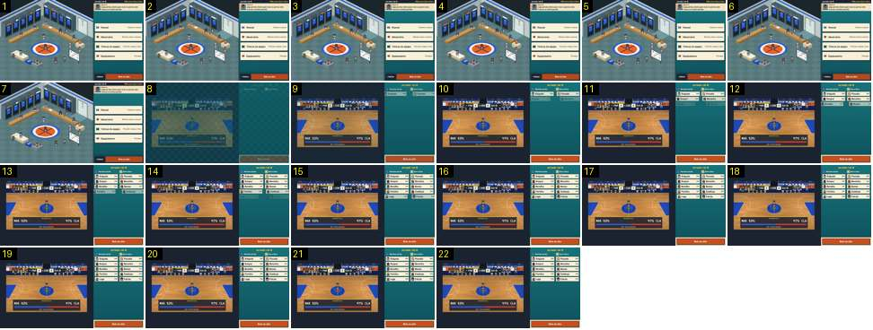

# Do balneário à apresentação dos cinco

Depois de «Bola ao alto» no balneário, o campo aparece com o prognóstico por cima e o painel apresenta os cinco de cada equipa, linha a linha. É o equivalente da antevisão do Calciobit: compara-se com [antevisao-faixas-entram](../../../../calciobit/sequencias/entrada-saida/antevisao-faixas-entram/README.md).

- **Duração:** 2,2 s, 22 frames a 10 fps
- **Origem:** `npm run sequences` (commit 2de1e62), vídeo `jogo.mp4`, de 3,2 s a 5,4 s
- **Etiquetas:** balneario, apresentacao, prognostico, deslizar, ease-out, fundido-curto, ui, pre-jogo
- **Calciobit:** [antevisao-faixas-entram](../../../../calciobit/sequencias/entrada-saida/antevisao-faixas-entram/README.md)

## Frame a frame

- **1–7:** o balneário parado (3,2–3,9 s). O toque em «Bola ao alto» cai aqui, mas o vídeo não tem imagens entre 3,28 s e 3,88 s, por isso os frames 2–7 repetem o 1.
- **8:** corte para o campo, já a meio do fundido `stage-in` (0,18 s): o campo e o painel aparecem escuros. Plano de cima, de lado, com o campo inteiro. Ao centro só o árbitro. Na bancada de cima, os dois bancos com os jogadores sentados. O marcador já está no topo do campo («MAR 0 · P1 2:00 · 0 CLA»). Por cima do campo, em baixo, uma caixa escura: «PROGNÓSTICO», «MAR 53 %» e «47 % CLA», uma barra azul e vermelha, e «227 ESPECTADORES».
- **8–10 (0,2 s):** o campo clareia até ao normal. No painel, o cabeçalho «Jornada 1 de 18» e os nomes das duas equipas com o emblema.
- **9–17 (0,9 s):** as linhas dos jogadores entram aos pares, uma por posição (BAS, ESC, EXT, EXP, POS): a da casa desliza 40 px da esquerda e a de fora 40 px da direita, a aparecer do transparente, com o rosto, o nome e a posição. Cada linha leva 0,35 s e a seguinte começa 0,14 s depois. Abrandam no fim.
- **17–22:** tudo parado: o campo com o árbitro, o prognóstico e as duas colunas de cinco. Em baixo, o botão «Bola ao alto» para saltar.
- **Depois (5,4–7,4 s, fora da sequência):** nada mexe. A apresentação passa sozinha ao jogo 3,5 s depois de abrir; o painel troca de uma vez para o painel do jogo (separadores Banco, Stats, Liga, Relato, Cartas). Continua em [bola-ao-alto](../bola-ao-alto/README.md).
