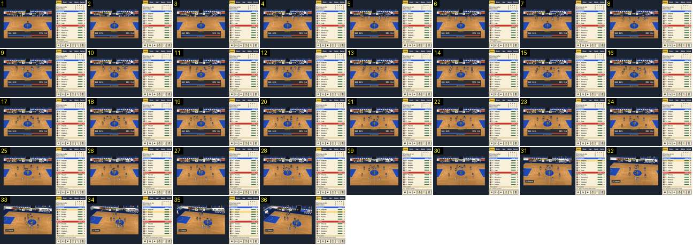

# Os cinco entram em campo e a bola ao alto

Do fim da apresentação até a bola andar: os dez saem dos bancos para as posições, o prognóstico desaparece, o árbitro lança a bola, e a câmara roda do plano de lado para o plano diagonal do jogo. Compara-se com [alinhamento-ate-ao-sorteio](../../../../calciobit/sequencias/entrada-saida/alinhamento-ate-ao-sorteio/README.md) e com o sorteio e o pontapé de saída da área jogo-camara do Calciobit.

- **Duração:** 7,2 s, 36 frames a 5 fps (a entrada a passo é lenta; a rotação da câmara fica com 5–6 frames)
- **Origem:** `npm run sequences` (commit 2de1e62), vídeo `jogo.mp4`, de 7,6 s a 14,8 s
- **Etiquetas:** entrada-equipas, alinhamento, prognostico, bola-ao-alto, arbitro, camara-parada, camara-roda, claque
- **Calciobit:** [alinhamento-ate-ao-sorteio](../../../../calciobit/sequencias/entrada-saida/alinhamento-ate-ao-sorteio/README.md), [sorteio-zoom-e-fade](../../../../calciobit/sequencias/jogo-camara/sorteio-zoom-e-fade/README.md), [pontape-de-saida-corte-e-zoom-out](../../../../calciobit/sequencias/jogo-camara/pontape-de-saida-corte-e-zoom-out/README.md)

## Frame a frame

- **Antes (7,0–7,6 s):** o painel da apresentação é trocado de uma vez pelo painel do jogo (marcador por períodos, energia e pontos de cada um, botões de pausa, velocidade, som, desconto, trocas e táticas). Os jogadores começam a levantar-se dos bancos.
- **1–20 (3,8 s):** com a câmara parada no plano de lado, os cinco de cada equipa descem da linha dos bancos e andam a passo, em diagonal, até às posições, uma equipa de amarelo e a outra de azul, misturadas pelo campo, e os dois saltadores junto ao círculo central com o árbitro. Ao mesmo tempo a barra do prognóstico enche-se do 50/50 até ao valor (53 % → 56 % → 60 % → 61 % para a casa, em 1,5 s, com abrandamento).
- **20–24:** todos parados nos lugares (0,8 s).
- **25 (12,4 s):** a caixa do prognóstico desaparece de uma vez. No topo direito começa a correr um letreiro da bancada, um cântico com letras brancas grandes sobre a fila de adeptos.
- **25–30 (1,2 s):** o árbitro atira a bola ao ar entre os dois saltadores; os outros oito esperam afastados do círculo.
- **31 (13,6 s):** um dos dois saltadores desvia a bola (a jogada fica «Bola ao alto: Farinha ganha a Falcão»). Aparece em baixo à esquerda a etiqueta do jogador com a bola («BAS Salgado», que recebeu a bola) e no marcador o relógio de posse («11»). O relógio de jogo continua a 2:00.
- **31–36 (1,2 s ou mais):** sem corte, a câmara roda e inclina-se do plano de lado para o plano diagonal de três quartos do jogo normal, a seguir a bola para o meio-campo da direita. Passa a ver-se o cesto da esquerda com a tabela e a bancada em perspetiva.
- **Notas:** não há grande plano, nem corte a preto, nem zoom no lançamento: é tudo no mesmo plano, com a câmara parada até a bola andar. O marcador está no ecrã desde a apresentação.
