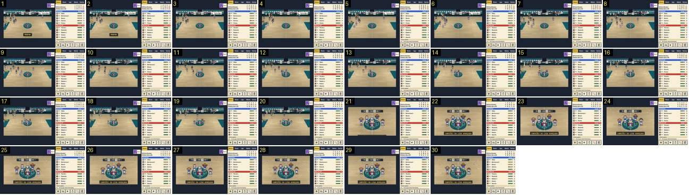

# Fim com título: a cerimónia do troféu

A final ganha que dá o título da liga. Tudo acontece no campo do jogo, sem sair do pavilhão: os vencedores correm para o círculo central, os vencidos saem, e a imagem salta para um grande plano do capitão com a taça, com uma faixa e papelinhos. Compara-se com [apito-final-titulo](../../../../calciobit/sequencias/entrada-saida/apito-final-titulo/README.md), [painel-trofeu-liga](../../../../calciobit/sequencias/entrada-saida/painel-trofeu-liga/README.md) e [mosaico-we-are-the-champions](../../../../calciobit/sequencias/entrada-saida/mosaico-we-are-the-champions/README.md).

- **Duração:** 6,0 s, 30 frames a 5 fps
- **Origem:** `npm run sequences` (commit 2de1e62), vídeo `cerimonia.mp4`, de 16,4 s a 22,4 s
- **Etiquetas:** titulo, cerimonia, trofeu, campeoes, zoom, corte, faixa, confetti, circulo-central
- **Calciobit:** [apito-final-titulo](../../../../calciobit/sequencias/entrada-saida/apito-final-titulo/README.md), [painel-trofeu-liga](../../../../calciobit/sequencias/entrada-saida/painel-trofeu-liga/README.md), [mosaico-we-are-the-champions](../../../../calciobit/sequencias/entrada-saida/mosaico-we-are-the-champions/README.md)

## Frame a frame

- **Antes (15,2–16,4 s):** o apito final é igual ao de um jogo normal: plano de lado, a faixa «Vitória!» ao centro em baixo e o marcador «PIN 35 · P4 0:00 · 33 NOV».
- **1–7 (1,2 s):** a faixa «Vitória!» sai (frame 3). A cerimónia começa 1,5 s depois do apito: os vencedores (de azul e branco) correm do meio-campo para o círculo central e os vencidos andam a passo para os bancos, em cima. A câmara fica parada no plano de lado.
- **8–18 (2,2 s):** os quatro companheiros fecham uma roda à volta do capitão, no círculo. Os últimos vencidos saem do enquadramento.
- **19–20:** a roda parada, à espera (0,4 s).
- **21 (20,4 s):** corte seco para um plano a 2× sobre o círculo central. Não há zoom animado: a arte cresce de uma vez e fica com os píxeis ao dobro. O capitão está ao centro com a taça de prata erguida por cima da cabeça, e os outros quatro à volta, de braços no ar. O marcador continua no topo e o painel da direita não muda. A ponta de uma faixa espreita na borda de baixo.
- **21–22 (0,2 s):** a faixa sobe da borda de baixo para o lugar: «CAMPEÕES DA LIGA AVANÇADA», em letras douradas numa caixa escura com contorno dourado.
- **22–30 (1,6 s):** começam a cair papelinhos de várias cores sobre o grupo. O capitão levanta e baixa a taça e os outros saltam no lugar. A câmara fica parada.
- **Depois (22,4–26,4 s, fora da sequência):** o mesmo plano, com papelinhos e a taça a subir e a descer, durante ≈ 4 s mais. Ao todo a taça fica no ar 5,9 s. Depois um corte seco, sem fundido, leva ao relatório (26,4 s), com o resultado a subir a contar, como num jogo normal. Um toque ou uma tecla salta a cerimónia a qualquer momento.
- **Medidas:** do apito ao início da cerimónia 1,5 s; da cerimónia à taça erguida ≈ 3,7 s (no código entre 1,6 e 3,5 s, quando todos chegam); taça no ar 5,9 s; do apito ao relatório ≈ 11,2 s, contra ≈ 45 s no Calciobit (do apito ao fim da claque, sem contar as falas).
