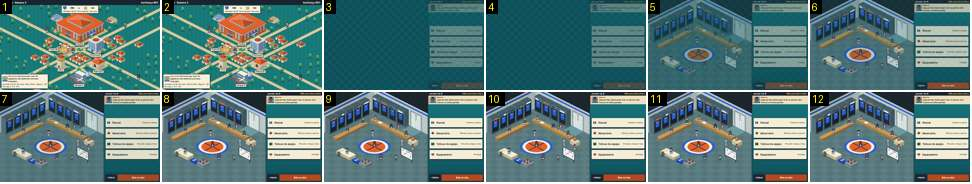

# Da cidade ao balneário

Mostra a passagem do mapa da cidade para o balneário antes do jogo, depois de se tocar no pavilhão. Compara-se com [mapa-para-tunel-live](../../../../calciobit/sequencias/entrada-saida/mapa-para-tunel-live/README.md): lá há uma pergunta do adjunto e 2,1 s de fundidos pelo preto; aqui é um corte com um fundido curto.

- **Duração:** 0,4 s, 12 frames a 30 fps
- **Origem:** `npm run sequences` (commit 2de1e62), vídeo `jogo.mp4`, de 1,17 s a 1,57 s
- **Etiquetas:** cidade, balneario, pre-jogo, corte, fundido-curto, ui
- **Calciobit:** [mapa-para-tunel-live](../../../../calciobit/sequencias/entrada-saida/mapa-para-tunel-live/README.md)

## Frame a frame

- **Antes (0–1,2 s):** o mapa da cidade, parado, com a etiqueta do jogo por cima do pavilhão («MAR vs CLA · Jornada 1 de 18 · Esta semana · Em casa») e a fala da secretária em baixo. O toque no pavilhão é dado pelo script: não há pergunta («vamos para o pavilhão?») nem botão sim/não.
- **1–2:** o mapa, igual.
- **3–4:** corte seco. O campo fica vazio, só o fundo azul-petróleo, e o painel da direita já está lá a 1/3 de opacidade (Jornada, fala do adjunto, quatro botões, «‹ Voltar» e «Bola ao alto»).
- **5–8 (0,13 s):** o balneário e o painel clareiam juntos até ao fim (ease-out). É a cortina `stage-in` de 0,18 s, de opacidade 0,35 a 1, que todas as trocas de ecrã usam.
- **9–12:** parado. Balneário isométrico: cacifos com camisolas azuis ao fundo, bancos de madeira, uma marquesa com um jogador, um tapete redondo com o emblema ao centro, o quadro tático num cavalete à direita e os jogadores de pé, espalhados. Os bonecos não mexem. No painel: «Jornada 1 de 18 · MAR contra Barra Clara», o adjunto («Jogo partido. Ganha quem tiver as pernas mais frescas no último período.»), Plantel, Adversário, Táticas da equipa, Equipamento, «‹ Voltar» e «Bola ao alto».
- **Notas:** não há preto em nenhum momento. Do toque ao ecrã completo passam cerca de 0,25 s, contra 2,1 s no Calciobit (0,2 s do retrato, 0,9 s a escurecer, 0,5 s de preto e 0,7 s a clarear). Há um salto de 0,24 s sem imagens no vídeo (1,44–1,68 s): os frames 3–4 e 8–12 repetem-se por isso.
