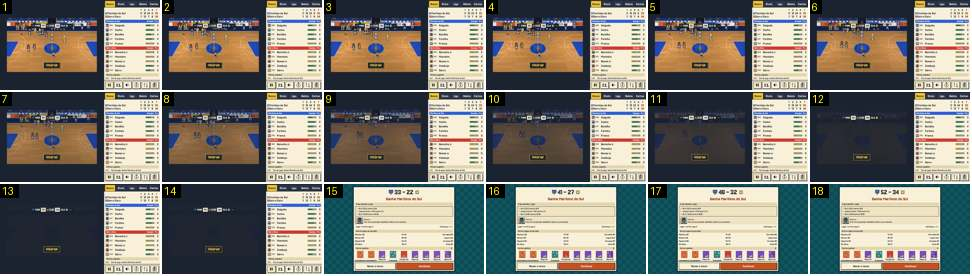

# Fim de jogo normal: passagem para o relatório

Numa vitória sem título: a faixa «Vitória!», os jogadores saem para os bancos, o campo escurece para azul-escuro e corta para o relatório, cujo resultado sobe a contar. Compara-se com [fim-para-resumo](../../../../calciobit/sequencias/entrada-saida/fim-para-resumo/README.md).

- **Duração:** 1,8 s, 18 frames a 10 fps
- **Origem:** `npm run sequences` (commit 2de1e62), vídeo `jogo-fim.mp4`, de 47,2 s a 49,0 s
- **Etiquetas:** fim-jogo, faixa, fundido-escuro, relatorio, contagem, ui
- **Calciobit:** [fim-para-resumo](../../../../calciobit/sequencias/entrada-saida/fim-para-resumo/README.md)

## Frame a frame

- **Antes (44,5–47,2 s):** o script saltou para o último segundo, por isso o vídeo corta para o plano de lado. Ao apito, a faixa «Vitória!» aparece ao centro, em baixo, e fica até ao fim. Os jogadores das duas equipas andam a passo para os bancos, sem festa nem desânimo que se note a esta distância. A câmara não se aproxima.
- **1–5:** o campo quase vazio, com «Vitória!» e o marcador «MAR 55 · P4 0:00 · 36 CLA».
- **6–13 (0,8 s):** o campo escurece de forma linear para azul-escuro. A faixa «Vitória!» e o marcador ficam acesos por cima. O painel da direita não muda.
- **14:** só o marcador e a faixa sobre o azul-escuro (0,1 s).
- **15 (48,6 s):** corte seco para o relatório, que ocupa a janela toda: um cartão creme ao centro, sobre um xadrez azul-petróleo. Em cima, os dois emblemas e o resultado, que começa a meio («33 – 22»), e «Ganha Marítimo do Sul» em vermelho. Por baixo: «O que decidiu o jogo» (três números), o adjunto («Isto foi um passeio. Amanhã treina-se na mesma.»), «Lugar 1 na Pro Liga 2 · Confiança +4 %», os outros jogos da jornada, as nove cartas ganhas e os botões «Rever o lance» e «Continuar».
- **15–18 (0,4 s):** o resultado sobe a contar (33–22, 41–27, 52–34) e para em 55–36 logo a seguir à sequência: 0,7 s ao todo, a abrandar no fim. Nada mais mexe.
- **Medidas:** do apito ao escurecimento 3,0 s; escurecer 0,8 s (0,7 s no código); azul-escuro ≈ 0,1 s; o relatório entra sem fundido.
- **Depois (58,6–59,6 s, sem sequência):** «Continuar» leva à cidade com a cortina `stage-in` (0,18 s): o mapa aparece meio apagado e clareia. A barra de cima já diz «Passar a semana», a etiqueta do pavilhão mostra o jogo seguinte («Jornada 2 de 18 · Próxima semana · Fora») e a confiança subiu para 84 %. Não há balneário nem fala do adjunto depois do relatório.
