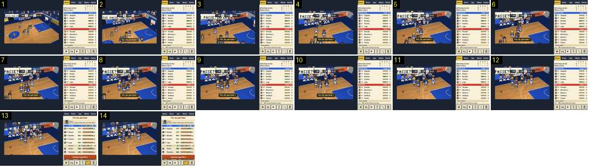

# Fim do 1.º período

O fim de um período que não é o intervalo: a imagem aproxima-se do banco da casa, os jogadores juntam-se ao treinador e o painel abre as trocas com uma contagem. O futebol não tem períodos, por isso não há par no Calciobit; o mais perto é a [ida ao balneário no intervalo](../../../../calciobit/sequencias/entrada-saida/intervalo-balneario-e-regresso/README.md).

- **Duração:** 2,8 s, 14 frames a 5 fps
- **Origem:** `npm run sequences` (commit 2de1e62), vídeo `jogo-fim.mp4`, de 13,1 s a 16,1 s
- **Etiquetas:** fim-periodo, paragem, banco, zoom, faixa, contagem, trocas, claque
- **Calciobit:** sem par; ver [intervalo-balneario-e-regresso](../../../../calciobit/sequencias/entrada-saida/intervalo-balneario-e-regresso/README.md)

## Frame a frame

- **1 (13,1 s):** plano diagonal do jogo normal, com o relógio a «P1 0:00» e 11–7 no marcador. Um letreiro da bancada corre por cima, à esquerda («ISSO FOI PA…»).
- **2 (13,3 s):** sem corte, a imagem cresce para o banco da casa, em cima. Ao centro, em baixo, entra a faixa «Fim do período 1», em letra amarela numa caixa escura. A arte cresce como uma imagem: os píxeis ficam ao dobro.
- **2–5 (0,6 s):** o zoom continua e abranda (curva exponencial, quase todo nos primeiros 0,4 s) até 2×. Vê-se em grande a fila do banco, com os suplentes de pé, e o letreiro «PASSE?» na bancada.
- **5–12 (1,4 s):** os cinco em campo andam para o banco e juntam-se aos suplentes, de costas para a câmara. A faixa sai ao fim de ≈ 1,6 s (frame 10).
- **13 (15,5 s):** o painel da direita troca de uma vez para «Fim do período»: o adjunto («Estamos a ganhar. Mudar agora é dar-lhes ideias.»), os cinco em campo e os do banco com a energia e as notas, e o botão laranja «Continuar jogo (28 s)».
- **13–14:** a equipa fica junta no banco. A contagem do botão desce um segundo por segundo, e o jogo recomeça sozinho no fim ou com um toque no botão.
